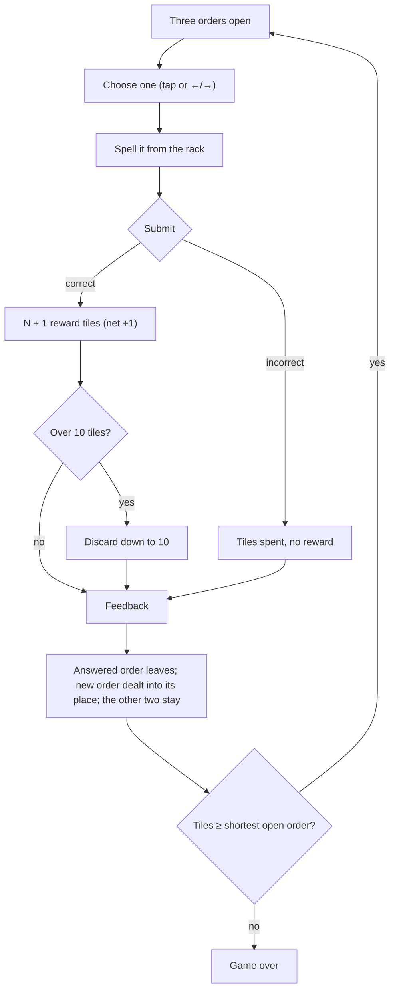

# 01 · Market · 장터

> **Status:** research draft — not canonical. Amends nothing in `docs/spec/`; on any conflict the spec wins.
> **Direction:** what if the player chose which equation to answer? · Opus research agent · 2026-10-17

Three equations lie open at once; you fill one with your tiles. The ones you pass over stay where they are until you answer them, right or wrong.

| | |
|---|---|
| Core verb | **Choose** which open order to fill, and which to sacrifice when none can be spelled |
| Only this draft contributes | The economics of choice: one rule — whether an unchosen equation *leaves* — decides the cliff, not how many are visible. With the shipped kind bias a free row crosses at k = 2 and a standing row holds through k = 3; with it off, k = 3 and k = 5. No aging rule is needed |
| Nearest neighbour | Endless — adds a per-round decision over *which* equation to answer; same capacity, rewards and loss |
| Spec fit | Needs amendment: product.md §1.2 (uniform draw), §1.8 (loss vs the shortest open order), §1.1/§1.3/§1.10/§1.11 (third mode, order row, ←/→), ui-i18n §1.14–§1.15 (copy, share prefix). §1.17 "skip" and the Pass ruling need none |
| Cliff verdict | Under — bot sim, k = 3, kind off, 2,000 runs: drift −0.45 tiles/submission from submission 16 (realised b 0.47); none reached 100 submissions. A row that drops unchosen equations crosses at k = 2 with the kind bias (51% of runs pass 100), k = 3 without it |
| Build size | M — one state field, one action, one row component, arrow keys; no new phase, motion or dial |
| Mode select copy | **Market** — Three open, fill one · **장터** — 세 주문 중 하나 |

## 1. Spec collisions

**`product.md` §1.17 — "Skip buttons or a separate manual-discard action during answering."** No amendment. No control removes an order without a submission: an order leaves the row only by **Submit**, and the two you did not choose keep their places, and two of your three choices. Choosing is not skipping, and §5 shows the difference is the whole economy. A row whose unchosen equations vanish is a free skip button (bot sim, §5: at k = 3 with the shipped kind bias, 98% of runs pass 100 submissions); the standing row ends every run. An *expiry* rule would be a priced pass needing this clause amended; §5 measures it and does not propose it.

**Endless-polish spec §2 — "Constructibility warning / Pass action: Out. The deliberate-wrong-answer exit … is a manual discard that is already correctly priced."** No amendment, though its premise shifts measurably. The deliberate miss stays the only manual discard, but choosing *which* order to miss lets the player pick the price, one tile or two: the bot's full-hand miss cost falls from 1.80 (one order, kind off) to 1.64 (k = 3), and every figure in §5 includes that drop. The miss also gains a use: paying it on a dead order frees its place.

**`product.md` §1.8 — "Loss is based only on tile count versus answer-slot count: `inventory.length < getAnswerLength(equation)`."** Amend for Market: *the run ends when the hand holds fewer tiles than the shortest open order needs.* The one-tile lifeline this allows changes nothing measurable (median 17 either way, mean 19.4 vs 19.3), so "fewer than two tiles" would also do.

**`product.md` §1.2 — "Every new equation draws a gate sample first."** Amend: Market draws every order uniformly (`generateEquation`); the row is the generosity. Kept at 0.2, runs still end (median 25), but the late-drift margin is thin (−0.08) and k = 4 crosses.

**Housekeeping amendments.** §1.1, §1.3 and the title's mode select (§1.10) gain a third mode. §1.10 `answering` swaps "Equation and exact answer-slot count" for the row plus the active order's slots, and §1.11 gains ← / →. ui-i18n §1.14 gains copy keys and §1.15 the prefix `ozterisk Market — Rounds: {totalRounds}`. **Motion (§1.12):** none new; the dealt order rises with `10b`'s `oz-round-rise`, and waiting orders never move. **Layout:** the row takes the equation's place, and three orders must fit the 281px budget at the 320px gate (about 88px each, smaller numerals). That is unverified.

**Checked, no collision:** timers (none), difficulty curves (no aging, uniform draw, nothing escalates), multiple attempts (one submission per order), digit picker, seeds, persistence, tutorials, AGENTS.md global constraints.

**A design tension, not a clause.** `decisions.md` § Classic dropped player nomination of boards because "a march the player can read beats a choice they must make". Market puts a choice in every round. §7 treats that as the main risk.

## 2. The mode

A delta against Endless. Everything not listed is Endless as shipped.

- **Setup.** Capacity 10 and the one-of-each opening hand. Three orders are dealt into a row, each drawn uniformly from the 45 pairs (`generateEquation`). Repeats are legal, including two copies open at once.
- **Choosing.** Exactly one order is *active*: raised, with a gold rule, its slot count shown in the answer slots. Each order shows its length as small dashed marks, which is also its price if missed. Tapping an order, or ← / →, makes it active and returns placed tiles, as **Clear** does. Other keys behave as today, against the active order.
- **Submit** resolves the active order exactly as Endless resolves its equation (§1.5–§1.7): a correct answer gets N + 1 rewards and may overflow; an incorrect one spends the tiles.
- **Next round.** The answered order leaves; a new one is dealt **into its place** and rises (`10b`). The other two stay exactly as they were: no ages, expiries or timers.
- **Loss.** At the advance, the run ends if the hand holds fewer tiles than the shortest open order needs.
- **Scoring and share.** Rounds survived is the headline, as in Endless.
- **Slot layout.** The slot area always reserves two positions, so switching between a 1-digit and a 2-digit order never re-centres it (`decisions.md`, "Answer slots are fixed 66px reserves").

## 3. The loop

## 4. The decision it creates

Endless deals the challenge. Market lets you take it, and every round asks one of three questions. Measured on the fixed bot of §5 (k = 3, kind off, 2,000 runs), by how many open orders the hand can spell at round start:

| Answerable orders | 0 — which to sacrifice | 1 — answer it, or clear a dead one | 2–3 — which to answer |
|---|---|---|---|
| All rounds | 38% | 29% | 33% |
| Submission 16 onward | 53% | 31% | 16% |

- **Which to answer.** Two answerable orders often compete for one tile: 7 × 8 and 6 × 9 both need the hand's only 5 (mockup). Answering one strands the other until a 5 comes back.
- **Which to sacrifice.** A dead 2-digit order costs two tiles to clear and a dead 1-digit order one, so the cheap miss is a resource, worth about one round of median over a bot that ignores cost. Clearing dead orders early never pays: clearing any order dead for 2 rounds costs three rounds of median.
- **What to discard.** Overflow now happens with two waiting orders in view, so you keep the digits they need. That lookahead alone is worth about one round.

The skill rewarded is digit accounting across three products at once: three multiplications read per round instead of one, a plus in a times-table game and a cost in reading time (§7). Where the spec says "a run is the story of that hand degrading", here the row degrades too, filling with products your hand cannot spell, each a debt you chose to carry.

**Precedents.**
- **Patchwork** offers "the three patches in front of the neutral token", which then moves "next to the chosen patch" [1]: the closest relative, a window of three where passed-over patches stay (my reading of the rule).
- **Century: Spice Road** taxes reaching past the front: "later ones" cost "cubes on all earlier cards", and "the others shift down" [2].
- **Splendor** keeps four face-up cards a level, refilling one as soon as it is bought or reserved; reserving, at most three, is its hold [3].
- **Ticket to Ride** guards an open market's generosity: a face-up locomotive ends your draw, and three face-up locomotives replace all five cards [4].
- The **Tetris hold** keeps a piece out until the swapped piece locks [5]: a standing row of two, measured below.
- **Balatro** prices skipping: a Small or Big Blind traded for a Tag forfeits its cash, and the Boss Blind cannot be skipped [6].
- **Overcooked 2** prices missed kitchen tickets: "failed or missed orders cause you to lose money" [7].
- **Slay the Spire** lays encounters out in "a branching structure", with elites that "offer enhanced rewards" [8].

Every open market either keeps untaken items in play or charges for passing them. Market keeps them, and §5 shows that is enough: no tax, timer or expiry.

## 5. Economy

**Where it sits.** The naive model says choice is fatal: always answering the spellable one of three gives `b` ≈ 1 − (1 − b)³, far past 0.631. That holds only if unchosen orders vanish, which is a free skip. If they stay, they **clog**, because the orders you could not spell are exactly the ones left behind. By submission 11 about two of three are dead, and late in a run Market's drift matches Endless's. The counterweight is conservation (an order leaves only when submitted); no other dial is needed.

**Instrument and conditions.** `market-sim.ts` ([`sims/`](sims/); the brief's runner).
- **From the repo:** the real `generateEquation`, `generateKindEquation` (shipped 0.2) and `generateRewardTiles`; only the round loop is re-implemented, since the reducer holds one equation.
- **Spell check:** a digit-count predicate that agrees with the real `canConstruct` on all 92,160 (hand, product) cases tried; a deliberately wrong one disagrees on 8,192, so the check can fail.
- **Bot, fixed across variants:** answer a spellable order (prefer the one leaving others spellable, then the oldest); with none, miss the cheapest with the least useful tiles; on overflow, keep open orders spellable, then digit spread, shedding the most-copied digit.
- **Runs:** 2,000 a row, cap 2,000 submissions unless marked; full-hand statistics skip each run's first 10 submissions.

**Calibration.**
- **Engine, hand redrawn uniformly before every draw:** `b(10)` = 0.482 (repo 0.48), `b'(10)` = 0.581 (repo 0.58), full-hand drift −0.454. The repo's −0.41 multiplies the pool-average miss cost, 1.71, but at a full hand misses skew to 2-digit products and cost 1.81; with that cost the analytic drift is −0.460, which the engine reproduces. So 0.631 is slightly conservative: the full-hand zero is 1.81 / 2.81 = 0.644.
- **Endless baseline:** the fixed bot at k = 1, median 18 rounds, full-hand drift −0.09.
- **Negative control:** zero rewards; no run outlasts 10 submissions. **Positive control:** a free row at k = 5 pins 100% of runs at the cap.

**Static: a free row, with the real `canConstruct`** (20,000 uniform hands per size; share of hands where at least one of k independent orders is spellable).

| Hand | k = 1 | k = 2 | k = 3 | k = 4 | k = 5 | naive 1 − (1 − b)³ | k = 3, kind 0.2 |
|---|---|---|---|---|---|---|---|
| 8 | 0.381 | 0.599 | 0.731 | 0.814 | 0.868 | 0.763 | 0.862 |
| 10 | 0.480 | **0.706** | 0.824 | 0.890 | 0.928 | 0.859 | 0.910 |
| 12 | 0.564 | 0.783 | 0.883 | 0.933 | 0.959 | 0.917 | 0.940 |

Correlation through the shared hand trims the naive 86% to 82%, but even k = 2 clears 0.631.

**Dynamic: the leaving rule decides.** "Late drift" pools submissions 16 onward over runs still alive, a bias toward lucky runs: the true value is worse.

| Row | Kind | k | Median rounds | Runs ≥ 100 | Drift, full hand | Late drift |
|---|---|---|---|---|---|---|
| Endless (one order) | 0.2 | 1 | 18 | 0% | −0.09 | −0.45 |
| Endless, kind off | 0 | 1 | 13 | 0% | −0.36 | −0.86 |
| Free row | 0 | 2 | 28 | 1.5% | +0.31 | −0.06 |
| Free row | 0 | 3 | 82 | 42% | +0.63 | +0.46 |
| Free row | 0.2 | 2 | 102 | 51% | +0.54 | +0.40 |
| Free row | 0.2 | 3 | 2,000 (59% at cap) | 98% | +0.81 | +0.78 |
| Standing | 0 | 2 | 15 | 0% | +0.12 | −0.64 |
| **Standing — proposal** | **0** | **3** | **17** | **0%** | +0.36 | **−0.45** |
| Standing | 0 | 4 | 19 | 0% | +0.46 | −0.32 |
| Standing | 0 | 5 | 22 | 0.1% | +0.58 | −0.14 |
| Standing | 0.2 | 3 | 25 | 0.9% | +0.44 | −0.08 |
| Standing | 0.2 | 4 | 29 | 2.3% | +0.56 | +0.06 |
| Standing | 0.2 | 5 | 33 | 5.1% | +0.64 | +0.18 |

**Why the full-hand column misleads.** The standing row's full-hand drift is positive, yet its runs end, because the row is a second state variable: full-hand rounds cluster early, before it clogs. In the chart its spellable share falls from 0.70 to 0.24 by submissions 11–15, while the free row holds 0.48. A standing row's cliff test must run over time, not at the ceiling. `balance.test.ts`'s single-state analytic model cannot see that, so a Market dial would need a simulated guard, which that file deliberately avoids.

**Robustness** (standing, k = 3, kind off; the aging rows use 2,000 runs with a cap of 500).

| Variant | Median | Note |
|---|---|---|
| Bot ignores miss cost (misses the oldest) | 16 | full-hand miss cost 1.86 vs 1.64 |
| Bot clears an order dead for 2 / 4 / 8 rounds | 14 / 16 / 17 | paying to reopen a place never helps |
| Lookahead only: one order, next 1–3 visible | 14 | vs 13 for Endless with kind off |
| Called: an order waiting T = 3 / 4 / 6 must be answered next | 16 / 17 / 17 | late spellable share 0.28 / 0.24 / 0.23 vs 0.23 |
| Expiry: an order waiting T = 3 / 4 / 6 leaves, billed its digits | 13 / 15 / 16 | bills 0.44 / 0.24 / 0.08 tiles a submission |

Aging rules shorten runs and do not revive the row: dead orders mirror the shrinking hand's holes, so replacing them only charges the hand. Tetris-style hold (standing, k = 2) is the gentlest step: median 15 against 13 for Endless with kind off.

**What it means.** How many options a player can see before the cliff collapses depends on whether options can be dropped. If they can, one with the shipped kind bias (k = 2 crosses) and two without it (k = 3 crosses). Static and dynamic disagree at k = 2 with the bias off: the uniform-hand figure, 0.706, crosses, but played hands are worse than uniform and the bot sits at the edge (late drift −0.06). If they cannot, at least five with the kind bias off and three with it on (k = 4 turns late drift positive), each extra order buying about two rounds of median. The proposal, k = 3 with kind off, lasts as long as shipped Endless: median 17 vs 18.

## 6. Smallest playable slice

Market at k = 3, kind off, digits only. Endless's capacity, rack, overflow and HUD stay as they are.

- **Reuse:**
  - `gameReducer`'s `SUBMIT_CORRECT`, `SUBMIT_INCORRECT`, `TOGGLE_DISCARD` and `CLEAR_SELECTION` work untouched, because they act on `state.equation`.
  - `generateEquation`, `generateRewardTiles`, `createInitialInventory`, `sortTiles`, `getAnswerLength`, and `getCapacity` (endless branch).
  - `EquationBoard` (one instance per order), `AnswerSlots`, `TileInventory`, `OverflowControls`, `GameHud`, `CapacityMeter`, and `services/sharing.ts`.
- **Add:**
  - `GameMode` `"market"`; `orders: Equation[]` and `activeOrder` in `GameState`, with `equation` kept equal to the active order so existing cases and components keep working.
  - `SELECT_ORDER { index }` (answering only; returns placed tiles); `NEXT_ROUND` replacing only `orders[activeOrder]` and checking loss against the shortest open order; `App.tsx` dealing three orders at start, then one per round.
  - An `OrderRow` of three `aria-pressed` toggle buttons; ← / → in `useGameKeyboard`; i18n keys, a third mode card, the share prefix.
  - Tests first: select returns tiles; submit resolves the active order; next round fills only the vacated place; loss uses the shortest order.

A cheaper first test of the thesis is the hold variant, k = 2.

## 7. Biggest risk — and the playtest that would kill it

**The choice thins exactly when it matters.** From submission 16, more than half of all rounds offer no answerable order and only 16% offer two, so the late row is one live order and two dead ones: a ledger of your own debts, or clutter that says the game is stuck. And three products per round may slow play until players simply answer whichever order is active, making Market Endless with extra reading, the "choice they must make" that `decisions.md` warned against. The economy cannot detect either; both are about feel.

**Kill test.** Five players, three runs each, after one Endless run.

Drop the direction if any of these appears:
- In rounds where two orders are answerable, most players answer the active one without looking at the others (no switching).
- Players describe the waiting orders as "stuck" or "broken" rather than as something they chose.
- Median round time more than doubles against Endless while players say they would rather be dealt one equation.

Keep it if players deliberately strand or clear orders and can say why.

## 8. Open questions for Ori

1. k = 3, or the hold variant k = 2 as the first build?
2. Kind bias off (median 17, the same as Endless) or on (median 25, thin margin, crosses at k = 4)?
3. Should an order show how long it has waited (information only, no rule)?
4. When the player switches orders, should placed tiles that still fit stay in their slots?
5. A third mode card, or a Market option inside Endless?
6. Classic with a standing row (not simulated): worth a pass, since Classic absorbs generosity by design?
7. Is a simulated guard acceptable for a Market dial, given that `balance.test.ts` deliberately avoids Monte Carlo?

## Sources

1. Patchwork rules (Ultra Board Games transcription) — https://www.ultraboardgames.com/patchwork/game-rules.php
2. Century: Spice Road review, Opinionated Gamers — https://opinionatedgamers.com/2017/04/24/century-spice-road-game-review-by-chris-wray/
3. Splendor rules (Ultra Board Games) — https://www.ultraboardgames.com/splendor/game-rules.php
4. Ticket to Ride rules (Ultra Board Games) — https://www.ultraboardgames.com/ticket-to-ride/game-rules.php
5. Hold piece, TetrisWiki — https://tetris.wiki/Hold_piece
6. Blinds and Antes, Balatro Wiki — https://balatrowiki.org/w/Blinds_and_Antes
7. Overcooked 2 review, GameRevolution — https://www.gamerevolution.com/review/414995-overcooked-2-review-cooking-with-gas
8. Slay the Spire, Wikipedia — https://en.wikipedia.org/wiki/Slay_the_Spire

Repo files: `docs/spec/product.md` (§1.1–§1.3, §1.8, §1.10, §1.11, §1.17); `docs/spec/ui-i18n.md` (§1.12, §1.14, §1.15); `docs/superpowers/specs/2026-08-09-endless-mode-polish-design.md` (§1.1–§1.2, §2); `docs/design-system/decisions.md` (§ Classic, § Layout and interaction); `src/game/balance.ts`, `balance.test.ts`, `selectors.ts`, `generators.ts`, `gameReducer.ts`, `factories.ts`, `types.ts`; `src/test/economy.ts`. Sim and chart scripts ([`sims/`](sims/)): `market-sim.ts`, `make-chart.py`.
