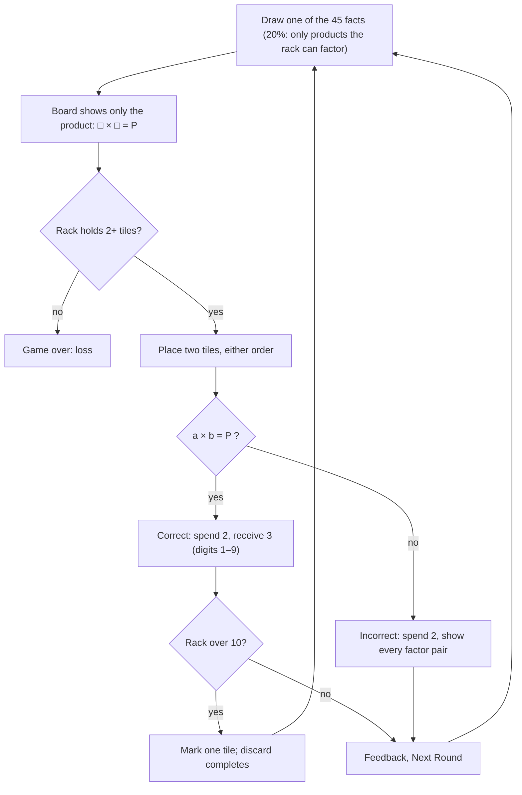
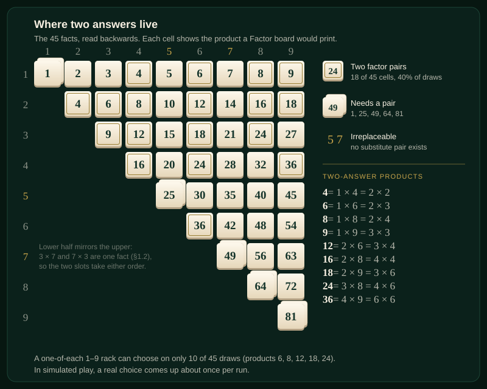

# 02 · Factor · 팩터

> **Status:** research draft — not canonical. Amends nothing in `docs/spec/`; on any conflict the spec wins.
> **Direction:** What if the arithmetic ran backwards — the product is shown and the player spells the factors? · Opus research agent · 2026-10-17

The board shows only the product, `□ × □ = 24`, and any two tiles that make it are right, so for the first time a round can have two correct answers and the player chooses which tiles to spend.

| | |
|---|---|
| Core verb | **Factor**: find two rack tiles whose product is on the board. When two pairs fit, choose which to spend. |
| Only this draft contributes | Answer multiplicity as a spend decision, measured. 40% of draws have two answers, but a real choice comes up about **once per run (0.9)**, and choosing well is worth about 1% of run length. Plus the full economy recompute for a reversed game: cliff at 2/3, new b(n), the 0 tile retired. |
| Nearest neighbour | **Endless**. Factor adds a reversed prompt, a once-a-run choice of factor pair, and a new value order for digits: 5 and 7 cannot be replaced, and squares need a pair. It keeps the same rack, the same dials and about the same run length. |
| Spec fit | **Needs amendment:** `product.md` §1.17 (division modes), §1.1, §1.2, §1.3, §1.4, §1.6, §1.10, §1.11; `ui-i18n.md` §1.14, §1.15 |
| Cliff verdict | **The cliff moves to b = 2/3**, because every answer costs 2. At capacity 10 with kind 20%, in-run b is 59.9% (70.0% on full-rack rounds). Runs end: mean 18.7 rounds against Endless's 18.9 on the same bot, and 0 of 2,000 runs capped. |
| Build size | **M**: touches correctness, slot count, rewards, the opening deal, the board, copy and share. No new motion, and the rack is unchanged. |
| Mode select copy | **Factor**: *Times tables, backwards* · **팩터**: *거꾸로 구구단* |

## 1. Spec collisions

**`product.md` §1.17: "Division, addition, or subtraction modes."** This is the real collision, and it is arguable both ways.

- *Against Factor.* Common Core defines the move: 3.OA.B.6 says "Understand division as an unknown-factor problem. For example, find 32 ÷ 8 by finding the number that makes 32 when multiplied by 8" [1]. By that wording, `3 × □ = 24` *is* division. 3.OA.A.4 files every unknown in a × or ÷ equation under one skill [1]. Cognition research describes a "mediation" strategy for division that works by "relying on the inverse relationship between multiplication and division to solve simple division problems" [9]. A fair reader can call Factor division in disguise.
- *For Factor.* `□ × □ = 24` never names a divisor. The board shows only × and =, the pool is the same 45 facts, and the player answers by recalling a multiplication fact. No new operator appears on screen.
- **Amendment wording:** "Division, addition, or subtraction modes: any board that shows ÷, + or −, or that gives one factor and asks for the other. A mode that shows a product from the 45-pair pool and asks for both factors is in scope." This admits `□ × □` and explicitly excludes `3 × □`. The list has been narrowed this way twice: `16f2ff6` (M4) narrowed "weighted equations" to admit the kind bias, and `facdfbb` (M7) struck "wildcard or special tiles".
- **If Ori says no, the mode does not survive.** Its verb exists only backwards. Going forwards, a product of two 1–9 operands has exactly one spelling, so there is nothing to salvage. Given §5, little would be lost.

**Other clauses it touches:**

| Clause | Today | Factor needs |
|---|---|---|
| §1.1 "two modes"; §1.3 "Endless is the default"; §1.10 "A mode select, **Endless** or **Classic**"; `ui-i18n` §1.14 rules must explain "ordered answer slots" | Two modes | Three modes. Factor joins the select, and Endless stays the default. Factor's rules explain order-free factor slots instead |
| §1.17 "Operand 0" | 0 is never drawn | **No conflict; reinforced.** Factor retires the 0 tile, so no board, not even a miss reading `0 × 7`, shows operand 0 |
| §1.2 rewards "digits 0 through 9"; §1.3 opening "one of each digit [0…9]" | `REWARD_DIGIT_COUNT` is "a domain fact, not a dial" (`constants.ts`) | Rewards uniform over 1–9, and the opening is one of each of 1–9 in ten sockets. A spec amendment, not a `tune(balance)` commit |
| §1.2 "3 × 7 and 7 × 3 are presentations of one sampling entry" | Display order is cosmetic | Cited as the justification for **order-free slots**. Nerdle accepts commutative answers too [8] |
| §1.4 slot count from the product's digits; "slot order is answer order"; per-slot correctness | Spelling | Always two slots, either order, correct iff the two digits multiply to the product |
| §1.6 step 7; `ui-i18n` §1.14 `result.answer` takes one `{value}`; `RoundResult.submittedValue` is a spelled number | One right answer | New key, e.g. `Correct answers: 3 × 8 or 4 × 6`. The submitted pair prints as `3 × 7` |
| §1.10 gameOver "the only phase that does" print the product | Product hidden in play | The product *is* the prompt, so it shows in every phase. gameOver prints the factor pairs instead |
| §1.11 keys `0`–`9` | All select | `0` becomes a no-op |
| §1.4a faces | Classic only | Excluded as written. "Counts as the digit that slot needs" is undefined when no slot has a fixed digit. The generalisation would be existential (correct if some digits drawn from the tiles' sets multiply to the product), and then two wildcards answer everything. Not proposed |
| `ui-i18n` §1.15 share | Endless/Classic formats | `ozterisk Factor — Rounds: {n}`, the same prefix pattern as Classic |

Checked and clear: difficulty curves (the draw and kind rate are fixed), timers, multiple attempts, skip/discard actions, persistence, seeds, motion (§1.12; Factor needs no new moment), and the rack layout (§1.12; five by two is unchanged).

## 2. The mode

A delta against **Endless**. Everything not listed is unchanged: overflow, discard collapse, the rail, Clear, streaks, HUD order, and rounds as the headline.

- **Tiles.** Digits 1–9 only. The opening hand is one of each of 1–9 in the ten-socket rack, so the zero's seat starts empty and the first correct answer fills it. Rewards are uniform over 1–9.
- **Draw.** Exactly as shipped: one of the 45 pairs, and 20% of the time only from pairs whose product the rack can factor. The board shows **only the product**, and the drawn pair is never revealed. A product with two factor pairs therefore appears twice as often as one with a single pair.
- **Answer.** Two slots, `□ × □ = P`, either order. A tap or digit key fills the leftmost empty slot. Submit enables when both are filled. The answer is correct iff `a × b = P`, and a square needs two copies of its digit.
- **Correct:** spend 2, receive 3, net +1. **Incorrect:** spend 2, receive nothing, and see the submitted pair and every correct pair. A deliberate miss remains the priced way to shed two chosen tiles.
- **Loss:** after a round, the rack holds fewer than 2 tiles (`getAnswerLength` returns 2).
- **Keyboard:** `1`–`9` select, `0` does nothing, and the other keys are as shipped.
- **No faces, no new motion, no new dials.** Capacity 10 and kind 0.2 are Endless's own values.

## 3. The loop

## 4. The decision it creates

**The spend choice.** Of the 45 facts, 9 products have two factor pairs: 4, 6, 8, 9, 12, 16, 18, 24 and 36. Those account for 18 cells, so 40% of draws *could* offer two answers. In the mockup's hand, the better answer is the one that spends the duplicate. **Where both answers live** is mapped below.

**A new value order for digits.** In the shipped game no product repeats a digit, so a duplicate tile is dead weight. In Factor, digits are valued by factor structure:

- **5 and 7 cannot be replaced.** Every fact that contains them needs them.
- **2 and 4 are the most replaceable.** Six of their nine facts have another pair; 3 and 6 have five.
- **1 partners every one-digit product,** and products 2, 3, 5 and 7 cannot be made without it.
- **25, 49, 64, 81 and 1 need a pair,** so a second 7 is now worth keeping.

Any two tiles in the rack form a valid fact, so the rack is a set of latent equations and the draw names one.

**Precedents.** Target-first games all have many right answers:

- **The 24 puzzle** asks for four integers combined into 24 [6].
- **Krypto** combines five cards with the four operations to hit an objective card [5].
- **Countdown's numbers round** aims at a 100–999 target and does not require all six numbers [7].

There, multiplicity makes the puzzle *solvable*. No input carries over as inventory, so no answer costs more than another. That matches Factor's sim (§5): multiplicity mostly means *more ways to be right*, not a trade-off. Where the choice of factorisation *matters*, something remembers it:

- **KenKen.** A "240×" cage can be 6·5·4·2 or 3·5·4·4, and the grid's row and column constraints pick which [2].
- **The Product Game** (Connected Mathematics *Prime Time*). Two paper clips sit on factors 1–9. "Player 1 moves either one of the paper clips to another number and then shades or covers the new product", and four in a row wins [3]. The clip that stays constrains which pair is possible, and the board remembers every claim.

Factor's only memory is the rack, and the next draw is random, so its choice carries less weight.

**Prime Climb**'s board is "color-coded to make multiplication and division easy" [4]: the same factor-structure texture, made visible. **The feeling** is the small "aha" of spending the spare 6 and of guarding a lone 7. It is real, but rare (§5).

## 5. Economy

**Where it sits.** Every answer costs exactly 2 tiles. A correct answer nets +1 and a miss costs 2, so drift is `3b − 2` and **the cliff moves from 0.631 to b = 2/3 ≈ 0.667** (analytic). What holds Factor under the cliff is that the higher cliff absorbs the extra b that a 1–9 tile set and multiplicity add. On uniform hands with the kind formula `b' = 0.2 + 0.8b` (analytic), b'(10) is 0.634, a 0.033 margin, against Endless's 0.584 and 0.047 margin. Capacity 11 gives b'(11) = 0.674, analytically over the cliff (the run sim still ends C11 runs, because the ceiling leaks; see below). So **capacity 10 is Factor's ceiling, the same one `balance.ts` sets for Endless**.

**Instrument 1: b(n) on uniform random hands** (`bn.ts`, [`sims/`](sims/)). This is an exact multinomial enumeration over digit multisets.

- *Calibration:* the repo's real `canConstruct` by Monte Carlo (20,000 hands) gives b(10) = 0.480 and b(20) = 0.800, matching the spec. My enumerator gives 0.480 and 0.800.
- *Controls:*
  - A one-of-each 1–9 hand scores exactly 40/45 under the pair draw and 31/36 under the product draw, as predicted.
  - b(0) = b(1) = 0, and an all-zero hand scores 0.
  - Monte Carlo (50,000 hands) matches the exact values to ±0.001.

| n | Shipped, tiles 0–9 | **Factor, tiles 1–9** | Factor, product-uniform draw | Factor, 0 kept as ballast |
|---|---|---|---|---|
| 8 | 0.383 | 0.426 | 0.390 | 0.372 |
| 9 | 0.433 | 0.487 | 0.448 | 0.430 |
| 10 | **0.480** | **0.543** | 0.503 | 0.484 |
| 12 | 0.566 | 0.638 | 0.598 | 0.581 |
| 14 | 0.640 | 0.715 | 0.677 | 0.660 |
| 20 | 0.800 | 0.859 | 0.833 | — |
| *cliff* | *0.631* | *0.667* | *0.667* | *0.667* |

**Instrument 2: whole runs** (`runs.ts`, `mulberry32` seeds 1000+, a run capped at 1,000 rounds).

- *Bot:* answers whenever it can (skill 1.0 unless noted). Among valid pairs it takes the one that leaves the most of the 45 facts answerable. A miss spends the two tiles whose loss costs the least coverage, and a discard does the same.
- *Calibration:* the same bot plays shipped Endless through the real `gameReducer`, `generateKindEquation` and `generateRewardTiles`. My multiset replica matched it **run length for run length on 2,000 of 2,000 seeds**, at skill 1.0 (mean 18.93) and at skill 0.95 (17.73).
- *Negative controls:* with zero rewards, every run loses (Factor in exactly 4 rounds, Endless at a median of 6).
- *Positive bracket:* kind 100% never loses (300 of 300 runs capped).
- Bots are not players. Compare the rows with each other.

| Variant (2,000 runs; C11–12: 500) | Mean rounds (median) | In-run b | b on full-rack rounds | Capped | Real choices / run |
|---|---|---|---|---|---|
| Endless as shipped, C10, kind .2 | 18.9 (17) | 54.9% | 70.8% | 0% | 0 |
| Factor C9, kind .2 | 14.7 (13) | 57.8% | 71.3% | 0% | ≈0.6 |
| **Factor C10, kind .2** | **18.7 (16)** | **59.9%** | **70.0%** | **0%** | **0.94** |
| Factor C11, kind .2 | 23.3 (18) | 61.9% | 71.0% | 0% | ≈1.4 |
| Factor C12, kind .2 | 28.7 (22) | 64.1% | 73.7% | 0% | ≈2.0 |
| Factor C10, kind 0 | 12.8 (11) | 51.4% | 64.6% | 0% | ≈0.6 |
| Factor C10, product-uniform draw | 16.1 (14) | 56.3% | 66.4% | 0% | ≈0.4 |
| Factor C10, 0 kept as ballast (rewards 0–9) | 16.9 (15) | 57.2% | 70.8% | 0% | ≈0.7 |

"Real choices" count rounds where two pairs are in hand *and* lead to different coverage. The ≈ values are derived from printed percentages. At skill 0.95, Factor C10 runs 16.4 rounds against Endless's 17.7. Full-rack b exceeds the cliff in both modes, yet runs end. At a full rack, overflow takes a correct answer's +1 while a miss still costs 2, so the ceiling leaks.

**The 0 tile is retired.** Kept as ballast, it is never a correct input and always the right discard, so it carries no decision. It also cuts run length (18.7 to 16.9) and choices.

**Does the decision matter?** I swapped one decision at a time for a random policy and paired each seed with itself (Factor C10, kind .2, 20,000 seeds; `paired.out`):

| Decision | Times per run | Rounds lost per run if random (± SE) | Per decision |
|---|---|---|---|
| Miss-spend (which two tiles to burn) | 7.49 | 3.91 ± 0.07 | 0.52 |
| Overflow discard | 4.65 | 1.53 ± 0.07 | 0.33 |
| **Factor-pair choice** | **0.91** | **0.20 ± 0.05** (worst policy: 0.41 ± 0.06) | **0.22** |

The instrument can see decision value: the miss-spend gap is 21% of run length. The discard gap of 8% falls short of the 10% I pre-registered for this check, and I report that as a miss. **The pair choice is real but small:** each instance is worth less than a discard, and it arrives about once a run, so over a whole run it is worth about 1%. The analytic 40% shrinks because the rack must hold *both* pairs. Even a perfect one-of-each hand offers a choice on only 10 of 45 draws.

**One bounded rescue attempt: variable-length answers.** The rule allows 2 *or* 3 tiles (24 = 3·8, 4·6, 2·3·4 or 2·2·6), with 1s allowed and a miss spending the minimum of two. Before running it, I pre-registered a bar in `PREREGISTRATION.md`: at least 3 real choices per run, and at least 10% spread across fixed answer policies, at a capacity that runs 14–24 rounds under the cliff.

| 4,000 runs | Greedy | Fewest tiles | Random | Most tiles | Anti | Spread | Choices / run |
|---|---|---|---|---|---|---|---|
| C9, kind .2 | 16.5 | 16.5 | 15.5 | 15.0 | 14.6 | 11.5% | 5.25 |
| C10, kind 0 | 14.9 | 14.8 | 13.9 | 13.3 | 12.8 | 14.1% | 4.99 |

**It clears the bar as written, but the reading is not the thesis.** "Always spend the fewest tiles" ties the coverage-greedy bot, so the whole spread is a trap avoided, not a trade-off weighed. A 1 used as padding acts as a reroll token, but greedy pads under 1% of correct answers, against 29–33% under the losing "most tiles" policy. The third slot is a rescue valve, used on about 10% of correct answers (about once per run). It would break §1.4 twice (optional slots, early Submit), leave the 45-fact pool, and drift toward 07 Kiln's transformation axis. **Not adopted.**

## 6. Smallest playable slice

Factor as a third mode, at Endless's dials.

**Reused unchanged:** `gameReducer` flow, overflow and discard collapse, the rail, `sortTiles`, the rack, all motion, `getCapacity` (Factor returns 10), and `KIND_EQUATION_RATE`.

**Added:**

- `GameMode` `"factor"` in `types.ts`.
- In `selectors.ts`: `getAnswerLength` returns 2 in Factor; a mode-aware `answerMatches` (product of the two digits); and `canFactor` beside `canConstruct` for the kind draw.
- In `generators.ts`: a 1–9 digit pool in `generateRewardTiles` for Factor.
- In `factories.ts`: a 1–9 deal in `createInitialInventory`.
- UI and copy: the board renders `□ × □ = P`; an incorrect result lists every pair; a title-screen mode option; `messages.ts` keys; and a `sharing.ts` prefix.
- Tests: order-free correctness, squares needing two copies, `0` as a no-op, a 1–9 reward pool, and a `balance.test.ts` Factor invariant (cliff 2/3, C11 failing).

**Thesis test:** three players, five Endless and five Factor runs each, think-aloud.

## 7. Biggest risk — and the playtest that would kill it

**The risk is that Factor is Endless with a reversed prompt.** The sim says its one new decision arrives about once a run, and the variable-length rescue turned out to be a trap rather than a choice. The digit texture (precious 7s, useful pairs) is real, but it is flavour on Endless's discard decision, not a new verb.

**Kill observation.** Across the 15 Factor runs in the thesis test:

- if fewer than 1 run in 3 shows a player visibly weighing two factor pairs (pausing, or saying "3·8 or 4·6"), or
- if players afterwards cannot tell Factor's decisions from Endless's,

drop the direction.

A second kill is a "no" on §1.17. A third, before any build: Ori judges that the reversed prompt alone does not justify a third mode select entry.

## 8. Open questions for Ori

1. **Is `□ × □ = P` a division mode under §1.17?** The wording in §1 admits it and keeps `3 × □` out. A no ends the direction.
2. **Is a reversed prompt plus a new digit-value order enough for a mode,** given about one real choice per run? If not, this slot is better spent on the spare direction.
3. **Variable-length answers** cleared a pre-registered bar only through a dominated option. Is that worth one playtest anyway, for the rescue moment ("saved it with 2·2·6")?
4. **Opening:** nine tiles in ten sockets (the empty zero's seat), or capacity 9 on a 3 × 3 tray (a `ui-i18n` §1.12 layout amendment, and 14.7 rounds)?
5. **Korean name:** 팩터 follows 엔드리스 and 클래식, while 인수 is the maths term but a homonym of "takeover".

## Sources

1. Common Core State Standards, Grade 3 OA (3.OA.A.4, 3.OA.B.6). https://www.thecorestandards.org/Math/Content/3/OA/
2. KenKen, cage rules and the "240×" example. https://en.wikipedia.org/wiki/KenKen
3. Product Game rules (UCSC MBAMP, adapted from CMP *Prime Time*). https://mbamp.ucsc.edu/product-game-rules. The NCTM Illuminations version came up in search, but fetching it returned HTTP 402: https://nctm.org/classroom-resources/illuminations/interactives/product-game
4. Prime Climb rules, Math for Love. https://mathforlove.com/2010/01/prime-climb-rules/
5. Krypto (game), via web search. https://en.wikipedia.org/wiki/Krypto_(game)
6. 24 (puzzle). https://en.wikipedia.org/wiki/24_(puzzle)
7. Countdown (game show), numbers round. https://en.wikipedia.org/wiki/Countdown_(game_show)
8. Nerdle, Classic FAQ ("Commutative answers are accepted"). https://www.nerdlegame.com/games/classic-nerdle.html
9. Huber, Fischer, Moeller & Nuerk (2013), *On the interrelation of multiplication and division in secondary school children*, Frontiers in Psychology. https://www.frontiersin.org/journals/psychology/articles/10.3389/fpsyg.2013.00740/full
10. Factor Captor: searched, no rules found (unverified).

**Repo:**

- `docs/spec/product.md` (§1.2–§1.11, §1.17) and `docs/spec/ui-i18n.md` (§1.12, §1.14, §1.15)
- `docs/superpowers/specs/2026-08-09-endless-mode-polish-design.md` §1–2 and `docs/design-system/decisions.md` (Classic)
- `src/game/{balance,constants,selectors,generators,factories,gameReducer,types}.ts` and `src/app/App.tsx`
- `docs/archive/complete-plan.md` §1.17, and commits `16f2ff6`, `facdfbb`

**Instruments** ([`sims/`](sims/)):

- scripts: `model.ts`, `bn.ts`, `runs.ts`, `mock.ts`
- outputs: `bn.out`, `calib.out`, `main.out`, `levers-decision.out`, `instrument.out`, `paired.out`, `split.out`, `splitpolicy.out`
- `make_map.py`, which generates `factor-map.svg` and asserts every count it draws
- `PREREGISTRATION.md`
