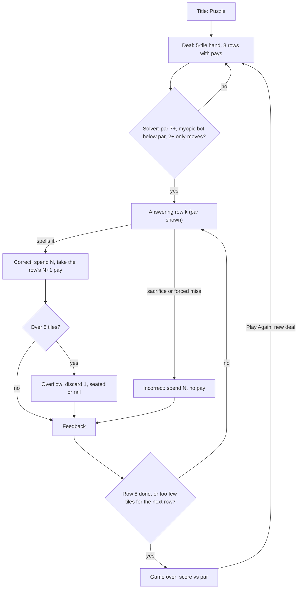

# 03 · Puzzle · 묘수풀이

> **Status:** research draft — not canonical. Amends nothing in `docs/spec/`; on any conflict the spec wins.
> **Direction:** what if nothing were random? · Opus research agent · 2026-10-17

Five tiles and eight equations are dealt face up, with what each equation pays. Find the line that answers as many as the table allows, sacrifices included. Par is printed before your first move.

| | |
|---|---|
| Core verb | **Plan a line.** With the whole table in view: answer, sacrifice (a deliberate wrong answer), or discard |
| Only this draft contributes | A solver-verified sample table, replayed on the real `gameReducer`. A deal-and-verify generator with a difficulty model that replaces the cliff. The handle analysis: the seed ban does not forbid determinism; it forbids a *name* for a run |
| Nearest neighbour | **Classic.** Classic hides each draw until it lands, so a run is judged against luck. Puzzle deals everything face up and judges the run against a known optimum (par) |
| Spec fit | **Fits as written** as a per-session deal: no number, no retry, and Play Again deals a new table. A shared or daily table needs amendments to the AGENTS.md seed line, product.md §1.17 "Seeded/replayable runs", and ui-i18n §1.15 |
| Cliff verdict | Eight rows, so drift can no longer make a run endless. Measured as a **score rate** (rows answered ÷ 8; rows after a loss count 0), the puzzle's analog of b: a uniform deal is hopeless even for a clairvoyant player, at **0.115** with five sockets. The planted deal gives a clairvoyant **0.666** (it lands just over 0.631) and a myopic bot **0.371**. The puzzle is the gap between the two |
| Build size | **M.** The reducer gains a mode, a table in state and an end row. Adds a ledger component and a pure solver (~150 lines). No new motion |
| Mode select copy | **Puzzle** — Every tile face up · **묘수풀이** — 모든 타일을 펼쳐 놓고 |

## 1. Spec collisions

**The per-session form crosses no ban.** Each table is dealt with `Math.random()` at the boundary, verified by the solver, played once, and gone. Clauses checked:

- **AGENTS.md seed line; §1.17 "Seeded/replayable runs".** Clear: nothing is seeded or named, there is no Retry, and Play Again deals a new table.
- **§1.17 "Difficulty curves".** Clear. The acceptance band (§5) is one fixed filter for every player that never adapts or escalates, like the kind bias's "generosity dial" (§1.2).
- **§1.17 "Multiple attempts", "skip buttons or a separate manual-discard action".** Clear: one submission per row, and a sacrifice is an ordinary wrong submission.
- **§1.17 "Exact-answer-constructibility loss detection".** Clear by design: the solver runs only at the deal, and nothing shows "par still reachable". That signal is the constructibility warning the polish spec ruled out (its §2).
- **§1.17 saved history and result parameters; ui-i18n §1.15–§1.16.** Clear: nothing persists, and the share text names no table. Its "Can you beat it?" loses its referent and needs new copy.
- **AGENTS.md "tutorials".** Clear for the slice. A par-line reveal is gray (§8 Q2).

Any third mode also needs ordinary new-mode text: §1.1 ("two modes"), §1.2, §1.3, §1.7a, §1.8, §1.10, §1.14, §1.15, and the ui-i18n §1.12 rack and ledger.

**Comparability is where the bans bite.** A table is not a seed; a *name* for a table is: any handle that lets a second person, or a second attempt, re-enter the run. FreeCell's deal numbers are "derived from the seed value" [2], and an implementation must "Seed the RNG with the number of the deal" [3]. Its deal number is a seed displayed as a handle. decisions.md concedes that "friend-versus-friend comparison needs a shared seed".

| Form | Handle | Needs |
|---|---|---|
| G · per-session deal (this draft) | none | only the new-mode text |
| G + Retry | a re-deal button | §1.17 replayable carve-out (the smallest handle) |
| A · numbered shipped tables ("Puzzle 12") | the number | §1.17 carve-out, AGENTS.md clarification, §1.15 format |
| D1 · daily: local date indexes a shipped list | the date (implicit, shared) | as A, plus a selection rule; brushes §1.1 "does not validate … retention" |
| D2 · daily: date seeds a runtime generator | the date, literally a seed | AGENTS.md seed line replaced; §1.2 "Production uses `Math.random()`" |
| C · share code that rebuilds a table | the code | the seed clause's core case; avoid |

**Is "Puzzle 12" a seed?** Not by mechanism: 12 indexes data. By function it is a handle to a replayable run, which §1.17 lists, so it needs the amendment. **Is a date-derived daily?** D2 literally is. D1's date is a handle every player shares, and refresh replays it.

Amendment text for A (and D1):

- **AGENTS.md**, after "…or share run seeds.", add: *"A Puzzle table number is not a seed: it names an entry in the shipped table list, may be shown and may appear in share text, and nothing is generated from it."*
- **product.md §1.17**: *"Seeded/replayable runs. Exception: Puzzle tables are shipped content, and any table may be played again by its number (§1.x). Endless and Classic runs are never replayable."* For D1, add: *"The day's table is the list entry at the number of days from launch to the device's local date."*
- **ui-i18n §1.15**: add *"ozterisk Puzzle {n} — {score}/8 · par {par}"*, with a plain URL. "Do not claim a shared result is verified" stays: without persistence anyone can replay, so comparison runs on the honour system. §1.16 stays too: no solved marks, no "played today".

D2 instead replaces the AGENTS.md line: *"…except Puzzle's daily deal, which seeds the deal generator with the device's local date; no other run may be seeded."* It carries a hazard too: any generator or dial change silently re-deals every day, and two deploys disagree about today's table. D1 avoids this because a table is data. That was Wordle's original design: the solutions sat "within the puzzle's code" [8], and "the daily word is the same for all players worldwide" [7]. Its leak, future answers readable in the bundle [8], matters less for a table that is meant to be read.

## 2. The mode

A delta against Endless:

- **Capacity.** 5 (`PUZZLE_CAPACITY`, new dial): one row of five sockets, Classic's floor without plugs (nothing is gone here).
- **Setup.** At **Start Run**, App deals a **table** with injected randomness:
  - 5 distinct digits;
  - 8 rows, each an equation plus its printed **pay** of `getRewardCount(len)` = len + 1 digits.

  The solver accepts or re-deals (§5). Table and **par** ride in `START_RUN`, and the reducer stays pure.
- **Answering.** Unchanged: slots, keys, Clear, Submit.
- **Correct.** Spend N, receive **that row's pay** (net +1). Overflow is Endless's one-tile discard, seated or rail.
- **Incorrect.** Spend N, receive nothing. Done deliberately, it is the **sacrifice**. A 1-digit sacrifice cannot spend the product's digit; a 2-digit one can spend any pair.
- **Kind bias.** None at play time; it acts once, at the deal.
- **End.** After the 8th submission: **Made par** (gold, as Run Complete) or **N short of par**. The existing loss applies earlier.
- **HUD.** Row *k*/8, score, streak, then **Par** as a fourth entry, like Classic's capacity.
- **Ledger.** Replaces the equation area, so the IA order holds.
  - Done rows collapse to ink ✓/✗ marks, since colour appears "only at the moment of the event".
  - The current row holds the slots.
  - Future rows show compact pay tiles.
- **Keyboard and phases.** Unchanged. `R` deals a new table.

## 3. The loop

## 4. The decision it creates

Endless and Classic ask *what do I keep, given what might come?* Puzzle asks *what do I keep, given what will come?* Both existing verbs become planning moves:

- **The discard becomes Bélády's rule.** "Discard information which would not be needed for the longest time" is the optimal cache policy, "unfeasible in practice" because the future is unknown [12]. On a face-up table it is reading the ledger. My lookahead bot is that rule, and it nearly solves the game (§5).
- **The deliberate miss becomes a sacrifice.** In the sample (§5), 3 × 5 = 15 is answerable on row 1, yet every line that answers it is capped at 6 of 8. The hand's only 1 is also needed by row 2's 14, and only 14 pays a 1 back. A chess problem's key "must be unique", and two keys make it "cooked" [1]. The sample's key is unique: 1 of 14 options keeps par.

Precedents:

- **Chess problems.** "Mate in n" [1] is why par is printed: it promises a solution exists.
- **Tetris Attack.** Its puzzle mode is "a preset block arrangement in a set number of moves" [5].
- **Into the Breach.** Procedural maps, yet "the direction of the Vek unit's intended attack" is shown [6]: a random deal plus perfect information, which is form G. Puzzle reveals eight turns, not one.
- **FreeCell.** It can deal blind because "around 99.999% of possible deals are solvable" [2]. Uniform ozterisk deals are 0.0% clearable (§5), so here the solver is mandatory.
- **Sokoban.** It is "NP-hard" [4]. This table is tiny by comparison: the sample has 714 reachable states, and a planted deal solves in a median 0.28 ms.
- **Shared puzzles.** Wordle compares through a shared handle: "the daily word is the same for all players worldwide" [7]. NYT Connections publishes one "human-made puzzle" a day [9]. Zachtronics compares through "histograms from other players" on cycles, cost and area [10][11]. That they come "via the game's storefront" suggests a server, though that is my inference. The backend-free alternative compares the player with the table's own outcome space (§8 Q3).

The name is 묘수풀이, the baduk problem book ("묘수풀이집") [13]: the click when the sacrifice makes the line fall into place.

## 5. Economy

**Where the cliff applies.** Eight rows end every run, so missing par, not drift, is the failure. The cliff survives in the generator: a uniform deal is hopeless even with clairvoyance. A difficulty model computed at the deal replaces it:

- **par**: the solver's maximum score;
- **a bot ladder**: myopic, then lookahead, then the solver;
- **only-moves**: par-line decisions where exactly one option keeps par;
- **density**: par lines ÷ all lines.

**Instrument** (session scratchpad, not committed):

- **Solver.** `solver.ts`, a memoized DFS over (row, hand counts). It gives par, the score histogram of every distinct line, the canonical par line, only-moves, and whether par needs a sacrifice.
- **Bots.** Neither ever sacrifices.
  - *Myopic*: the journal's T84 Classic bot at skill 100%, discarding or spending the most-copied digit.
  - *Lookahead*: Bélády.
- **Grids.** 2,000 tables per cell, seeded `mulberry32` (research tooling only, not production).
- **Real-reducer replay.** `run-cap.mjs` sets `INVENTORY_CAPACITY` to 5 in Vite's load hook (in memory; repo untouched), so solver lines replay on the real `gameReducer`. A rejected dispatch throws.

**Calibration.**

- Real `canConstruct` gives **b(10) = 0.479** over 20,000 hands (repo ≈ 0.48).
- The memoized histogram equals naive enumeration on 300 tables.
- On the real reducer, 2,000 random lines (6,326 submissions) match hand by hand, and 400 par lines each score exactly par.

**Negative controls.**

- Five 1s against six rows of 7 × 8: par 0, both bots 0.
- Hand 1 2 4 6 8; rows 5 × 8, 2 × 3, 3 × 4, 2 × 4; pays 1 2 3 · 1 2 · 6 8 9 · 1 3. Row 1 needs a 0 that nothing supplies: **par 3 of 4, not clearable**.
- 21 claimed correct for 3 × 4: the reducer refuses.
- A corrupted pay: the replay disagrees on 46 of 46 lines.

**Results.** 5 sockets, 8 rows, 2,000 tables per row. Rate = mean rows answered ÷ 8, with rows after a loss counted as 0. This is the puzzle's analog of b, not the repo's spellable share.

| Deal | Clairvoyant rate (par ÷ 8) | Lookahead rate | Myopic rate | Clear-all possible | In band |
|---|---|---|---|---|---|
| Uniform hand, pairs and pays | 0.115 | 0.110 | 0.068 | 0.0% | 0.1% |
| **Planted q = 0.6, distinct hand** | **0.666** | **0.645** | **0.371** | 9.6% | **14.6%** |
| Planted q = 1.0, distinct hand | 1.000 | 0.996 | 0.739 | 100.0% | 2.5% |

**The planted deal.** The deal follows a hidden random line. With probability q, the next pair comes from products that line's hand can spell: the shipped kind bias, applied once at the deal. The line is never shown.

**The band (pre-registered).** A table is accepted when:

- par ≥ 7;
- the myopic bot scores below par;
- the par line has ≥ 2 only-moves.

**What the cells say.**

- **q = 0.6 is the dial.** I chose it for its acceptance rate. That it straddles the cliff is where it landed, not a law. One deal in ~7 lands in band, at **2.9 ms of solver time per accepted table** (Node 24, Apple M4; phones unmeasured).
- **Band composition.** 84% of accepted tables are *Medium* (Bélády makes par); 16% are *Hard*. The tiers are bot-relative: they say nothing about how hard a person finds a table. §7's playtest would.
- **Sacrifice tables are rare.** 0.7% of accepted, about 1 deal in 1,000.
- **Median accepted table.** 2 only-moves.
- **Other settings.** q = 1.0 makes everything clearable for the myopic bot too. Capacity 6 and 6-row tables give 11–16% in band at q = 0.6.
- **A face-up wall loses to printed pays.** A single face-up wall, where a miss shifts every later pay, came within 0.005 of printed pays' clairvoyant rate on every uniform cell. Its coupling bought no measured depth.

**The sample table (verified).** The deal is `plantedTable(mulberry32(16641), 5, 8, 0.6, distinct)`; the seed is a research handle, never shown to a player. Of 20,000 deals, 425 were Hard with ≥ 3 only-moves. I picked this one from my top three because its key is row 1, so it is a showcase, not typical. Opening hand **1 4 5 7 9**; **par 7 of 8**.

| Row | Equation | Pays | Par line | Hand after | Options / keep par |
|---|---|---|---|---|---|
| 1 | 3 × 5 | 9 5 5 | **Sacrifice**: submit 5 and 7 (57 ≠ 15) | 1 4 9 | 14 / **1** |
| 2 | 7 × 2 | 8 1 6 | 14 ✓ | 1 6 8 9 | 4 / **1** |
| 3 | 3 × 3 | 2 7 | 9 ✓ | 1 2 6 7 8 | 4 / **1** |
| 4 | 1 × 7 | 4 4 | 7 ✓, discard 6 | 1 2 4 4 8 | 9 / 2 |
| 5 | 4 × 1 | 6 2 | 4 ✓, discard 8 | 1 2 2 4 6 | 8 / **1** |
| 6 | 8 × 3 | 0 7 7 | 24 ✓, discard 0 | 1 2 6 7 7 | 12 / 2 |
| 7 | 2 × 3 | 8 8 | 6 ✓, discard 7 | 1 2 7 8 8 | 7 / 2 |
| 8 | 3 × 4 | 2 0 2 | 12 ✓, discard 0 | 2 2 7 8 8 | 11 / 4 |

Why it holds:

- **Row 1 forces the pair.** Rows 2–3 need 1, 4 and 9, so only 5 + 7 can go.
- **Row 5 forces the discard.** Rows 6–8 need 2 4, 6 and 1 2, so the 8 is the spare.
- **Answering 15 caps the run at 6,** under all four discards.
- **The bots fall short.** Lookahead scores 6. Myopic scores 2, emptying the rack before row 7.
- **Reducer check.** All three lines score the same on the real reducer, hand for hand.
- **Rarity.** 38 of 16,893 lines make par.

## 6. Smallest playable slice

Thesis: does face-up planning against par feel different from Classic?

- **Reuse:** `gameReducer` (Endless paths unchanged), `getRewardCount`, `canConstruct`, `answerMatches`, `getAnswerLength`, `sortTiles`, the rack component, and the reward-arrival treatment. The rack needs a one-row-of-five footprint, a §1.12 addition already listed in §1. No ledger-to-rack flight, since that would amend §1.12.
- **Add:**
  - `src/game/puzzle.ts`: `dealPuzzle(random)` and `solvePuzzle(table)`, pure, ~150 lines ported from `solver.ts`.
  - Export `EQUATION_PAIRS`.
  - `GameMode` gains `"puzzle"`; `GameState.table` holds rows and par.
  - Reducer:
    - the table rides in `START_RUN`/`RESTART_RUN`;
    - `SUBMIT_CORRECT` checks reward digits against the row's pay;
    - `NEXT_ROUND` ends the run after row 8 (like `isAtClassicFloor`).
  - `getCapacity("puzzle")`.
  - Dials: `PUZZLE_CAPACITY = 5`, `PUZZLE_ROWS = 8`, `PUZZLE_PLANT_RATE = 0.6`.
  - App's deal loop.
  - Ledger, Par HUD entry, verdict, and en/ko copy.
- **Tests:** the sample (par 7, sacrifice required); the no-0 control; pay validation and the row-8 end; a deal under a deterministic `RandomSource`.
- **Left out:** numbers, retry, daily, par-line reveal, outcome histogram, face tiles.

## 7. Biggest risk — and the playtest that would kill it

**The information is on screen and nobody uses it.** If players go row by row, as in Endless, missing par feels like a scolding, not a puzzle. Load comes close behind: eight products and five tiles may feel like homework.

**Kill playtest.** Five people, three tables each, title rules only. Record:

- seconds before the first submission;
- whether they look at the ledger;
- after missing par, whether they can name the move they'd change.

**Drop the direction if** most submit row 1 within ~5 s on every table *and* cannot name a move to change. Also drop it if Medium and Hard tables feel the same.

**Code honesty.** In code this is close to "Endless plus a table". In play, the verb moves from reacting to planning.

## 8. Open questions for Ori

1. **The handle.** Per-session only (no amendment), or numbered or daily tables? The table format is the same either way.
2. **Par-line reveal.** Showing a solution at game over, like a chess problem's: is that a tutorial under AGENTS.md?
3. **Outcome histogram.** "Your 6 ties 5,692 of 16,893 lines; 38 make par" compares you with the table, not the crowd. Is it meaningful or arcane? Counting distinct lines overweights sacrifice-heavy branches.
4. **Par up front, or revealed at the end?**
5. **A Hard tier.** Sacrifice tables are ~1 deal in 1,000, too rare to deal on a phone. Ship a pool with no visible number?
6. **Face tiles.** They are Classic-only (§1.4a) and multiply solver states.

## Sources

1. Chess problem — https://en.wikipedia.org/wiki/Chess_problem
2. FreeCell — https://en.wikipedia.org/wiki/FreeCell
3. Deal cards for FreeCell — https://rosettacode.org/wiki/Deal_cards_for_FreeCell
4. Sokoban — https://en.wikipedia.org/wiki/Sokoban
5. Tetris Attack — https://en.wikipedia.org/wiki/Tetris_Attack
6. Into the Breach — https://en.wikipedia.org/wiki/Into_the_Breach
7. Wordle — https://en.wikipedia.org/wiki/Wordle
8. PCWorld, "How to cheat at Wordle" — https://www.pcworld.com/article/606109/how-to-cheat-at-wordle.html
9. The National, NYT Connections — https://www.thenationalnews.com/arts-culture/pop-culture/2023/09/02/connections-game-wordle/
10. Zachtronics — https://en.wikipedia.org/wiki/Zachtronics
11. Opus Magnum — https://en.wikipedia.org/wiki/Opus_Magnum_(video_game)
12. Cache replacement policies (Bélády) — https://en.wikipedia.org/wiki/Cache_replacement_policies
13. 경향신문 (묘수풀이집) — https://www.khan.co.kr/article/200805181836365

**Repo:**

- `AGENTS.md` (Global Constraints)
- `docs/spec/product.md` §1.1–§1.17
- `docs/spec/ui-i18n.md` §1.12, §1.15, §1.16
- `docs/superpowers/specs/2026-08-09-endless-mode-polish-design.md` §1–2
- `docs/design-system/decisions.md` (Classic)
- `docs/journal/journal-2026-09-27.md` (T84 bot)
- `docs/tasks/T08-title-screen.md`
- `src/game/{balance,types,selectors,generators,factories,gameReducer}.ts`

**Scripts** (session scratchpad, not committed):

- `solver.ts`, `verify.ts`, `replay.ts`, `grid.ts`, `grid2.ts`, `find-sample.ts`, `sample.ts`, `run-cap.mjs`
- logs: `verify-cap5.log`, `grid.log`, `grid2.log`, `sample.log`
