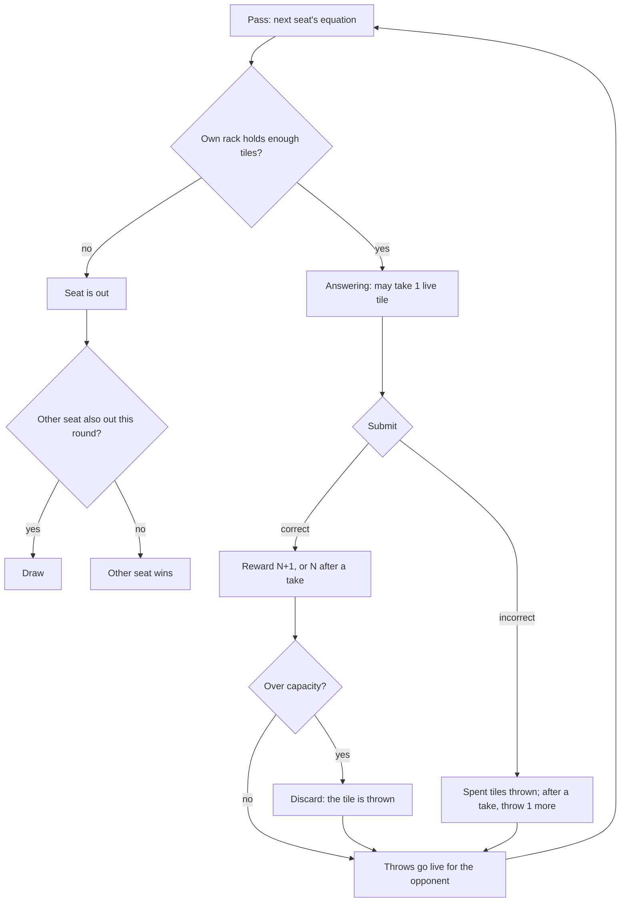

# 04 · Table for Two · 둘이서

> **Status:** research draft — not canonical. Amends nothing in `docs/spec/`; on any conflict the spec wins.
> **Direction:** what if two people shared the table — one device, local play? · Opus research agent · 2026-10-17

Two players share one phone and one mahjong table: every tile you throw away lands face up in front of your opponent, who may take it instead of a blind reward.

| | |
|---|---|
| Core verb | **Take**: claim one tile your opponent just threw, in place of one blind reward draw. Its mirror is the **throw**: every tile that leaves your rack unscored is offered to them for one turn. |
| Only this draft contributes | A second person at the table. It adds a take-and-throw channel between two racks, open-hand pass-and-play on one screen, and a measured snowball and fairness analysis. In that analysis the river is a rubber band on luck and a mild ratchet on skill, and never a snowball. |
| Nearest neighbour | **Endless**. Each seat plays Endless's economy unchanged; this adds an opponent whose throws widen your options, and a head-to-head end. Mechanically it is "Endless twice, plus one rule". The value is the social format, not new solo depth. |
| Spec fit | Needs amendment: `product.md` §1.1, §1.3–§1.11; `ui-i18n.md` §1.12, §1.15; `architecture.md` §2.2, §2.4, §2.5 |
| Cliff verdict | **Under** (two-bot sim; conditions in §5). Drift at 9 tiles is −0.14/turn, against −0.23 with no river; b_eff(9) = 0.62 < 0.631. None of 10,000 games hit the 400-round cap. Games run 15.5 rounds against 13.7. |
| Build size | **M**. The waiting seat is stashed beside the active seat's `GameState`, so every reducer branch is reused. New: two actions (`TAKE_TILE`, `PASS_TURN`) and two display components. |
| Mode select copy | **Table for Two** — Take what they throw · **둘이서** — 버린 패를 가져오기 |

## 1. Spec collisions

`product.md` §1.1 says the PoC "does not validate competition". I treat that as a scope note, not a ban: local play needs no accounts, server, leaderboard or anti-cheat. Shipping this mode still makes the PoC test competition, so the sentence needs a one-line amendment.

| Clause | Today | Amendment | Works without it? |
|---|---|---|---|
| `product.md` §1.1; `README.md` | "two modes"; "does not validate competition"; README: "does not implement competition" | "Table for Two tests the loop as local head-to-head play on one device. It adds no online play, accounts, leaderboard or anti-cheat." | No: the mode *is* a competition test |
| §1.3 | one inventory; mode select Endless/Classic | Third mode. Two Endless hands, East first | No |
| §1.4, §1.11 `answering` digit | "with none, the narrowest face tile holding it" | "with none, the opponent's live tile holding it, taken and selected (once per turn)" | Touch works without it; keyboard parity needs it |
| §1.5 step 6 | "Generate exactly `N + 1` random reward tiles" | "`N + 1`, less one if the seat took a tile this turn" | No |
| §1.6 step 1 | "Remove the `N` submitted tiles permanently" | Submitted tiles are *thrown* (live for one opponent turn). After a take, the seat also throws one tile of its choice | No |
| §1.7 | "`excess = inventory.length - capacity`" | Required count = excess + owed, where owed is 1 after a miss that followed a take. Same step, same last-mark-completes rule | No |
| §1.8 | `NEXT_ROUND` draws and checks one hand | `PASS_TURN` checks the incoming seat's own rack, using the same formula. Round completion and draw rules (§2 below) | No |
| §1.9, §1.10 | one set of stats; HUD round → score → streak; `title`: "A mode select, **Endless** or **Classic**" | Per-seat score and streaks. A turn line ("West to play"). The waiting rack and live throw. gameOver names the winner or a draw | No |
| §1.11 `feedback` | "`Enter`: Draw and advance to the next equation" | "`Enter`: pass the turn" (same key, new label) | Yes |
| §1.17 | "a separate manual-discard action during answering" | None. A take *acquires*, and its repayment happens after the verdict, in the existing discard step | Yes |
| §1.17 | "Difficulty curves — any weighting that adapts to player skill" | None. The rubber band comes from the opponent's choices, never from a game-side weighting | Yes |
| `ui-i18n.md` §1.12 | IA "HUD → equation/slots → phase action → rail → inventory"; targets ≥ 44 × 44; the named motion inventory | Insert "waiting rack, live throw" after the HUD. Live tiles are drawn at full tile size. A take lands with `9i` `oz-fire` (it replaces a reward); a throw leaves with `8c` `oz-slide-off`. The live tile *appears* without motion, so no new keyframe is needed. Animating its landing would amend §1.12 | Yes, with static throws |
| `ui-i18n.md` §1.14 | required-copy table; "The expanded rules must explain" list | New keys: the mode name and hint, the seat names, "Take", "Pass to …", "… to play", the winner and draw lines. The expanded rules add the take, the seats and the end rule | No |
| §1.15 | single-player share text | `ozterisk Table for Two — West wins — Round 15` / `East 9 · West 11`, and the Korean equivalent. No "Can you beat it?": both players are present | No (or omit Share in this mode, which amends §1.10) |
| `architecture.md` §2.2, §2.4 | `GameMode`, `GameAction`, `GameState`, `ShareStats` | `"table"` mode, `TAKE_TILE`, `PASS_TURN`, a `table` field (§6), a `ShareStats` variant | No |
| §2.5 | "`inventory.length <= getCapacity(...)` when phase is `answering`"; overflow means `inventory.length > capacity`; `round === totalRounds + 1` | `answering` may hold capacity + 1 after a take (it sits on the rail). Overflow is entered when excess + owed > 0. `totalRounds` is per seat | No |

Checked and clear: persistence and seeds (nothing is stored), audio, timers, tutorials, multiple attempts, and accounts (seats are named by wind).

## 2. The mode

A delta against **Endless**. Each seat plays Endless exactly (capacity 10, one-of-each opening hand, digit rewards, kind bias 0.2 on its own rack, no faces).

1. **Seats.** **East 東** and **West 西** face each other (mahjong seats run East, South, West, North counter-clockwise [1]). East plays first. Each rack carries its wind tile; the active seat's is gold-rimmed, and text names the seat ("East", "동"), never colour alone.
2. **Turn.** The active seat's equation is drawn against its own rack, and its §1.8 check counts its *own* rack only. That keeps §1.8 verbatim, and it means a repayment is always payable: a seat that passes its check holds ≥ N tiles.
3. **Throw.** Every tile that leaves a rack unscored is thrown face up in front of its thrower: an incorrect answer's tiles, an overflow discard, or a take's repayment. It is **live for the opponent's next turn only**, then gone. A seat never sees its own throws again (furiten's spirit: the river can never become extra capacity). No pond accumulates: with independent rewards and no wall to count, a dead discard carries no information.
4. **Take.** During `answering`, the active seat may take **one** live tile. It joins the rack (on the rail if the rack is full) and is the seat's own, usable now or kept. Like a mahjong call, it is irrevocable *(that calls are irrevocable: unverified recall)*.
5. **Price.** It is settled at the verdict, so counts move exactly as in Endless. A **correct** answer pays `N` rewards instead of `N + 1` (net +1). An **incorrect** one throws one extra tile of the seat's choice (net −N). A take changes *which* tiles you hold, never *how many*.
6. **Pass.** **Next Round** becomes **Pass to East/West** (`Enter` too). After a discard the turn passes on its own. The active rack is always full size at the bottom; the waiting rack is compact at the top and display-only.
7. **End.** A seat that fails its check is out. If East fails, West still takes its check: passing wins, failing is a **draw** (流局). If West fails after East passed, East wins. Both seats always get the same number of checks.
8. **Scoring.** The round reached, then each seat's score and longest streak. gameOver shows the failing seat's terminal equation ("East could not answer"). On a draw it shows West's, the last check, captioned "Neither seat could answer". `R` restarts, East first.
9. **Keyboard.** As §1.11, plus: in `answering`, a digit with no matching rack tile takes the live tile holding it (if the take is unused) and selects it; Tab reaches live tiles as buttons; in `feedback`, `Enter` passes.
10. **Accessibility.** Live tiles are full-size buttons (≥ 44 × 44) named "Take East's 7". The waiting rack is a labelled group ("East's rack, 10 tiles"). A pass announces "West to play: 9 × 8" through `aria-live`.

**Open hands, no curtain.** Hidden racks need a hand-off phase and leak on a shared screen anyway; a reviewer found Ticket to Ride's iPad pass-and-play "less than ideal … because you can see other players' routes too easily" [11]. And a throw is only a decision if you can see what the opponent lacks: open racks *create* the read.

## 3. The loop

## 4. The decision it creates

**The throw is the decision.** In Endless a discard is private housekeeping. Here it is offered to someone watching your rack, and your spare 7 may be the 7 they lack. Throw it and keep your coverage, or throw a digit they hold and weaken yourself? Mahjong calls this defence. In the two-bot sim (conditions in §5) the defensive pick differs from the selfish one on 24% of throws, which is two or three contested throws per player per game, and a defending seat wins 3.7 points more often.

**The take** is rummy's small, frequent choice of a known tile over a blind draw: 27% of turns, about four per player per game, usually easy (take what you lack) and rarely a rescue (2.6% of turns). **Spectating has stakes:** your opponent's miss throws tiles you may take next turn.

The literal mahjong port fails instructively. A "ron" call (a live tile straight into your answer) rescues 2.8% of turns, and defending against it is worth 1.3 points, which is noise. ozterisk's tiles are too fungible for one discard to matter: ten kinds, uniform rewards, one copy suffices. What survives is mahjong's *economics*: callers "reveal the meld on the table and then make their own discard" [2]. I read that as giving up the wall draw, as a take gives up one reward.

Precedents:
- **Mahjong.** A meld comes "only from the most recent discard" [1]. That is the one-turn window.
- **Japanese mahjong.** Riichi requires that the player "has not claimed another players' discards" [2]: calls have a price.
- **Furiten.** "A player cannot win on any discard if any of their potential winning tiles are present in their discard pile" [2]. Hence own throws are dead.
- **Lost Cities.** Players "can make use of opposing discards" [3].
- **Gin rummy.** A player draws "either the top of the stock pile or the top card on the discard pile" [4]. Known versus blind.
- **Jaipur.** Taking several goods means you "exchange the same number of cards from hand" [5][6], a count-neutral take. That the returned cards then sit in the market for the opponent is *(unverified recall)*.
- **Scrabble and Bananagrams.** Scrabble exchanges tiles "for an equal number from the bag, scoring zero" [7]; Bananagrams' dump "MUST TAKE THREE TILES IN RETURN" [8]. Both price an exchange in tiles.
- **Hanabi.** "Players can see each other's cards but they cannot see their own" [9]. That is the cooperative hidden-information answer, rejected here for open racks.
- **Ticket to Ride (iPad)** added pass-and-play "for up to four players" [10]. That its hand-off screen hides cards is *(unverified recall)*.

**On 억까.** Hostile random was cut for lacking "a channel to signal intent". An opponent supplies one, so I tested "feed", where your rewards are paid from their throws. Poisoning changed win rate by −0.2 points: a duplicate digit is barely worse than a random one.

## 5. Economy

**Where it sits.** Each seat is an Endless economy, below the cliff; the river adds kind-bias-like generosity. Two valves hold it under: a **one-turn** window and **one take per turn**. Remove the window and the cliff breaks; drop the take's price and every deliberate miss gets cheaper.

**Instrument.** `table-sim.ts` ([`sims/`](sims/)) is driven by `sweep.ts` and `focus.ts` and run through the shared Vite runner.
- It calls the real `generateKindEquation`, `generateEquation` and `generateRewardTiles` at the shipped kind rate 0.2.
- Table rules and bots are re-implemented. Each (game, seat, round, purpose) has its own seeded stream, so variants share random numbers.
- The bot answers correctly with probability 0.95 when it can spell the answer; an error spends the answer's own tiles.
- It gives up tiles greedily by its own coverage lost, plus λ × the opponent's coverage gained (λ = 0 selfish, λ = 1 defends).
- It takes the live tile that completes its answer, otherwise the one adding the most coverage.
- Runs are 10,000 games per row unless stated, with a 400-round cap.

**Calibration.** The sim's own spellability test (digit presence, via its `COV` mask table) agrees with the real `canConstruct` on 900,000/900,000 product checks, over 20,000 random hands of 0–13 tiles (`calib.ts`). b(10) from that table is 0.479 (repo 0.481), and the analytic drift at that b is −0.41 (repo −0.41). Solo Endless with this bot lasts 13.1 rounds at kind rate 0 (14.0 at skill 1) and 18.3 at 0.2. That is **not** the spec's "~22 rounds" (my unmeasured guess: a linear 10 ÷ 0.41 ignores b falling as the hand shrinks). Compare rows with each other, not with reality.

**Negative controls.** A width-0 river runs the full river code path with every throw emptied. It reproduces the no-river baseline in 3,000/3,000 games for each claim mode. Zero rewards ends every game: mean 5.5 rounds, 0% cap-hit.

**Variants** (both seats selfish; "edge" is the win-rate gain of a defending seat against a selfish one, averaged over both seat orders):

| Variant | Takes / rescues per turn | Mean rounds | Cap-hit | Leader at round 8 wins | Defence edge |
|---|---|---|---|---|---|
| No river (40,000 games) | — | 13.7 | 0% | 79.2% | — |
| Call into answer (ron), live | 2.8% rescues | 14.9 | 0% | 75.8% | +1.3 |
| Call, live, **no price** | 2.1% rescues | 25.3 | 0% | 57.1% | −2.1 |
| Call, **history river** | 27.1% rescues | 93.0 | **12.7%** | 67.0% | +6.1 |
| **Take, live (this draft)** | 0.27 takes, 2.6% rescues | **15.5** | **0%** | **75.1%** | **+3.7** |
| Take, history river | 0.57 takes, 6.8% rescues | 19.3 | 0% | 71.6% | +2.6 |
| Feed (rewards paid from throws) | 0.54 fed tiles | 13.0 | 0% | 80.9% | −0.2 |

**Drift by hand size** is the cliff instrument: the mean tile change on turns that start with n tiles. At 10 a correct answer cannot add, so 9 decides whether a seat climbs back.

| | b(6) / drift | b(8) / drift | **b(9) / drift** |
|---|---|---|---|
| Solo Endless | 0.48 / −0.51 | 0.57 / −0.28 | 0.58 / −0.26 |
| Two seats, no river | 0.49 / −0.49 | 0.58 / −0.26 | 0.59 / −0.23 |
| **Take, live** | 0.54 / −0.35 | 0.62 / −0.16 | **0.62 / −0.14** |
| Take, history | 0.60 / −0.21 | 0.66 / −0.05 | 0.68 / −0.01 |
| Call, history | 0.74 / +0.17 | 0.80 / +0.33 | 0.84 / +0.44 |

The take closes about 40% of the gap to zero at 9 tiles and stays under. A history river puts the take on the edge and the call over it. The realised zero sits near b ≈ 0.68, not 0.631. That is my reading of the table, not separately measured: unspellable equations skew to two-digit products, so a forced miss costs more than 1.71.

**Snowball and fairness.**
- **Positive-sum, not a transfer.** A thrown tile was leaving anyway, so a take costs the thrower nothing. Games run 13% longer.
- **A rubber band on luck.** At equal skill, the seat ahead on tiles after round 8 wins 79.2% without the river and 75.1% with it. A seat at capacity throws an overflow tile on every correct answer, and the trailing seat is likelier to lack it.
- **Defence keeps a lead.** With both seats defending, the leader wins 78.8%, and the rubber band is gone. Leads are kept by play, not by mechanics.
- **A mild ratchet on skill.** With 95% against 80% accuracy, the stronger seat wins 67.0% with the take and 64.2% without (20,000 games per row, both seat orders).
- **Seat order is fair.** Over 40,000 games East wins 48.4%, West 49.1%, with 2.5% draws. The gap is about 1.4 SE, so no compensation is needed. Closing round 1 changes nothing, because West's one-of-each hand lacks nothing to take.
- **Variants.** Kind rate 0 gives 11.6 rounds (10.5 with no river). Letting live tiles count toward the check gives 16.3 rounds and 6.3% draws. Co-op (the team ends when either seat fails, both gifting) lasts 15.2 rounds against 13.7: the river is too narrow to carry co-op.

**What it means.** The mechanism is sound: it stays under the cliff, never snowballs, and gives defence some value. But it is light. Accuracy swings win rate by about 33 points; reading the opponent's rack swings it by about 4.

## 6. Smallest playable slice

**Reuse.**
- `gameReducer` runs the active seat unchanged.
- `getRewardCount`, `getOverflowCount`, `canConstruct`, `generateKindEquation`, `generateRewardTiles` and `sortTiles`.
- `TileInventory`, whose rail already holds past-capacity tiles, plus `AnswerSlots`, `OverflowControls`, `EquationBoard` and the `useGameKeyboard` branches.

**Add.**
- `GameMode` `"table"` and
  `table: { active: "east" | "west"; waiting: { inventory; score; currentStreak; longestStreak; totalRounds }; live: Tile[]; thrown: Tile[]; took: boolean; out: Seat | null }`.
- `TAKE_TILE { tileId }`, which moves a live tile into `inventory` and sets `took`.
- `PASS_TURN { equation }`, which swaps the seats, sets `live = thrown`, checks the incoming seat and applies the end rule.
- Four reducer deltas:
  - the reward count drops by one after a take;
  - `SUBMIT_INCORRECT` throws the spent tiles, and owes 1 after a take;
  - the overflow count adds what is owed;
  - `TOGGLE_DISCARD` throws.
- `WaitingRack` (compact 5 × 2, display-only) and `LiveThrow` (full-size buttons).
- The title option, the en/ko copy, the winner line and the share line.

**Leave out.** Co-op, face tiles, a tablet layout, and animated throws.

## 7. Biggest risk — and the playtest that would kill it

The interaction is light: about four takes and two or three contested throws per player per game, while accuracy and luck decide most results. Pass-and-play also halves each player's active time. It may play as two Endless runs sharing a phone.

**Kill playtest.** Five pairs play three games each on one phone, after a two-minute rules explanation. Drop the direction if, in most games:
- nobody remarks on a throw ("don't give me that 7");
- players take fewer than two tiles each; or
- the waiting player stops watching the board.

Asking to "just play Endless and compare" is the same verdict.

## 8. Open questions for Ori

1. Is local head-to-head inside the PoC's thesis (§1.1), or a project after it?
2. Phone side by side (racks swap, active rack at the bottom) or tablet face to face (the board turns 180° each pass)?
3. Should Play Again alternate which seat starts? The measured seat bias is too small to require it.
4. A Classic-based table would make throws high-stakes, since a thrown ✳ is decisive. But head-to-head Classic needs a winner rule at the floor. Worth a pass?
5. Co-op: gifting adds only 11% team survival. Should co-op get a different mechanic, or be dropped?
6. Does a local two-player result need Share at all?

## Sources

1. https://en.wikipedia.org/wiki/Mahjong — melds "only from the most recent discard"; seats in counter-clockwise order East, South, West, North.
2. https://en.wikipedia.org/wiki/Japanese_mahjong — callers "reveal the meld on the table and then make their own discard"; chii from the left; riichi needs no claimed discards; furiten. (riichi.wiki returned HTTP 403.)
3. https://en.wikipedia.org/wiki/Lost_Cities — "they can make use of opposing discards".
4. https://www.pagat.com/rummy/ginrummy.html — draw from the stock or the discard pile.
5. https://en.wikipedia.org/wiki/Jaipur_(card_game) — "exchange the same number of cards from hand".
6. https://www.yucata.de/en/Rules/Jaipur — "then exchange the same number of cards."
7. https://en.wikipedia.org/wiki/Scrabble — exchange "for an equal number from the bag, scoring zero."
8. https://rulespal.com/bananagrams/rulebook — the dump (a third-party rulebook; no publisher copy found).
9. https://en.wikipedia.org/wiki/Hanabi_(card_game) — "players can see each other's cards but they cannot see their own".
10. https://www.pocketgamer.com/articles/031348/r/ — Ticket to Ride iPad pass-and-play "for up to four players".
11. https://meadowparty.com/blog/2011/09/09/1846/ — "less than ideal for pass and play because you can see other players' routes too easily".

Repo: `docs/spec/product.md`, `docs/spec/ui-i18n.md`, `docs/spec/architecture.md`, `docs/superpowers/specs/2026-08-09-endless-mode-polish-design.md` §1–2, `docs/design-system/decisions.md` (motion inventory; Classic theme), `src/game/{balance,selectors,generators,gameReducer}.ts`, `docs/journal/journal-2026-09-27.md` (sim-reporting precedent).
Sim ([`sims/`](sims/)): `table-sim.ts`, `calib.ts`, `gonogo.ts`, `sweep.ts`, `focus.ts`, with outputs `*.out`.
