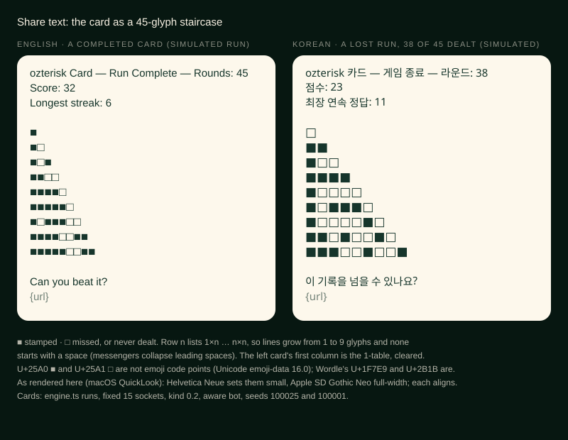
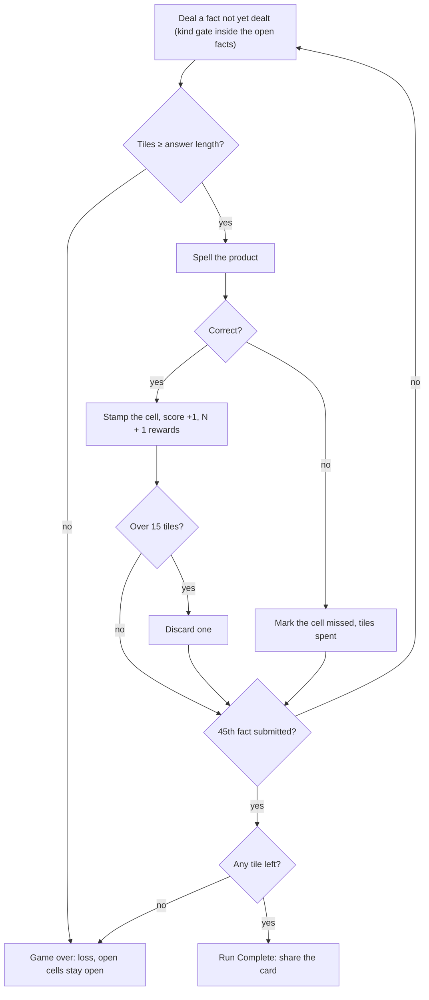
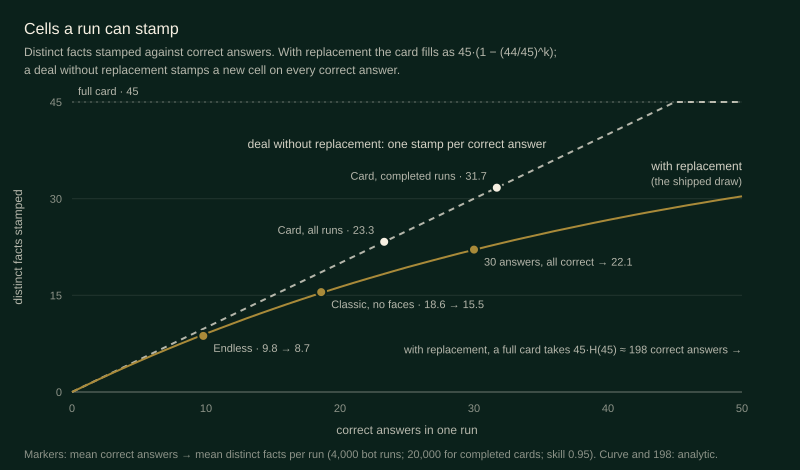

# 05 · Card · 카드

> **Status:** research draft — not canonical. Amends nothing in `docs/spec/`; on any conflict the spec wins.
> **Direction:** What if the run had a map to fill? · Opus research agent · 2026-10-17

Deal each of the 45 times-table facts exactly once, stamp every correct answer onto a visible card, and finish the deal with tiles in hand. The card you share is the run.

| | |
|---|---|
| Core verb | **Stamp**, and in the late deal, count what is left |
| Only this draft contributes | A run-level completion goal sized by coupon-collector math. The math forces a deal without replacement, which turns the card from a record into a forecast. Plus a 45-glyph share grid that uses no emoji |
| Nearest neighbour | **Classic.** Both are definite arcs, won by reaching the end with tiles in hand. Card adds no repeats, a visible map of the times table, an endgame forecast and a share grid. Its tray is a fixed 15-socket rack, and the new decision is small (+2.3 win points, §5) |
| Spec fit | Needs amendment: `product.md` §1.1, §1.2, §1.3, §1.8, §1.10; `ui-i18n.md` §1.12 (layout, rack), §1.14, §1.15. Rulings needed: §1.17 (late-deal skew from the kind gate); decisions.md "No emoji" (spirit) |
| Cliff verdict | b = 0.66 over submitted rounds (0.85 in the first nine facts, 0.47 in the last nine), at 15 fixed sockets and kind 0.2. The 45-fact deal ends every surviving run, so the 0.631 cliff sets the win rate (34% for the bot), not whether runs end |
| Build size | **M**: a third mode, a deal generator, a card component and a share format. No new tile kinds and no new keyframes |
| Mode select copy | **Card** — Every fact, once · **카드** — 모든 곱셈 한 번씩 |

## 1. Spec collisions

1. **`product.md` §1.2**: "the pair is drawn uniformly with replacement from the full pool … Immediate repetition is legal."
   - **Amendment:** Card draws from the facts not yet dealt this run, the kind gate filtering inside them. If the hand spells none, the draw is uniform over the undealt facts.
   - **Without it,** the direction collapses: with replacement a run stamps 9–16 of the 45 cells (§5).
2. **`product.md` §1.1, §1.3 and the §1.10 title**: "two modes", and a mode select of **Endless** or **Classic**.
   - **Amendment:** a third mode, with a new dial `CARD_CAPACITY = 15` and a 15-tile round-robin opening deal. AGENTS §4.5 allows adding dials; no existing dial changes.
3. **`product.md` §1.8 step 0** is Classic-only.
   - **Amendment:** in Card, advancing after the 45th submission enters `gameOver`. A non-empty hand wins, as at Classic's floor.
4. **`product.md` §1.17**: difficulty curves are "any weighting that adapts to player skill or escalates over a run".
   - No weighting is added, but a fixed kind gate in a finite deal pulls easy one-digit facts forward. A completed card's last nine facts hold 2.24 of them, not 2.60, and their mean answer length is 1.751, not 1.711. The skew grows with the kind rate (§5).
   - **Ruling needed.** The clean alternative is a mode-specific kind rate of 0 (2.50). It needs about 17 sockets for a comparable 40% win rate.
5. **Line rewards:** none. A table payout would meet §1.17, and also `decisions.md`'s reason for counting submissions: "Correct-answer-driven boards would mean the tray watches how well you are doing and moves accordingly." §5 shows payouts are inert anyway.
6. **`ui-i18n.md` §1.12 layout**: "HUD → equation/slots → phase action → rail → inventory".
   - **Amendment:** the card joins the HUD band.
     - In the mockup the band is about 226 px and the tray ends at 736 of 844, so a 64 px rail fits at 390 × 844.
     - The 320 px gate is unchecked.
   - **Rack:** Classic's 15-socket mid size (5 columns of 48 × 60) at every round, so there are never plugs.
   - **Motion:** cells change state by CSS transition, which AGENTS allows for functional state changes. A stamp keyframe would extend §1.12's inventory, so it is left out.
7. **`ui-i18n.md` §1.14–§1.15**: new copy keys and a Card share format. The grid keeps every §1.15 rule:
   - it is text only, with nothing in the URL;
   - it claims no verification;
   - it carries no deal order, so it is no seed.
8. **`decisions.md` § Content**: "No emoji, anywhere."
   - The grid's U+25A0 ■ and U+25A1 □ are absent from Unicode's emoji-data 16.0.
   - That file does list Wordle's U+1F7E9 and U+2B1B, and the wordmark's own U+2733 ✳, which defaults to text presentation.
   - The letter is kept; the spirit is Ori's call.
9. **No collision:**
   - **§1.12 semantic colour:** resting cells use gold and ink only, and shape carries state.
   - **§1.10:** "Print the product on the board. `gameOver` is the only phase that does." Cells carry marks, never products, which would make a cheat sheet.
   - **Persistence and history:** the card ends with its run.

## 2. The mode

A delta against Endless:

- **Setup.** The title gains **Card**: 15 fixed sockets, a 15-tile round-robin opening hand (`0–9`, then `0–4`), digits only, and 45 open cells.
- **Deal.** Equations come from the open facts, under the shipped `KIND_EQUATION_RATE` gate, in random display order. Each fact is dealt once per run. The card shows which facts remain, never their order: partial information, not Puzzle's perfect information.
- **Answering, outcomes and overflow** are unchanged (§1.4–§1.7). At a fixed capacity of 15, overflow is always one tile.
- **Marks.**
  - A correct answer **stamps** the fact's cell.
  - An incorrect answer marks it **missed**, because the fact never returns. A deliberate miss, the priced discard, now also costs a cell.
  - On a loss, the terminal and undealt facts stay **open**.
  - A fully stamped **table** (all nine facts sharing an operand: the hook through k × k) takes a hairline gold rule. This is cosmetic only.
- **End.** After the 45th submission: **Run Complete** with tiles in hand, a loss without. Before that, the §1.8 loss applies.
- **Score.** §1.5 is unchanged, and with each fact dealt once, score equals stamps.
  - The HUD keeps Round *n* / 45, Score and Streak in order and emphasis, with the card beside them.
  - `gameOver` shows the card at full size and names any cleared tables.
- **Layout.** The card is the lower-left triangle of the 9 × 9 table: column *a*, row *b*, one cell for each *a* ≤ *b*. Rows grow from 1 cell to 9.
- **Share.**
  - The first line is `ozterisk Card — Run Complete — Rounds: {totalRounds}`, or `Game Over` on a loss. In Korean it is `ozterisk 카드 — 완주 — 라운드: …`, or `게임 종료`.
  - The Score and Longest streak lines are unchanged.
  - Then come nine lines of ■ (stamped) and □ (missed or never dealt), shaped like the card, with no leading spaces (messengers collapse them).
- **Keyboard.** Unchanged. Nothing on the card is selectable, so it never chooses an equation (Market's axis).

## 3. The loop

## 4. The decision it creates

**What is left.** A deal without replacement is a countable deck, and the card keeps the count.

- **Before the deal**, digit demand is already skewed. A 0 appears in four products (10, 20, 30, 40), 7 and 9 in three each, and 1, 2 and 4 in 12–13 each. A player who learns this keeps 2s and sheds 9s.
- **During the deal**, the card adds what changes. Once 2 × 5, 4 × 5, 5 × 6 and 5 × 8 are gone, every 0 in the tray is dead, and the card shows it without arithmetic. Late in the deal the discard becomes "which of these thirteen facts can I afford to miss?"
- **This is card counting:** tracking what was dealt to read what remains (Thorp [7]). Mahjong's version is *kabe*, which reads tile depletion to find safe discards [8].

**How the run ends.** Classic shows how many sockets remain; Card shows *which facts* remain, a countdown that never moves the felt.

**The macro-goal:**
1. finish the deal;
2. stamp as many cells as you can;
3. clear a table, which 14% of runs do. No perfect card occurred in 4,000 bot runs.

**Precedents** (each opened):

- **Bingo calls without replacement.**
  - The BINGO Paradox reasons that after the first number, "60 of the remaining 74 numbers will produce a new letter" [2].
  - The 90-ball game pays a line, two lines and a full house [3].
  - Card keeps the progression, not the payouts (§5).
- **Panini albums show the collector's tail** [4]: a lone buyer needs 931 packets on average, a quarter of them for the last 3 of 660 stickers. With replacement, ozterisk's last 10 facts take 131.8 of 197.8 expected answers.
- **Wordle's grid made a result shareable without spoiling it.** Wardle adopted it after seeing players' emoji grids [5]. Card's grid is the run's map, with no numbers on it.
- **Speedrun bingo** offers a line, a blackout (the full board) or a lockout [6]. A table is Card's line and Run Complete its blackout, but nothing on the card is ever chosen.
- **Times Tables Rock Stars' heatmap** is a fact grid that stays grey until a fact is answered [9]. It is the visual precedent for an open cell; its purpose, fluency, is Dojo's.
- **Nonograms** fill a grid by deduction from clues [10]. Card's cells are dealt, not deduced. Not adopted.

## 5. Economy

**Where it sits.**
- **Instrument:** `engine.ts`, aware bot, fixed 15, kind 0.2, 4,000 runs.
- Over submitted rounds b = 0.66, above the 0.631 cliff, and it falls with deal position.
- Later columns count only surviving runs, so they mix survivorship with the hand's decay.

| Facts 1–9 | 10–18 | 19–27 | 28–36 | 37–45 |
|---|---|---|---|---|
| 0.85 | 0.68 | 0.61 | 0.57 | 0.47 |

As in Classic, runs open above the cliff and close below it.

**Instruments.**

- **`harness.ts`** steps the real `gameReducer` with the real `createInitialInventory`, `canConstruct`, `generateKindEquation` and `generateRewardTiles`.
  - The deal and the stop at 45 sit outside the reducer, because `NEXT_ROUND` takes its equation as input.
  - It also runs Classic's schedule with digit-only rewards.
- **`engine.ts`** re-implements the loop on digit counts, for capacities and line rewards the reducer cannot express.
- **Bots.** All answer correctly with probability 0.95 when they can. They differ in what a discard or a miss gives up:
  - *naive*: the most-duplicated digits (the journal's T84 bot);
  - *blind*: whatever keeps the most of all 45 facts spellable;
  - *aware*: whatever keeps the most open facts spellable;
  - *scrambled*: aware, but fed a randomly relabelled card.

**Calibration.**

- The deal generator reproduces `generateKindEquation` run for run on the same seeds.
- An unbiased deal at capacity 10 gives b = 0.479 over 300 runs (spec: 0.48), and the analytic drift(0.48) is −0.410 (spec: −0.41).
- Engine against the real reducer, same bot and seeds, 4,000 runs each:
  - Endless: 16.3 against 16.2 rounds, b 0.540 against 0.542.
  - The deal: 18.5 against 18.5 rounds.
  - Faceless Classic: 41.3% ± 1.5 against 40.9% ± 1.5 wins.
- On faceless Classic the journal's bot wins 33.0%, decisions.md records 47% for the M6 handoff's bot, and my blind bot wins 50.2%. Bots differ by up to 17 points on identical rules: compare variants, not players.

**Negative controls.**

- Always-miss on the real reducer dies in 6.0 rounds (p10 5, p90 7; 300 runs) and never wins.
- Skill 0 never wins.
- The scrambled card does worse than blind (30.1% against 32.1%): information that is noise should cost, not help.

**A. With replacement, a run stamps 9–16 cells** (real reducer, 4,000 runs):

| Run (shipped draw) | Correct | Distinct cells (p10–p90) | ≥ 1 table complete |
|---|---|---|---|
| Endless, blind bot | 9.8 | 8.7 (4–15) | 0.3% |
| Classic schedule, no faces, blind bot | 18.6 | 15.5 (12–19) | 0.1% |
| Any 30 answers, all correct (analytic) | 30 | 22.1 | — |

Filling the card takes 45 · H(45) = 197.8 correct answers. That rules out whole tables, the full card, and any reward on them: over 4,000 Endless runs a table reward paid out 0.00 times per run.

**B. The tray for a deal of 45** (engine, aware bot, 3,000–4,000 runs; a win is all 45 dealt with tiles left):

| Tray | Kind 0 | Kind 0.2 |
|---|---|---|
| Fixed 10 (Endless) | 0.1% | 0.6% (real reducer: 0.4%) |
| Fixed 13 | 2.2% | 11.9% |
| Fixed 15 (Classic's mid rack) | 14.9% | **35.1%** |
| Fixed 16 | 25.3% | 45.9% |
| Fixed 17 | 40.0% | 61.2% |
| 20 → 5, one seal per 3 submissions | 3.6% | 8.1% |

Ten sockets die about 27 facts short. Fifteen, the smallest tray with an existing clean layout, is harder than faceless Classic (blind bot: 32.1% against 50.2%).

**C. What the card's information is worth** (engine, fixed 15, kind 0.2, 20,000 runs per bot on the same seeds):

| Bot | Win | Stamps, all runs (p10–p90) | Stamps, completed cards |
|---|---|---|---|
| naive | 26.1% | 21.6 (10–33) | 32.0 |
| blind | 32.1% | 22.9 (12–33) | 31.8 |
| scrambled | 30.1% | 22.7 (12–33) | 31.9 |
| **aware** | **34.4% ± 0.7** | 23.2 (12–33) | 31.7 |

- **Paired on the same seeds,** aware beats blind by **+2.27 ± 0.31 win points** and +0.26 ± 0.03 stamps.
- **Static digit demand** (naive → blind) is worth about +6 points.
- **The forecast is real but small.** It works where runs end: 40% of losses fall in the last nine facts.
- **On Endless's chassis,** aware, blind and scrambled tie within noise, because runs end before the forecast sharpens.

**D. Line rewards are inert by construction.** The last of *k* given facts arrives on average at deal position *k* · 46 / (*k* + 1): **41.4 of 45** for a table, so a payout lands about four facts from the end. Measured (fixed 15, kind 0.2, 4,000 runs):

| A completed table pays | Win | Effective b | Payouts per run |
|---|---|---|---|
| nothing | 35.1% | 0.663 | — |
| a socket | 35.2% | 0.663 | 0.18 |
| a wildcard | 36.3% | 0.667 | 0.20 |
| a tile | 35.6% | 0.663 | 0.18 |

Rewarding the 3 × 3 blocks instead pays 0.23–0.25 times per run, for at most +1.7 points. No reward moves the cliff, so the honest answer is a stamp only.

**E. The kind lever and its cost** (fixed 15, aware bot, 4,000 runs):

| Kind rate | 0 | 0.1 | 0.2 | 0.3 | 0.4 |
|---|---|---|---|---|---|
| Win | 14.9% | 22.1% | 35.1% | 46.9% | 58.7% |
| One-digit facts in the last nine (uniform: 2.60) | 2.50 | 2.35 | 2.24 | 2.12 | 2.04 |

**Run length** (derived): decisions.md puts 30 submissions at about 6.5 minutes. A completed card (45 submissions) then takes about 9.75 minutes, and the mean run (36.8) about 8.

## 6. Smallest playable slice

Deal, card, end at 45 and share grid; table rules and motion later.

- **Reuse:**
  - `createInitialInventory(ids, 15)` and `canConstruct`;
  - from `generateKindEquation`: `orientPair`, `sampleBinIndex` and the empty-subset fallback, by making its pool a parameter;
  - Classic's mid rack in `TileInventory`;
  - `isAtClassicFloor` and `isClassicWin`, generalized into run-end selectors now that two modes end at a count;
  - `shareResult` and `copyResult`, unchanged.
- **Add:**
  - `"card"` in `GameMode`;
  - `card: ("open" | "stamped" | "missed")[]` in `GameState`, indexed in `EQUATION_PAIRS` order and written by both `SUBMIT_*` actions;
  - `CARD_CAPACITY`;
  - the step-0 check in `NEXT_ROUND`;
  - a `TimesCard` grid with an accessible name ("23 stamped, 9 missed, 13 to come"), plus a `<table>` at `gameOver`;
  - the share format;
  - `en` and `ko` keys.
- **Tests:**
  - a deal of 45 holds each fact once;
  - the marks;
  - the end at 45, including the empty-hand loss;
  - both share texts;
  - the new dial's economy note in `balance.test.ts`.

## 7. Biggest risk — and the playtest that would kill it

**The card may be a scoreboard, not a mechanic.** Its information is worth 2.3 points to a greedy bot. If people ignore it too, Card is Classic with a prettier result and a longer run: 8–10 minutes, against Classic's 6.5, which are already flagged as long.

**Kill test:** five players, three runs each, thinking aloud.
- **Fewer than one late-deal discard in three refers to an open fact** ("no 0s left to need"): the card is decoration. Drop the mode, and keep the grid as an Endless and Classic share format, where it would show a sparse 9–16 stamps.
- **Players quit before the deal ends:** first test a 36-fact card, with the ×1 facts pre-stamped like bingo's free space. That variant is untested and changes §1.2's pool.

## 8. Open questions for Ori

1. May a mode deal without replacement, as a per-mode amendment to §1.2?
2. Which win-rate lever?
   - 15 sockets: 35% for the bot, on an existing layout.
   - 16 sockets: 46%, but a new rack layout.
   - A mode-specific kind rate of 0.3: 47%, with more late skew.
3. Do ■ and □ keep the spirit of "No emoji, anywhere"? In this render Helvetica Neue draws them small and Apple SD Gothic Neo full-width; other platforms are unverified.
4. Should cleared tables appear in the share text?
5. Is a roughly 10-minute completed card acceptable for a third mode?
6. Layout is unverified at the 320 px gate and at the 548 px discard-scroll viewport (§1.12). Should it be checked before building?

## Sources

1. Coupon collector's problem, E(T) = n·H_n — https://en.wikipedia.org/wiki/Coupon_collector%27s_problem
2. Benjamin, Kisenwether and Weiss, "The BINGO Paradox", *Math Horizons* 25(1), 2017 — https://math.hmc.edu/wp-content/uploads/sites/5/2019/06/The-BINGO-Paradox.pdf
3. Bingo (British version): line, two lines, full house — https://en.wikipedia.org/wiki/Bingo_(British_version)
4. Sardy and Velenik, "Paninimania: sticker rarity and cost-effective strategy" — https://www.unige.ch/~velenik/Vulg/Paninimania.pdf
5. Wordle, the share grid's origin — https://en.wikipedia.org/wiki/Wordle
6. Bingosync, "About": line, blackout, lockout — https://bingosync.com/about
7. Card counting (Thorp, *Beat the Dealer*) — https://en.wikipedia.org/wiki/Card_counting
8. Kabe, which "relies on tile depletion" — https://themahjong.com/blog/mahjong-defense-fundamentals
9. Times Tables Rock Stars, heatmaps — https://intercom.help/times-tables-rock-stars/en/articles/3871753-heatmaps-heat-maps-ttrs
10. Nonogram — https://en.wikipedia.org/wiki/Nonogram
11. Unicode emoji-data 16.0 (checked U+25A0, U+25A1, U+2733, U+1F7E9, U+2B1B) — https://www.unicode.org/Public/16.0.0/ucd/emoji/emoji-data.txt

**Repo files:**
- `docs/spec/product.md` §1.1–§1.10, §1.17
- `docs/spec/ui-i18n.md` §1.12, §1.14, §1.15
- `docs/superpowers/specs/2026-08-09-endless-mode-polish-design.md` §1.1–§1.2
- `docs/design-system/decisions.md` (§ Content; the Classic sections)
- `docs/journal/journal-2026-09-27.md` (T84)
- `src/game/balance.ts`, `selectors.ts`, `generators.ts`, `gameReducer.ts`, `factories.ts`
- `src/services/sharing.ts`

**Sim files** ([`sims/`](sims/); outputs in `out-*.txt`): `analytic.ts`, `common.ts`, `harness.ts`, `engine.ts`, `runs.ts`, `engine-runs.ts`, `engine-runs2.ts`, `cal-classic.ts`, `final-runs.ts`, `lever.ts`, `tableA.ts`, `markers.ts`, `examples.ts`.
