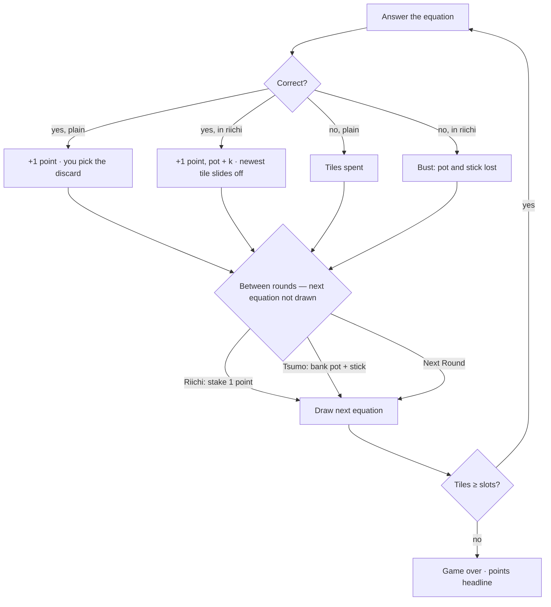
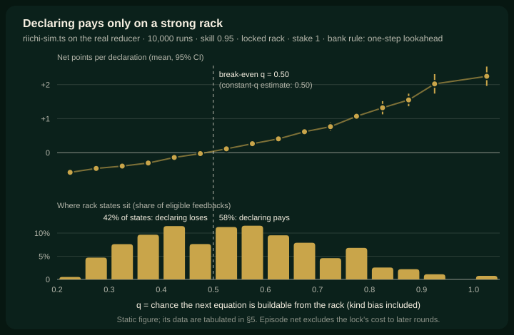

# 06 · Riichi · 리치

> **Status:** research draft — not canonical. Amends nothing in `docs/spec/`; on any conflict the spec wins.
> **Direction:** what if the player could bet on themselves? · Opus research agent · 2026-10-17

Endless, plus one call between rounds: stake a point, lock your rack, and bank an escalating pot before your hand decays — or lose it on a miss.

| | |
|---|---|
| Core verb | **Declare** — stake a point and lock the rack; then ride or call |
| Only this draft contributes | A risk decision shown live by EV. Declaring pays above q ≈ 0.50 (the chance the next equation is buildable), and 58% of rack states sit there. A rack-reading policy beats both NEVER (+1.7 ± 0.2 points/run) and best-ALWAYS (+1.41 ± 0.07) |
| Nearest neighbour | **Endless** — its streak is passive; here the streak is declared, staked and banked. Tile rules are Endless's, except the riichi lock |
| Spec fit | Needs amendment: `product.md` §1.5 + §1.9 (a points figure), §1.7 (locked overflow), §1.10 (HUD, title), §1.11 (one key); `ui-i18n.md` §1.14–1.15 (copy, share). §1.17 checked, untouched |
| Cliff verdict | Measured b′ 0.552 with the best policy, against Endless's 0.567 and the 0.631 cliff. The lock can only lower it; a bet paid in tiles would push it to 0.625 |
| Build size | M — no new phase; 3 state fields, 2 actions, one reducer branch, a stick strip, HUD/share copy in en + ko |
| Mode select copy | **Riichi** — Bet on your tiles · **리치** — 내 타일에 걸기 |

## 1. Spec collisions

- **`product.md` §1.5:** "The score is the number of correct submissions, not a product-, speed-, streak-, or difficulty-weighted value." Riichi leaves `score` as defined. It adds **points**, weighted by a declared streak, and makes points the headline.
  - **Amendment:** a §1.5b "Riichi points", plus one line in §1.5: "In Riichi the headline is points; `score` keeps this definition."
  - **Argument:** the clause guards against the game inflating the number by things the player does not choose. Riichi's weighting is chosen, staked and losable. A player who never declares has points equal to score in every run, and the sim checks that identity (2,000 of 2,000 runs).
  - **Does the draft work without it? No, and that is a finding.** The tile-paid bet tested in §5 is degenerate: every declaring policy loses rounds. The capacity ceiling explains why: a tile prize is capped, because extra tiles at capacity become discards, while a tile stake is not.
- **§1.9:** add `points`, `riichi: null | { answers, pot }` and `bestTsumo`.
- **§1.7:** "The player may mark any owned tile", and "there is no Next Round after a discard". In riichi, a correct answer that overflows drops the newest arrival (the rail tile) in the same transition. There is no overflow phase, and feedback waits for Next Round or Tsumo. Outside riichi, §1.7 stands. The Riichi control is also offered during overflow, before the final mark.
- **§1.10:** the HUD becomes round, **points**, streak, with points carrying primary emphasis. While riichi is open, a stick strip sits between the HUD and the equation. Game over shows points, rounds, longest streak and best tsumo. The title gains a third mode, and **More** explains riichi in rules text — not a tutorial, which AGENTS.md bans.
- **§1.11:** one key for the riichi control in feedback and overflow, accepted by value or by physical position, as `R` is. Proposed: `D`. Not `R`: a stray `R` after a run-ending miss would restart and destroy the result screen, the failure §1.11 records.
- **`ui-i18n.md` §1.14–1.15:** new keys (`mode.riichi`, `mode.riichiHint`, `action.riichi` / 리치, `action.tsumo` / 쯔모, `hud.points` / 포인트, a bust line). The share heading follows Classic's pattern: `ozterisk Riichi — Points: {points}`, then `Rounds: {totalRounds}` and `Best tsumo: {bestTsumo}` (`ozterisk 리치 — 포인트: …`, `최고 쯔모: …`). Nothing is encoded in the URL.
- **§1.12 motion and the felt rule:**
  - The locked discard reuses `8c` (`oz-slide-off`), the shipped discard exit.
  - Placing the stick, the pot changing, and a bust are functional state changes, so CSS transitions cover them.
  - A theatrical bank or bust moment would amend §1.12 first.
  - The stick is an object on the table, like the wind tile; the felt never reacts.
- **Checked, no amendment (Ori should still rule):**
  - **§1.17 difficulty curves.** Equations and rewards are drawn exactly as in Endless, the kind rate is fixed, and nothing adapts to skill. The pot escalates inside a bet the player opened, not over the run.
  - **Skip / manual discard during answering.** Riichi controls exist only between rounds, and no equation is ever skipped. The stake is a point, not a tile, because a tile stake would be a second, separately priced manual discard.
  - **Other lines.** No timers and no multiple attempts. Nothing persists, and no seed is shown; the sim's seeds are instrument-only.

## 2. The mode

The delta against Endless:

- **Setup.** Endless exactly: capacity 10, the one-of-each deal, the 20% kind bias, digit tiles only. New state: `points = 0`, `riichi = null`, `bestTsumo = 0`.
- **Plain point.** Every correct answer scores **+1 point** (and +1 `score`), in or out of riichi. The plain point is never at risk.
- **Riichi (declare).** Between rounds, in feedback (or in overflow before the final mark), when not in riichi, with points ≥ 1 and at least 2 tiles: pay **1 point**. The stick goes on the table. The next equation has not been drawn yet, so the call is blind.
- **In riichi.**
  - The *k*-th correct answer adds *k* to the pot (1, 3, 6, 10 …), on top of the plain point.
  - The rack is locked: an overflowing correct answer drops its newest arrival (tsumogiri), and the player marks nothing.
- **Bust.** A miss in riichi loses the pot and the stick, and riichi ends. Tiles and streak follow Endless.
- **Tsumo (bank).** Between rounds, in riichi: points += pot + 1 (the stick returns), `bestTsumo = max(bestTsumo, pot)`, and riichi ends. Riichi cannot be re-declared in the same feedback. Re-entering costs a new stick and at least one plain round — the price of banking.
- **End.** As Endless. A run cannot end right after a correct answer, because net +1 leaves at least N + 1 ≥ 2 tiles. Declaring needs 2 tiles, so a pot or stick is never stranded at game over. The sim asserts this; only its zero-rewards control trips it.
- **Points** = correct answers + banked pots − lost sticks. Never declaring gives points = score.
- **Reducer.** No new phase. `DECLARE_RIICHI` and `CALL_TSUMO` are pure and need no randomness. `SUBMIT_CORRECT` in riichi resolves its own overflow deterministically.
- **Dials (`balance.ts`).**
  - `RIICHI_STAKE = 1`. This is the sensitive dial: at 2 the decision collapses (§5).
  - `RIICHI_LOCK = true`. With it off, a riichi overflow is an ordinary player discard, which auto-advances, so Tsumo must also be offered during overflow, before the final mark.
  - No pot cap: caps from 3 to 99 measured identical.

## 3. The loop

## 4. The decision it creates

There are two calls, both made before the draw. **Declare:** is my rack strong enough? **Ride or call:** is it still? The first is live at every skill tested. The second is live for strong arithmetic; for weaker players it collapses to "call after one" (§5). Endless's streak happens to you; this one you call, and the locked rack sheds tiles you would have kept while you ride.

**The skill is reading coverage.** That means knowing the times table's digit economy:
- 1, 2 and 4 each appear in 12–13 of the 45 products; 7 and 9 in only 3.
- So two 8-digit racks are not equal. Missing 7 and 9, a rack spells 39 of 45; missing 1 and 2, it spells 23.
- In the mockup, the lock has just thrown away the 4. Had it stayed, the rack would spell 36 of 45 (q = 0.84). Without it, the rack spells 25 (q = 0.644).
- Riding there risks 7 (pot plus stick) to win 4. That is +0.08 with perfect arithmetic and −0.27 with one slip in twenty: a real call.

Precedents, each opened:

- **Riichi mahjong.**
  - A closed, one-tile-from-winning hand may declare. The player "places a 1,000-point stick on the table, as a deposit", and afterwards "any tile they draw must be automatically discarded if it does not give them a winning hand" [1].
  - The deposit is "collected by the next winning player" [3].
  - From this come the stick (1 point), tsumogiri (the locked overflow) and the name.
  - Ippatsu and double riichi [1] were cut: a PoC does not need a second bonus.
- **Blackjack's double down:** "Increase the initial bet by 100% and take exactly one more card", with the card turned sideways [8]. A declared stake bought by giving up options.
- **Can't Stop:**
  - Busting loses the turn's progress [4].
  - Keller's "Rule of 28" is a simple stopping heuristic, "not flawless" [5]. This draft's human rule ("8 different digits; call at 6") is its analogue.
- **Incan Gold / Diamant:** you leave "before the next card is revealed", and a second hazard makes everyone still inside "drop all the gems they've collected that round" [6][7]. Hence: call before the draw.
- **Pig:** Knizia's "jeopardy dice games". Optimal play depends on the game state, yet hold-at-20 gives up only 8% against optimal play [10]. Simple heuristics keep most of the value, which is what §5 finds for humans.
- **Balatro:** skipping a blind trades the sure reward for a tag [9] — voluntary upside, taken here. Its rising blinds are an escalating curve §1.17 forbids, not taken.
- **Design writing:** push-your-luck needs "a valid risk and a worthy reward" [11]. The tile variant fails *worthy reward*, because the ceiling eats it. The replace variant fails *valid risk*, because the risk dwarfs the reward.

## 5. Economy

**The cliff comes first.** Points never touch tiles. Only the lock changes the tile game, and it removes a discard choice, so it can only lower b′. Measured b′: Endless 0.567, best riichi play 0.552, cliff 0.631. Runs end as Endless's do, about 0.9 rounds sooner (−5%). Paying the bet in tiles instead raises b′ to 0.625–0.630, close enough to brush the cliff, while *shortening* runs.

**Analytic estimate.** Hold q constant, with stake 1 and pot +k; this ignores rack decay and the lock. The side bet breaks even at **q = 0.50**. If the pot *replaced* the plain point instead, break-even would be 0.713. A pot that never grows is never worth declaring.

**Instrument and conditions.** `riichi-sim.ts` (session scratchpad, not committed) steps the real `gameReducer`, `generateKindEquation`, `generateRewardTiles` and `canConstruct` in Endless mode. Every policy shares the same mulberry32 seeds, so the comparisons are paired.

The bot:
- answers correctly with probability *skill* (0.95, or 0.85) when the answer is buildable;
- otherwise, spends the tiles whose loss costs the least coverage;
- discards the same way outside riichi;
- makes riichi calls between rounds, blind to the next equation, from the rack's exact q = 0.2 + 0.8·c/45 (c = buildable pairs).

Each sweep tested 69 policies:
- NEVER;
- 11 ALWAYS variants, each with its own bank rule;
- 32 THRESH (declare if q ≥ θ; bank by one-step lookahead);
- 25 HUMAN (declare at ≥ *d* distinct digits; call at pot *P*).

The chosen policies were re-run on **fresh seeds**, so picking the best of 69 cannot flatter them. Bots are not players: compare rows, not absolutes.

**Calibration.**
- b(10) = 0.4772, both by `canConstruct` and by digit mask, against the repo's 0.4797.
- Miss cost 1.7111, cliff 0.6311, drift at b = 0.48 of −0.410.
- NEVER reproduces Endless: points equal score in 2,000 of 2,000 runs.

**Negative controls.**
- **Zero rewards** end every run by round 9 (bound 10).
- **A pot that never grows** (cap 0) makes NEVER best, and ALWAYS loses 5.8.
- **Rack-blind RANDOM** declaring at the best policy's 30% rate gains +0.2, against +1.7.
- **The first control failed, which is why there are three.** An always-miss bot outlived its bound, first through a bot bug, then for a real reason: the kind bias makes some correct answers unavoidable.

**Results.** Fresh seeds; 10,000 paired runs; stake 1, uncapped, rack locked.

| Policy | Skill 0.95: points | Δ vs NEVER | Rounds | Declines | Skill 0.85: Δ vs NEVER |
|---|---|---|---|---|---|
| NEVER (= Endless) | 10.1 ± 0.1 | — | 18.8 | 100% | — (7.9 ± 0.1) |
| ALWAYS, best bank rule | 10.4 ± 0.2 | +0.3 ± 0.2 | 17.8 | 0% | **−1.2 ± 0.1** |
| THRESH q ≥ 0.55 | **11.9 ± 0.2** | **+1.7 ± 0.2** | 17.9 | 70% | +0.4 ± 0.1 |
| THRESH q ≥ 0.65 | 11.6 ± 0.2 | +1.5 ± 0.1 | 18.0 | 85% | **+0.5 ± 0.1** |
| HUMAN: ≥ 8 digits, call at 6 | 11.2 ± 0.2 | +1.1 ± 0.1 | 18.0 | 86% | +0.4 ± 0.1 |
| RANDOM 30%, rack-blind | 10.3 ± 0.2 | +0.2 ± 0.1 | 18.2 | 70% | −0.5 ± 0.1 |

The paired gap over ALWAYS is THRESH − ALWAYS = **+1.41 ± 0.07** at skill 0.95 and +1.58 ± 0.05 at 0.85.

The figure's data, as a table (q bins of 0.05; ALWAYS samples every bin; states measured under NEVER):

| q | .20 | .25 | .30 | .35 | .40 | .45 | .50 | .55 | .60 | .65 | .70 | .75 | .80 | .85 | .90 | 1.0 |
|---|---|---|---|---|---|---|---|---|---|---|---|---|---|---|---|---|
| Net / declaration | −.58 | −.46 | −.40 | −.30 | −.14 | −.03 | +.11 | +.26 | +.41 | +.62 | +.76 | +1.07 | +1.32 | +1.55 | +2.02 | +2.25 |
| Share of states | .5% | 4.7% | 7.6% | 9.6% | 11.5% | 7.6% | 11.3% | 11.6% | 9.5% | 7.9% | 4.6% | 6.8% | 2.6% | 2.2% | 1.1% | .8% |

**Is the call live too?** The declare rule is held at THRESH q ≥ 0.55 and the bank rule varied, on fresh seeds over 10,000 paired runs. The table gives how far one-step lookahead is ahead of each fixed rule:

| Bank rule | Skill 0.95 | Skill 0.85 |
|---|---|---|
| Call after 1 answer | +0.77 ± 0.12 | 0.00 ± 0.09 (tie) |
| Call after 3 answers | +0.77 ± 0.10 | +0.58 ± 0.07 |
| Never call (ride to bust) | +5.80 ± 0.14 | +3.85 ± 0.10 |

**Variants (2,000 paired runs).**

| Variant | Result |
|---|---|
| Pot *replaces* the plain point | NEVER best at both skills and at caps 8 and 99; best ALWAYS −5.5 ± 0.3 |
| Bet paid in tiles (+2 net if right, one extra tile lost if wrong; rounds as the objective) | Every declaring policy loses rounds; ALWAYS −3.2 ± 0.5. b′ climbs to 0.625 |
| No lock (fresh seeds) | THRESH +3.4 ± 0.2, ALWAYS +2.1 ± 0.2, gap +1.31 ± 0.05; rounds unchanged |
| Pot cap 1 / 3–99 | Best +0.8 / +1.7 (caps 3–99 identical: episodes rarely pass 3–4 answers; mean banked pot 3.8) |
| Stake 2 | Best +0.1 ± 0.1 at every cap: the decision collapses to "never" |

**Pre-registered liveness criteria.** These were written before the first result, then amended once, before running the side-bet framing:
- **L1 — beats NEVER and ALWAYS, both skills:** passes.
- **L2 — declines ≥ 25% of eligible calls:** passes (68–86%).
- **L3 — ≥ 25% of declarations after round 10:** borderline. 25% at skill 0.95, **18% at 0.85**. Riichi is a first-half verb, because Endless racks decay; the declare rate does track the rack (0–3% at ≤ 5 digits, 68% at 7, 100% at ≥ 8).
- **L4 — robust across the pot cap:** passes. **It is knife-edge on the stake.**

**What it means.**
- The decision is live and learnable. The break-even falls inside the distribution of rack states, the careless gambler earns +0.3 at best and loses 1.2 at skill 0.85, and a rule a person can count captures 65–80% of the gain.
- The prize is modest: +17% points at skill 0.95, +6% at 0.85.
- The lock halves riichi's value and front-loads it. In exchange, it makes reading matter: without it, even ALWAYS profits.

## 6. Smallest playable slice

- **Mode.** `GameMode` gains `"riichi"`, playing Endless's rules. `getCapacity` returns `INVENTORY_CAPACITY`. `generateRewardTiles` and the `SUBMIT_CORRECT` face guard already treat every non-Classic mode as digits-only.
- **State.** `points`, `riichi`, `bestTsumo`.
- **Actions.** `DECLARE_RIICHI` and `CALL_TSUMO`. One `SUBMIT_CORRECT` branch, in riichi: score the pot; on overflow, drop the rail tile and enter `feedback`.
- **UI.**
  - One stick-strip component.
  - The control in `feedback` and `overflow`.
  - HUD points.
  - `formatShareText` heading and lines, plus copy keys in en and ko.
- **Tests.** Reducer transitions (declare, bust, tsumo, locked overflow, the never-stranded edge), and a `balance.test.ts` guard asserting that the analytic break-even stays near 0.50 for `RIICHI_STAKE`.
- **Reused unchanged:** `canConstruct`, `generateKindEquation`, `sortTiles`, `createInitialInventory`, the `8c` exit.

## 7. Biggest risk — and the playtest that would kill it

**The risk: people cannot read q.** The bot sees the exact coverage; a player sees ten tiles. If players cannot tell a 25-of-45 rack from a 39-of-45 one, declaring is a slot machine. Rack-blind declaring earns +0.2 against +1.7, and +17% may not be felt at all.

**The playtest.** Six to eight players, three runs each. Silently log q at every eligible call; it is never shown.

**Drop the direction if any of these holds:**
- Mean q when players declare is within 0.05 of mean q when they decline, so declarations are rack-blind.
- Most players stop declaring after two busts, so the mode collapses to "never".
- Players cannot say why they called.

## 8. Open questions for Ori

1. **Lock or no lock?** The lock is riichi's identity, and it makes careless declaring unprofitable. It also costs about 5% of run length, halves the bet's value and front-loads it.
2. **Points as this mode's headline** — is the §1.5 amendment acceptable, given that no tile-paid version is live?
3. **Show the rack's reach, as a waits count?** It would make the read learnable. It sits close to the ruled-out constructibility warning, and it would remove the skill.
4. **Stake 1 is a knife-edge.** Should `balance.test.ts` guard it?
5. **Key choice** (`D`?) for the control.
6. **Riichi in Classic too?** Its generous opening would front-load it even harder.

## Sources

1. https://en.wikipedia.org/wiki/Japanese_mahjong_yaku — riichi deposit and auto-discard; double riichi; ippatsu
2. https://en.wikipedia.org/wiki/Japanese_mahjong — "the hand is then fixed and may not be changed"
3. https://www.ymimports.com/pages/how-to-play-japanese-riichi-mahjong — deposits collected by the next winner
4. https://en.wikipedia.org/wiki/Can%27t_Stop_(board_game) — bust loses the turn's progress
5. https://en.doc.boardgamearena.com/Tips_cantstop — Rule of 28 (Michael Keller, 1986)
6. https://en.wikipedia.org/wiki/Incan_Gold — designers, push-on or run-out framing
7. https://www.meeplemountain.com/boardgame/incan-gold-diamant/ — leave before the next card; second hazard drops the haul
8. https://en.wikipedia.org/wiki/Blackjack — double down
9. https://en.wikipedia.org/wiki/Balatro — blinds, antes, skipping for a tag
10. https://en.wikipedia.org/wiki/Pig_(dice_game) — jeopardy dice games; Neller & Presser; hold at 20/25
11. https://islaythedragon.com/guides/a-guide-to-pressing-your-luck — Wolfie, 2013

**Not openable** (claims above do not rest on them): riichi.wiki (403), the EMA 2016 rules PDF and the Diamant rulebook PDF (binary), mahjongo.com (410).

**Repo files:** `docs/spec/product.md` §1.5, 1.7, 1.9–1.11, 1.17; `docs/spec/ui-i18n.md` §1.12, 1.14–1.15; `docs/superpowers/specs/2026-08-09-endless-mode-polish-design.md` §1–2; `docs/design-system/decisions.md` (Classic; felt rule); `src/game/{balance,types,selectors,generators,gameReducer,factories}.ts`; `src/services/sharing.ts`; `docs/journal/journal-2026-09-27.md`.
