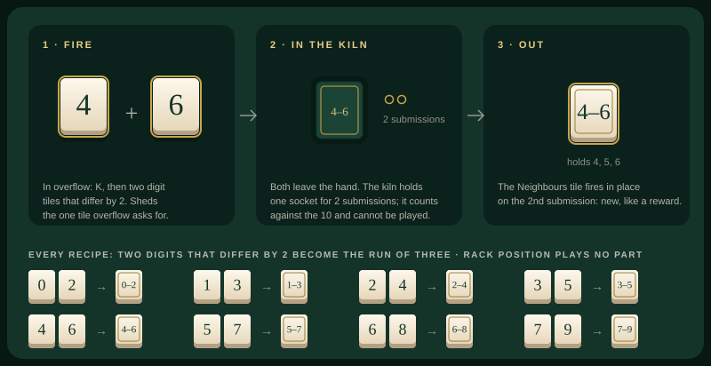
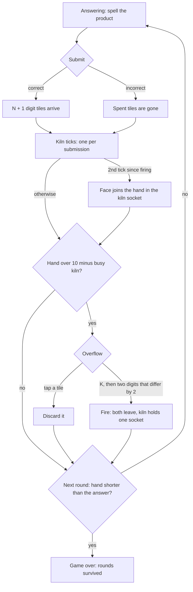
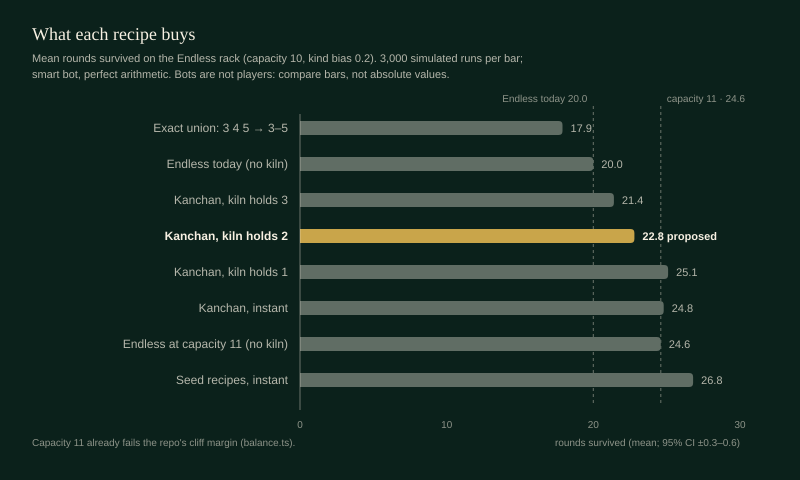

# 07 · Kiln · 가마

> **Status:** research draft — not canonical. Amends nothing in `docs/spec/`; on any conflict the spec wins.
> **Direction:** What if tiles could be combined? · Opus research agent · 2026-10-17

Endless's ten-socket rack with one kiln: when the rack overflows, instead of breaking a tile you may fire two digits that differ by 2 — a 4 and a 6 — into the Neighbours tile `4–6`, which comes out of the kiln two submissions later.

| | |
|---|---|
| Core verb | **Fire**: at overflow, two digit tiles that differ by 2 become the Neighbours tile through them; the kiln invents the middle digit |
| Only this draft contributes | The transformation economy. Compressing single-use tiles is a trap, free invention breaks Classic, and one invented digit priced by a positional two-submission hold lands between. The hold is a reusable pricing device. |
| Nearest neighbour | **Endless** — adds a second answer to overflow (make instead of break), and faces on the fixed rack that M7 kept out because random faces push Endless toward the cliff. Against Classic + M7: there faces are drawn and free; here they are made and priced |
| Spec fit | Needs amendment: `product.md` §1.1/§1.3/§1.10, §1.4a, §1.7, §1.7a/§1.8, §1.11; `ui-i18n.md` §1.12, §1.14–1.15 (see §1). §1.17 checked: fits |
| Cliff verdict | **Under, thinly.** The kiln is worth ~0.6 of an 11th socket, an estimated b′ ≈ 0.605 on the repo's analytic yardstick against the 0.611 gate (cliff 0.631). Only a hold of ≥ 2 submissions stays under. |
| Build size | **M** — a third mode, two reducer actions, a kiln slot in state, an overflow marking mode; face tiles, rail and keyframes are reused |
| Mode select copy | **Kiln** — Ten sockets, one kiln · **가마** — 열 칸, 가마 하나 |

## 1. Spec collisions

| Clause (today) | Amendment Kiln needs | Works without it? |
|---|---|---|
| `product.md` §1.1 "an arithmetic inventory game with two modes"; §1.3 and §1.10 `title` "A mode select, **Endless** or **Classic**" | A third mode: capacity 10, opening hand one of each digit, digit-only rewards, kind bias as shipped | No |
| §1.4a "Face tiles exist in Classic only." and "**Arrival.** Face tiles arrive only as correct-answer rewards" | "…and in Kiln, where they arrive only from the kiln (§1.7)" | No |
| §1.7 "**The mark that reaches `excess` completes the discard**, at any count"; §1.10 `overflow` | At an excess of 1 the first tap would complete a discard, so firing needs its own marking mode (§2). The second valid kiln mark completes a firing, which resolves the overflow. | No |
| §1.10 `answering`: Endless's meter "states tiles held against the ten-tile capacity" | A busy kiln shows as one gold pip of the ten | Yes |
| §1.7a "Capacity is a function of mode and submissions, never stored" | Kiln's live capacity is `10 − (kiln busy ? 1 : 0)`. The kiln is stored state, and the overflow count and rail seating (§1.5 step 7) subtract it. | No |
| §1.8 loss `inventory.length < getAnswerLength(equation)` | Formula unchanged; state that a tile in the kiln is not in hand | Yes (clarification) |
| §1.11 keyboard contract | `overflow`: `K` toggles kiln marking, accepted by value or physical position like `R`. In kiln marking, a digit key lifts a tile and a second digit key completes the firing; `Escape` returns to discard marking. | No: keyboard is a global constraint |
| `ui-i18n.md` §1.12 motion: "extending the inventory amends this section" | Two named moments, **no new keyframe**: *K1 into the kiln* (`oz-perch-drop` seats the first tile into the kiln socket, `oz-seal` closes it) and *K2 out of the kiln* (`oz-fire` in place) | Yes: the reduced-motion snap is a whole game |
| §1.12 "A plug is not an empty socket: an empty socket is a debt the run can repay, a plug is gone" | A third socket state, **the kiln**: a plug carrying the face tile's 1px gold inlay rule, read as *a promise* | Partly: drawn as a plain plug it reads as gone |
| §1.14 required copy; §1.15 share text | Mode name and hint, overflow prompts, kiln status, Kiln's overflow title rule; share prefix `ozterisk Kiln — Rounds: {totalRounds}` / `ozterisk 가마 — 라운드: {totalRounds}` | No |

Checked and fitting as written:

- **§1.17 "a separate manual-discard action during answering".** Firing exists only in `overflow` and sheds exactly the excess: two tiles leave and the kiln takes one socket. For two submissions the hand is one tile shorter than after a discard, but no new shedding route opens.
- **§1.17 digit picker.** The output is a pure function of the inputs, and a face still never asks which digit it is.
- **§1.17 difficulty curves and the felt rule.** The hold counts submissions, so it is positional, and nothing watches play.
- **Seed and persistence bans.** Nothing is seeded or stored.
- **`balance.ts`.** It gains one dial and changes no existing value.

## 2. The mode

A precise delta against **Endless**:

- **Setup.** As Endless: capacity 10, one of each digit, digit rewards, kind bias 0.2. No face ever arrives except from the kiln. One kiln, idle.
- **Answering.** As Endless. A fired face behaves exactly as §1.4a: placement, constructibility, the narrowest face on a digit key, discard, engraving in a wrong answer.
- **Overflow.** It is always over by one, measured against `10 − busy kiln`. Two resolutions:
  - **Discard**, exactly as §1.7.
  - **Fire**, only while the kiln is idle:
    - Press **KILN** or `K`; marks become kiln marks.
    - Mark two digit tiles whose digits differ by 2 (`c − 1` and `c + 1`, `c` in 1–8), anywhere in the hand; rack position plays no part. Faces cannot be fired. The rail tile can, since it is owned.
    - The second valid mark completes the firing, with no confirm. Both tiles leave and the kiln holds one socket containing `nbr(c)`. The kiln takes a seated input's socket (the second marked, if both were seated). If both inputs were seated, the rail tile perches into the other freed socket.
    - The round then advances on its own, as after a discard (§1.7).
    - Marking a non-partner moves the first mark. **DISCARD** or `Escape` returns to discarding.
- **The kiln.**
  - It counts against capacity. Its tile is not in hand: it can't be played and it doesn't count for the loss check.
  - It ticks once per submission, correct or not. On the second submission after the firing, before overflow is checked, the face joins the hand in the kiln's socket, marked new. It cannot cause an overflow, since it takes the socket it already held.
  - The round's one re-sort moves the kiln to the last socket.
- **End and score.** As Endless: the loss is fewer tiles in hand than the answer needs, and the headline is rounds survived.
- **Hue and motion.** Kiln marks are lifted with a gold rim, and their partners take a dashed gold outline. Vermilion keeps its meaning of a tile leaving for good. A firing comes about every seven rounds, so K1 belongs to the fast, quiet tier: 220 ms + 180 ms.
- **State.**
  - `GameMode` gains `"kiln"`.
  - `GameState` gains `kiln: { tile: Tile; submissionsLeft: number } | null` and `marking: "discard" | "kiln"`.
  - Actions `TOGGLE_KILN` and `FIRE { tileIds: [a, b], faceId }` are added. The face ID is injected at the boundary, so the reducer stays pure.
  - `KILN_HOLD_SUBMISSIONS = 2` goes in `balance.ts`, with a safe range of 2–3.
- **Copy.**
  - Overflow prompt: "Choose a tile to discard — or press Kiln (K) to fire two digits that differ by 2." / "버릴 타일 1개를 고르거나, 가마(K)로 차이가 2인 두 숫자를 구우세요."
  - Kiln status: "In the kiln: 4–6 · ready in 2" / "가마 안: 4–6 · 2라운드 후".
  - Kiln's overflow title rule: "Over ten? Discard one, or fire two digits that differ by 2 into the run between them." / "열 개를 넘으면 하나를 버리거나, 차이가 2인 두 숫자를 구워 사이를 채우세요."

## 3. The loop

## 4. The decision it creates

Classic + M7 draws faces free onto a shrinking rack. Kiln makes them, at a price, on the fixed rack where the cliff binds. What it adds beyond "faces you can make" is the which-gap trade below and the pricing result in §5.

**Which gap, not whether.** Take the mockup's hand after 6 × 7 = 42: seated 0 1 2 4 6 7 7 9 9 9, with the 8 on the rail, and no 3 or 5. Scoring each option by the kind-biased buildable share b′ of the resulting hand (`mock.ts`):

| Option | b′ while firing | b′ after |
|---|---|---|
| Discard a spare 7 or 9 | — | 0.769 |
| Fire 4 + 6 → `4–6` (adds 5) | 0.520 | **0.804** |
| Fire 2 + 4 → `2–4` (adds 3) | 0.449 | **0.804** |
| Fire spare 7 + 9 → `7–9` | 0.769 | 0.769 |

The hold is what makes this a choice. Inventing a missing digit costs a two-round dip, because the 4 is a glue digit: 2 is needed by 13 of the 45 pairs, 1 and 4 by 12, and 7 and 9 by only 3. Firing spares is safe and gains nothing.

The skill rewarded:

- spotting gaps on a sorted rack;
- knowing which digits the table leans on;
- timing a single kiln: firing now blocks firing at the next overflow.

The feeling: overflow, the game's most frequent forced choice (about one round in four), turns from breaking into making. Mahjong players will recognise the shape.

The simulation shows the decision is real but narrow (3,000 runs each, §5 instrument):

- **Choosing the gap matters.** Firing the best gap rather than a random one gives 22.8 against 21.8 ± 0.4 rounds, about a third of the kiln's lift.
- **Whether to fire barely matters.** Firing on sight and firing only when it adds a missing digit are indistinguishable: 22.8 against 22.6 ± 0.4.

**Precedents.**

- **Threes!** "Ones and twos merge to become a single 'three'" [1]. Two *different* tiles make a third, which is the kanchan's shape.
- **2048.** Equal tiles "merge into a tile with the total value" [2]. There, merging *is* the move and is free. ozterisk can't make it free, because tiles are its life.
- **Suika Game.** Two identical fruits merge into the next size, and a fruit crossing the top line ends the game [3]. Merging is the answer to overflow, the seed this draft keeps.
- **Triple Town.** "Three grass tiles become a bush, three bushes a tree…", and merging four or more earns a bonus [4]. I tested a ladder (`0–2` + `2–4` → `0–4`, Low + High → ✳). It changed nothing measurable, so it is cut.
- **Merge Dragons.** "Matching 5 is better than 3": a bigger merge earns a bonus object [5]. Here the opposite held: on single-use tiles, bigger exact recipes (3 → 1, 5 → 1) were traps.
- **Mahjong kanchan.** "Waiting for the middle tile in a gapped sequence (like 3-5 needing 4)" [6]. Kiln is a kanchan the kiln completes.
- **Mahjong kan.** A kan melds four identical tiles, and the player draws "a supplemental tile from the end of the dead wall" [7]. Four of a kind sits in the hand at 6–9% of overflows. A kan → ✳ recipe under the hold is neutral (22.6 against 22.8 rounds, about one ✳ per four runs), so it stays an open option (§8), away from 06 Riichi's declaration axis.
- **Balatro tarots.** Death: "Select 2 cards, convert the left card into the right card". The Hanged Man: "Destroys up to 2 selected cards" [8]. Transformation there is priced as a scarce consumable; Kiln prices it in time.
- **Scrabble blanks.** The blank "is worth zero points", and the player "must designate the letter" [9]. That is a wildcard priced in points and resolved by a picker, the very picker §1.17 bans. Kiln's output needs no designation.

## 5. Economy

**Where it sits.** On Endless's rack the kiln buys **+14% rounds** (20.0 → 22.8), about 0.6 of an eleventh socket. On the repo's own yardstick (`src/test/economy.ts`), interpolating b′(10) = 0.584 and b′(11) = 0.619 at 10.6 gives an estimated **b′ ≈ 0.605**. That is under the 0.611 gate (`CLIFF_MARGIN` 0.02 in `balance.test.ts`), thinly.

What holds it there is the **hold**. An instant or one-submission kiln (24.8 and 25.1 rounds) is as generous as capacity 11 (24.6), which `balance.ts` already records as failing the margin.

The **hoarding loop** has a structural bound and a measured tail:

- **Bound:** one kiln and a two-submission hold allow at most one face per two submissions, and a face is spent whole on first use.
- **Tail (68,279 rounds):** crafted faces in hand (kiln excluded) were 0 in 57.1% of rounds, 1 in 32.2%, 2 in 9.1%, and 3 or more in 1.6%.

**Instrument and conditions.**

- **Loop:** `lib.ts` (session scratchpad, not committed) plays runs on the repo's real `generateKindEquation`, `generateRewardTiles`, `canConstruct`, `answerMatches`, `getCapacity` and `createInitialInventory` (`main` at 4d1259e). Only the kiln and the bots are new. A seeded PRNG drives the simulation only.
- **Bot:** answers whenever the hand can spell the product (perfect arithmetic unless stated). It picks tiles, discards and firings that maximise the next hand's b′, counting a tile in the kiln as present, and breaks ties toward spare copies of the digits products need.
- **Runs:** 3,000 per cell, round cap 1,000.

**Checks** (`check.ts`, `calib.ts`):

- **Calibration.** b(10) = 0.480 against the repo's 0.48; drift(0.48) = −0.410 against −0.41. Run with journal 2026-09-27's T84 bot, my loop reproduces its Classic figures: 61.6% / 48.9% wins on the shipped ramp (journal 61.2 / 49.4) and 34.1% / 24.6% without faces (33.0 / 23.8).
- **Equivalence.** The loop matches the real `gameReducer` run for run on 900 seeded runs (0 differ), and perturbing skill makes 99 of 300 differ, so the check can fail.
- **Negative controls.** With zero rewards every run ends by round 8 and Classic wins 0%. With the kiln enabled but never used, every run reproduces the baseline (300 of 300).

| Endless rack, skill 1 | Run-wide b′ | Mean rounds (95% CI) | Median |
|---|---|---|---|
| Exact union (3 4 5 → `3–5`, five → `O`…) | 0.557 | 17.9 ± 0.3 | 16 |
| Endless today | 0.561 | 20.0 ± 0.3 | 18 |
| Kanchan, hold 3 | 0.558 | 21.4 ± 0.4 | 18 |
| **Kanchan, hold 2 (proposed)** | **0.573** | **22.8 ± 0.4** | **20** |
| Kanchan, hold 1 | 0.603 | 25.1 ± 0.5 | 21 |
| Kanchan, instant | 0.625 | 24.8 ± 0.5 | 21 |
| Endless at capacity 11 | 0.577 | 24.6 ± 0.5 | 21 |
| Seed recipes (two consecutive digits → Neighbours, three of a kind → `O`/`E`, four → ✳), instant | 0.667 | 26.8 ± 0.6 | 23 |

At skill 0.95 the proposal gives 20.5 rounds against Endless's 18.6.

**On Classic** (1,000 runs, skill 0.95, the smart bot above; the journal's T84 bot on the same rules wins 34% and 62% — compare rows, not instruments):

| Recipe | Wins without random faces | Wins with random faces |
|---|---|---|
| None (today) | 62% | 81% |
| Kanchan, hold 2 | 74% | 92% |
| Exact union | 38–43% | 65–71% |
| Seed recipes | 89% | 98% |

The descent absorbs generosity, so this draft does not propose Kiln for Classic.

**What it means.**

1. **Compression on single-use tiles is a trap.** A fired face is spent whole on first use, so three tiles' coverage burns at once. The exact union never raises the current hand's b′: of 3,789 firings examined, none did. Yet a bot that values freed sockets fires anyway, and loses.
2. **Free invention breaks Classic.**
3. **The middle works.** One invented digit, priced by a positional hold, lands between the two.
4. **The hold generalises.** It costs capacity and rate at once, counted in submissions, so any draft can use it to price a generous mechanic.

**A caveat for drafts that lean on lock-in.** This instrument never sees it. Without a kiln (400 runs per cell), capacity 12 averages 31 rounds, 16 averages 73 and 20 averages 174, and none reached 1,000. Today's Endless measures b′ 0.71 on a full rack, above the cliff, yet ends in about 20 rounds: one miss drops the hand into a far weaker band. This is bot-dependent (§8) and does not overturn endless-polish §1.2.

## 6. Smallest playable slice

Kiln mode with the kanchan recipe and a two-submission hold. Use the reduced-motion snap only, and leave out partner outlines and previews, so the playtest measures unaided gap-spotting.

**Reuses** the face-aware `tileDigits`, `answerMatches` and `canConstruct` (`selectors.ts`); `generateRewardTiles`, which already draws digits only outside Classic; `generateKindEquation`; the overflow, rail and seating logic of `TOGGLE_DISCARD` (`gameReducer.ts`); M7 face rendering and Classic's sealed-plug styling (`TileInventory`).

**Adds** the `"kiln"` mode and title card, a busy-kiln subtraction in `getCapacity`/`getOverflowCount`, `TOGGLE_KILN` and `FIRE`, the kiln tick in both submit actions, the overflow toggle and `K`, en/ko copy, and the dial with a `balance.test.ts` guard (hold ≥ 2) whose message cites §5.

**Test first:** a firing resolves overflow; faces, a difference other than 2 and a busy kiln are rejected; the face emerges on the second submission, correct or not; the kiln tile counts for neither loss nor constructibility; StrictMode double-dispatch (endless-polish §3.1).

## 7. Biggest risk — and the playtest that would kill it

**Kiln may be Endless plus a verb.** The bot gains as much by firing on sight as by firing judiciously; only *which* gap matters, about one round of the 2.8 gained. On a sorted 5 × 2 rack, gaps may be easy to miss, or so easy that firing is reflex.

**The kill test.** Five or more players, one Endless run, then three Kiln runs, thinking aloud, with the slice's unaided UI. Drop the direction if any of these hold:

- most firings happen without the player comparing two gaps;
- players miss an available gap in most overflows that had one;
- afterwards they describe Kiln as "Endless with an extra button".

Also watch whether the two-round dip reads as a chosen bet or as "the kiln ate my 4".

## 8. Open questions for Ori

1. Are partner outlines and the outcome preview (mockup) an affordance or a hint? The constructibility warning was ruled out. Is "these tiles complete a firing" the same thing?
2. Kan → ✳ as a rare second recipe? It is economically neutral under the hold and lands about once per four runs, a once-a-run moment with the game's own mark. It costs one more rule.
3. Hold 2 (+14% rounds, thin margin) or 3 (+7%, wider margin)?
4. Should Classic get a kiln at all? It would need a tighter floor.
5. This bot never locks in, even at capacity 20 (mean 174 rounds), against the analytic "capacity 20 removes the loss condition". Worth a proper look before other drafts lean on lock-in?
6. Name: Kiln / 가마, or something else?

## Sources

1. Threes — https://en.wikipedia.org/wiki/Threes
2. 2048 (video game) — https://en.wikipedia.org/wiki/2048_(video_game)
3. Suika Game — https://en.wikipedia.org/wiki/Suika_Game
4. Triple Town — https://en.wikipedia.org/wiki/Triple_Town
5. Merge Dragons, official tips — https://www.mergedragons.com/tips-and-tricks
6. Mahjong wait types (kanchan) — https://themahjong.com/blog/mahjong-wait-types-explained
7. Japanese mahjong (kan, supplemental tile) — https://en.wikipedia.org/wiki/Japanese_mahjong
8. Balatro Wiki, Tarot Cards — https://balatrowiki.org/w/Tarot_Cards
9. Scrabble (blank tiles) — https://en.wikipedia.org/wiki/Scrabble

Repo: `docs/spec/product.md`, `docs/spec/ui-i18n.md` (§1.12, §1.14, §1.15), `docs/design-system/decisions.md` (motion inventory; Classic and M7 sections), `docs/superpowers/specs/2026-08-09-endless-mode-polish-design.md` §1–2, `docs/journal/journal-2026-09-27.md` (T84), `src/game/{balance,types,selectors,generators,gameReducer,factories}.ts`, `src/game/balance.test.ts`, `src/test/economy.ts`, `src/app/App.tsx`. Sim scripts and outputs: session scratchpad, not committed.
