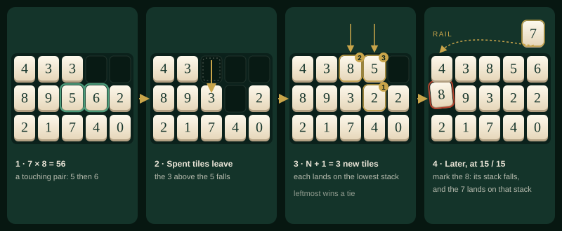
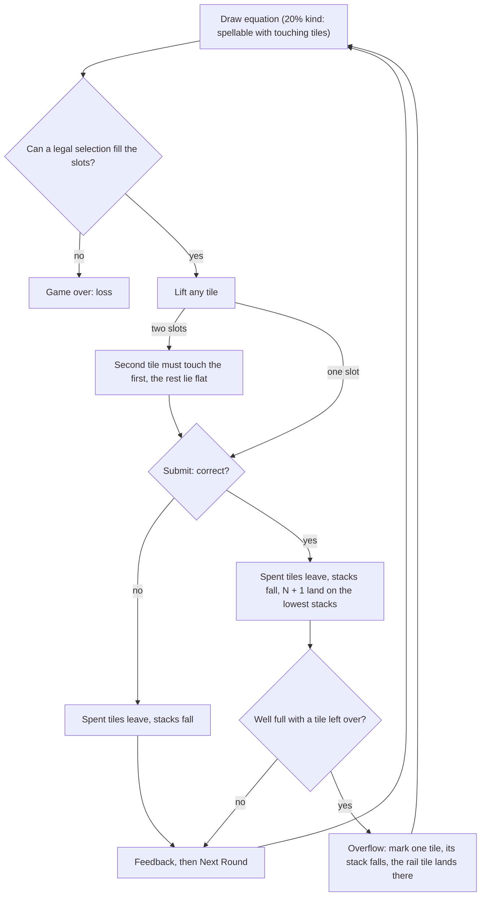
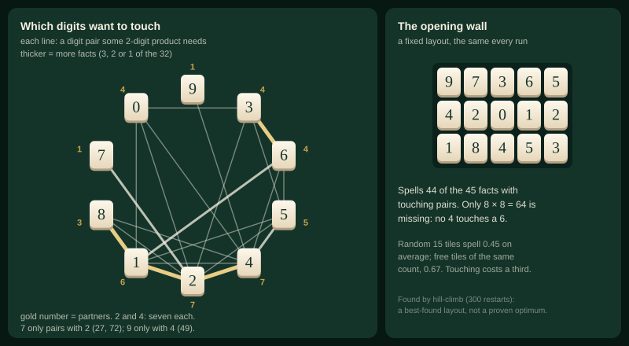

# 08 · Well · 우물

> **Status:** research draft — not canonical. Amends nothing in `docs/spec/`; on any conflict the spec wins.
> **Direction:** what if the rack were a place? · Opus research agent · 2026-10-17

The rack becomes a well of fifteen tiles in five stacks. An answer's two tiles must touch. When they leave, the tiles above fall, and new tiles land on the lowest stack.

| | |
|---|---|
| Core verb | **Dig**: spend a touching pair, knowing what will fall into its place |
| Only this draft contributes | Geometry as a resource: measured *b* under adjacency (touching costs a third of *b*; 15 touching cells spell about what 10 loose tiles do), the multiplication digit-pair graph, and a keyboard and screen-reader design in which every legal partner is one arrow press away |
| Nearest neighbour | **Endless** — adds a positional choice to the rounds Endless leaves choiceless: which copy to spend, what falls, where the newcomer lands. Endless treats copies as identical (§1.4) |
| Spec fit | Needs amendment, scoped to the new mode: `product.md` §1.1–§1.5, §1.7, §1.8, §1.10, §1.11; `ui-i18n.md` §1.12, §1.14, §1.15; `decisions.md` 9i and the flat rule. Endless and Classic unchanged |
| Cliff verdict | Under, thinly: greedy bot's *b'* 0.61 at capacity and 0.59 one tile below, vs 0.631 (Endless, same bot: 0.57 and 0.53). Overflow makes drift at capacity negative whatever *b'* is, so the cell below decides pinning; 0 of 2,000 runs reach the 1,000-round cap |
| Build size | **L** — a position-aware inventory reaches the reducer, rack, keyboard and motion; the 5 × 3 layout already ships |
| Mode select copy | **Well** — Fifteen stacked, pairs touch · **우물** — 열다섯 칸, 맞닿게 |

## 1. Spec collisions

Each amendment is scoped "in Well" so Endless and Classic read exactly as today.

| Clause | Says today | Amendment for Well | Works without it? |
|---|---|---|---|
| `product.md` §1.1 | "an arithmetic inventory game with two modes" | Three modes; one sentence defining Well | No |
| §1.2 | kind draw "from only those pairs whose product the current inventory can spell" | "can spell **with a touching pair**" | Runs, but the bias then offers unspellable equations and silently overstates *b'* |
| §1.3 | "Inventory display order: digit tiles in ascending digit…"; round-robin opening | Position is the order; never sorted; fixed opening wall (§2) | No: a sort destroys the board |
| §1.4 | digit key picks "a digit tile first, in sorted inventory order"; "Duplicate digit tiles have no strategic distinction"; "Returned tiles are re-sorted into inventory" | Second tile must touch the first; reading order plus pair resolver (§2); copies differ by place; a returned tile goes back to its own cell | No |
| §1.4a Constructibility | "some assignment of distinct inventory tiles to its slots…" | "…and, for two slots, the two tiles touch" | No (feeds §1.2) |
| §1.5 step 7 | "Sort only the tiles that fit within the live capacity" | Stacks fall; rewards land on the lowest stack | No |
| §1.7 | "Rail tiles that survive take the sockets the discard freed; the rest of the rack neither compacts nor re-sorts" | The discarded tile's stack falls; the rail tile lands on top of it | No |
| §1.8 | step 2 "sort the whole inventory — the one re-sort per round"; loss is `inventory.length < getAnswerLength(equation)` | No sort. Loss adds "or two slots and no two tiles touch" | No: without it, a two-slot round with no touching pair can be neither answered nor lost (a soft-lock) |
| §1.10 | answering: "Sorted digit inventory"; title: two modes, four rules | Well's rack; a third mode button; the capacity rule reads "Fifteen cells in five stacks; an answer's tiles must touch" | No |
| §1.11 | digit-key rows; overflow row; the stand-aside paragraph | Rows in §2's keyboard table | No: without arrows, a keyboard player cannot choose which copy, which breaks AGENTS.md's keyboard support |
| endless-polish §3.1 | "at `requiredCount === 1` that single keystroke completes the discard" | In Well, a digit key moves focus and does not mark | Yes, but an unseen copy gets discarded and decides where the newcomer lands |
| `ui-i18n.md` §1.12 layout | "Endless: … ten fixed sockets in a `5 × 2` grid" | Well draws Classic's mid tier, `5` columns of `48 × 60`, gap `6px`, footprint 15: already verified at 320px ("its tray is `282px`") | Yes: it exists |
| §1.12 motion | "Motion outside that inventory is not permitted; extending the inventory amends this section" | Add **W·1** (a stack falls) and **W·2** (a reward drops onto its stack) | Snapping works, but tiles teleport: the fall is how a player learns what moved |
| §1.14, §1.15 | required copy; share formats | Mode name and hint, the title rule, live-region strings; share prefix `ozterisk Well — Rounds: {n}` / `ozterisk 우물 — 라운드: {n}` | No |
| `decisions.md` 9i | "Reward insertion fires in place. It never flies in", because travel "implies the rack is a queue you can predict; it isn't" | In Well the rack *is* predictable, so a drop into a known stack is information, and firing in place would hide it | No |
| `decisions.md`, flat rule | "Disabled means flat… requires `disabled` to be a genuine prop" | Non-touching tiles use `aria-disabled` so roving focus can pass through them, and the flat style keys off it | No |

Checked and clear: AGENTS.md (in-browser, `useReducer`, nothing persisted; the opening wall is a constant, not a seed) and §1.17 (no timer, escalation, skip, manual discard, retry or tutorial). The new loss clause reads positions and counts, never digit values, so it is not the excluded "exact-answer-constructibility loss detection".

## 2. The mode

Everything not named here is Endless.

- **Setup.** Mode `well`, capacity **15**: five stacks, three deep. Tiles rest on the bottom row, and a stack's empty cells are at its top. No pip meter: as in Classic, the rack is the meter, and the empty cells are the score. The opening is the fixed **wall**, bottom row first: `1 8 4 5 3` · `4 2 0 1 2` · `9 7 3 6 5`. It spells 44 of the 45 facts with touching pairs (only 8 × 8 is missing). It is a constant, like Endless's one-of-each. The Well gets its own kind-rate dial, starting at the shared 0.2, because an existing dial's value is not an agent's to change (AGENTS.md §4.5).
- **Selecting.** The first tile can be any tile. A two-digit answer's second tile must **touch** the first: left, right, above or below. Slot order is still tap order, so one touching `1`–`2` serves both 12 and 21. Flat always means *cannot be picked now*: the non-touching tiles while the second slot is open, and the whole well once every slot is full, when Submit rises (11d). A lifted tile's cell is a socket on loan, as today.
- **Wrong answers obey the same rule.** A deliberate miss spends a touching pair or a single tile. Shedding tiles is therefore positional too.
- **Resolve.** Spent tiles leave, and the tiles above them fall straight down. Nothing slides sideways, and there are **no cascades or chains**: the score counts correct answers only (§1.5), so there is nothing for a combo to pay. On a correct answer, the `N + 1` rewards land one at a time on the **lowest stack, leftmost on a tie**. If every stack is full, the remaining tile waits on the rail: Endless's overflow, always exactly one.
- **Overflow.** Mark one tile, seated or on the rail. A seated tile leaves, its stack falls, and the rail tile lands on top of that stack, so the discard chooses *what goes* and *where the newcomer lands* in one tap. Marking the rail tile discards it, and nothing moves.
- **Next round, loss, score.** There is no re-sort. The run is lost when no legal selection can fill the slots. Rounds lead the HUD, as in Endless.
- **Motion.** **W·1**: a stack falls (`oz-fall`, `--ease-fall`); it plays every round, so it must be fast. **W·2**: a reward drops into its stack from the well's mouth (`oz-perch-drop`'s shape, longer `--dy`), replacing 9i in this mode; the gold "new" outline stays. Reduced motion snaps both, by the existing global rule.

**Keyboard and screen reader.** The well is an ARIA grid (`role="grid"`, rows, gridcells), named "Well, 5 stacks, 13 tiles". It is one tab stop, as the APG grid pattern requires [9], kept with a roving tabindex [10]. Flat tiles carry `aria-disabled` and stay focusable, as the APG advises for disabled items in menus, listboxes and trees [10].

| Input | Well | Endless today |
|---|---|---|
| Tab | Enters the well at the last focused cell | Every tile is a tab stop |
| Arrows | Focus moves one cell, no wrap; an empty cell reads "Empty" | — |
| Space / Enter on a tile | Selects it. Once every slot is filled, well tiles are inert, so Enter submits even with focus inside the well | Enter on a focused tile selects it |
| After the first tile | Focus stays on its cell, so **every legal partner is exactly one arrow press away**. Polite live region: "5 lifted. Touching: 9 left, 6 right, 3 above, 7 below." | — |
| `0`–`9`, first slot | The first tile holding the digit in reading order (top row first, left to right) | First in sorted order |
| `0`–`9`, second slot | A touching tile holding the digit. If none touches, the first slot re-seats onto the first touching pair that spells the two typed digits in order; if there is none, the key is a no-op and the live region says "No 6 touches a 5". The resolver reads only the typed digits, never the product | First matching tile |
| `0`–`9` in overflow | Moves focus to the next tile holding the digit, cycling; Space or Enter marks it | Marks the first match and completes the discard |
| After resolve | "New tiles: 2 and 5 on stack 4, 8 on stack 3." | "Received 3 tiles" |
| `Backspace`, `Escape`, `R` | Unchanged | — |

The Enter row amends §1.11's stand-aside paragraph: `Enter` stands aside only for a focused control that would act. Otherwise roving focus, which almost always sits on a tile, would stop `Enter` from ever submitting. That is the failure class §1.11 records for a focused **Clear**.

## 3. The loop

## 4. The decision it creates

In Endless a correct answer involves no choice: copies are interchangeable, and only a miss or an overflow asks *which digit*. In the Well every tile has an address, and the multiplication table decides which addresses matter. The 32 two-digit facts need only **21 digit pairs**, and they are unevenly spread. `2` and `4` each have seven partners and `1` has six. `7` partners only `2` (27, 72), and `9` only `4` (49). A `7` that does not touch a `2` is good for 1 × 7 and nothing else.

So the skill is **keeping hubs central and leaves beside their partner**. You spend the `5` whose departure drops a `2` next to a `4`, not the one whose departure strands a `9`. You burn a pair from under a tile you want lower, and you discard from the stack where the waiting tile belongs. This is Endless's "keep coverage" instinct, read off the board instead of counted. The feeling should be a mahjong player's: a tidy wall taken apart on purpose. Turns stay calm, because nothing moves while you think: gravity resolves after **Submit**, so §1.10's "neither compacts nor re-sorts until the round resolves" holds as written.

Precedents, and what each one decided:

- **SpellTower** is the closest: letters "cascade downward" into a word's gap, and Puzzle mode "adds a row every time you make a word", a turn-counted rise; Rush adds rows over time [1]. Words trace "horizontally, vertically, or diagonally" [1, 2]. The Well takes the turn-counted feed and refuses diagonals (§5).
- **Bookworm** "Classic" is "untimed". Letters must be "adjacent", and "the remaining letters collapse to fill the available space", with new tiles entering "from the top" [3]. That is the calm-gravity proof. A burning tile that reaches the bottom must be cleared that turn or the game ends [3]; the Well adds no such threat, per the 억까 ruling.
- **Boggle** allows a "horizontal, vertical, or diagonal neighbor" under "a three-minute sand timer" [4]; the Well keeps adjacency and drops the clock.
- **Tetris Attack / Panel de Pon**, **Puzzle & Dragons** and **Dr. Mario** make falling the payoff. Falling blocks "cause chain reactions" against a rising stack [5]; orbs move "within 5 seconds", with "skyfall combos" [6]; unsupported capsules "fall to the bottom" [7]. Timers and combos are out by §1.17 and §1.5; in the Well, falling is information, not a reward.
- **Letterpress** puts geometry on ownership: a surrounded tile is "locked" [8], while its words may use letters from anywhere *(unverified recall)*. Position can matter without constraining what you spell.

## 5. Economy

**Against the cliff: under, with a thinner margin than Endless.** The greedy bot's steady-state *b'* is 0.61 at capacity (0.63 at skill 0.95) and 0.59 one tile below, against 0.631; Endless's are 0.57 and 0.53. At capacity a correct answer's +1 overflows, so drift there is negative whatever *b'* is; the cell below (drift −0.19 a round) decides whether a hand gets pinned. Touching removes about a third of *b*; the extra five sockets buy most of it back.

**Instrument.** Two scripts live in the session scratchpad, not committed, and run through the shared Vite runner.
- `static-sweep.ts`: iid uniform digits laid out by gravity, level fill (the lowest-stack rule's shape), 20,000 grids a row.
- `runs.ts`: 2,000 runs a row, capped at 1,000 rounds, kind 0.2, skills 1.0 and 0.95. Endless runs on the **real** `gameReducer`, `generateKindEquation` and `generateRewardTiles`. The Well re-implements only what differs; its kind gate keeps `generateKindEquation`'s sample order with a touching-aware filter (the real one would silently overstate *b'*).
- Bots, one family for both modes. **Naive** makes random legal choices. **Greedy** is 1-ply: it takes the choice that leaves the highest coverage after removal and gravity, not knowing the reward digits but knowing the rail tile. **Position-blind greedy** scores with loose coverage instead. Bots are not players; compare rows with each other.

**Calibration.** With every pair adjacent, the grid code reproduces the free rack: *b*(10) = 0.480 and *b*(15) = 0.672. The closed form gives 0.480 and 0.673, and the repo's `canConstruct` by Monte Carlo gives 0.481 and 0.671. The real `generateEquation` draws one-digit products at 0.2894, against 13/45 = 0.2889. Drift at *b* = 0.48 is −0.409 (spec: −0.41).

**Negative controls.** A grid with no adjacency spells 0.229, which is 13/45 · (1 − 0.9¹⁵) exactly. With rewards off, no Well run outlives its 15 opening tiles (max 11). On the real reducer, an Endless bot that never answers correctly never passes 10 rounds (max 8). It also caught a bot fallback: when every legal selection is correct (a lone `5` facing 1 × 5), a correct answer is forced, so those runs (72 of 500) are counted, not bounded.

**Static: what touching costs** (*b'* = 0.2 + 0.8*b*, the kind bias applied analytically):

| Well | Cells | Loose *b* | Touching *b* | Touching *b'* | Reading-order *b* | Diagonal *b* | Diagonal *b'* |
|---|---|---|---|---|---|---|---|
| 5 × 2 | 10 | 0.480 | 0.335 | 0.468 | 0.272 | 0.387 | 0.509 |
| 4 × 3 | 12 | 0.566 | 0.390 | 0.512 | 0.314 | 0.455 | 0.564 |
| **5 × 3** | **15** | 0.673 | **0.454** | **0.563** | 0.364 | 0.533 | 0.627 |
| 4 × 4 | 16 | 0.703 | 0.477 | 0.581 | 0.380 | 0.559 | 0.647 |
| 6 × 3 | 18 | 0.756 | 0.509 | 0.607 | 0.406 | 0.596 | 0.677 |
| 5 × 4 | 20 | 0.800 | 0.546 | 0.637 | 0.435 | 0.641 | 0.713 |

**Runs** (skill 1.0; "at cap" and "below" are steady-state *b'* after round 10, at 10 and 9 tiles for Endless, 15 and 14 for the Well; "choice" is the share of correct answers with two legal spellings that leave different wells; the blind row is a separate batch whose naive and greedy rows matched these within 0.2 mean rounds):

| Mode | Bot | Median | Mean | p90 | Capped | *b'* all | At cap | Below | Choice |
|---|---|---|---|---|---|---|---|---|---|
| Endless | naive | 14 | 14.9 | 23 | 0% | 0.493 | 0.53 | 0.49 | 0% |
| Endless | greedy | 17 | 19.3 | 31 | 0% | 0.551 | 0.57 | 0.53 | 0% |
| **Well**, opening wall | naive | 21 | 23.2 | 35 | 0% | 0.492 | 0.52 | 0.52 | 20% |
| **Well**, opening wall | greedy, position-blind | 24 | 26.6 | 41 | 0% | 0.522 | 0.55 | 0.52 | — |
| **Well**, opening wall | greedy | **30** | **33.3** | 52 | 0% | **0.568** | **0.61** | **0.59** | 19% |
| Well, one-of-each in two rows | greedy | 18 | 21.5 | 38 | 0% | 0.504 | 0.60 | 0.54 | 13% |
| Well, random 15 | greedy | 25 | 28.4 | 47 | 0% | 0.512 | 0.61 | 0.56 | 19% |
| Well + diagonals | greedy | 35 | 39.2 | 64 | 0% | 0.601 | 0.66 | 0.62 | 24% |

What the results mean:

1. **Touching costs about a third of *b*** (0.673 → 0.454 at 15 cells; 30–33% at every size). A 5 × 3 touching well spells about what 10 loose tiles do (0.454 vs 0.480). Capacity is the compensation: five sockets pay for adjacency.
2. **Every run ends**, at both skills. At 0.95, medians are Endless 13 and 16, Well 20 and 28 (naive, greedy).
3. **Position is a skill, and not just a bigger hand.** On the Well's own rules, a greedy bot that ignores position gains 3.2 mean rounds over naive; scoring by position adds 6.9 more (2.0, then 6.5, at skill 0.95). About two thirds of the skill is geometry, and Endless's whole greedy gain is 4.4. One correct answer in five offers a positional choice; Endless offers none.
4. **The opening sets run length.** The 44/45 wall runs 1.5–1.7× Endless. One-of-each in two rows (34/45) is roughly Endless's length.
5. **Rejected on numbers.** Diagonals put the greedy bot at the cliff (0.66 at capacity, 0.62 below, drift −0.08). Reading order costs another fifth of *b*. Random-column placement matched lowest-stack in a 300-run pilot (medians 22 and 30 both ways); lowest-stack wins on legibility.
6. **The tuning risk is §3.3's, sharper.** A player planning two moves ahead may beat a 1-ply bot, and the margin is 0.04, not Endless's 0.10. The counterweight is the Well's own kind rate, added to `balance.ts` with `WELL_COLUMNS` and `WELL_ROWS`.

## 6. Smallest playable slice

Enough to test whether position reads as a decision.

- **Reuse:** `generateEquation`, `generateRewardTiles`, `getAnswerLength`, `getRewardCount`, `answerMatches`; `rackTier`'s mid size; `Tile`'s states; the rail and `oz-perch-drop`; `OverflowControls`; `useGameKeyboard`.
- **Add to state:** `"well"` in `GameMode`, and a `cell` (0–14) on each tile in Well. Selectors `touches`, `canSpellInWell` and `canFillWell`.
- **Add to the generator:** a predicate for `generateKindEquation` that keeps its sample order.
- **Add to the reducer:**
  - `SELECT_TILE` guard: the second tile touches the first.
  - Resolve on both `SUBMIT_*`: remove, fall, place on the lowest stack.
  - `TOGGLE_DISCARD`: fall, then land.
  - `NEXT_ROUND`: no sort, and the touch-aware loss check. It stays pure; rewards still come from the boundary.
- **Add to the UI and keyboard:** `TileInventory` lays out by cell, and flat keys off `aria-disabled`. The fall rides the existing FLIP frame (`oz-reseat`'s `--fx`/`--fy`) as a placeholder, which is still a §1.12 amendment, because the inventory counts moments, not keyframes. Digit keys get the pair resolver.
- **Before release, not in the slice:** arrow navigation and the grid semantics, a tuned `oz-fall`, and the live-region strings.

## 7. Biggest risk — and the playtest that would kill it

**Position reads as luck, not as a decision.** Touching blocks a third of what the same tiles could spell loose, and only one correct answer in five offers a positional choice. If a blocked answer feels like "the 6 was in the wrong place" rather than "I put it there", the mode repeats the 억까 failure: difficulty with no channel for intent reads as variance.

**Kill playtest.** Five players on phones each play three Endless runs, then three Well runs. Before a resolve, ask them to point to where the new tiles will land. After each run, ask: "Was there a moment you chose a tile because of where it was?" Drop the direction if any of these holds:
- (a) By the third run, most players still cannot say where tiles will land.
- (b) They cannot name a positional choice.
- (c) They blame at least half their dead rounds on placement as bad luck.

## 8. Open questions for Ori

1. **Opening:** the fixed 44/45 wall (longest runs, the same start every time) or one-of-each in two rows (34/45, about Endless's length)?
2. **Rewards:** lowest stack (deterministic), or placed by the player? Placing adds agency and a tap per correct answer, and is unsimulated.
3. **Third mode or Classic variant:** is the Well a mode of its own, or should a well also descend, sealing from the top?
4. **Name:** Well · 우물, or Wall · 패산 (the mahjong wall; the Korean term is *(unverified recall)*)?
5. **Teaching:** is the flat/raised state plus one title rule enough to teach touching without a tutorial?

## Sources

1. Pocket Gamer, *SpellTower* review — https://www.pocketgamer.com/spelltower/review/
2. Wikipedia, *SpellTower* — https://en.wikipedia.org/wiki/SpellTower
3. Wikipedia, *Bookworm (video game)* — https://en.wikipedia.org/wiki/Bookworm_(video_game)
4. Wikipedia, *Boggle* — https://en.wikipedia.org/wiki/Boggle
5. Wikipedia, *Tetris Attack* (Panel de Pon) — https://en.wikipedia.org/wiki/Tetris_Attack
6. Wikipedia, *Puzzle & Dragons* — https://en.wikipedia.org/wiki/Puzzle_%26_Dragons
7. Wikipedia, *Dr. Mario* — https://en.wikipedia.org/wiki/Dr._Mario
8. Wikipedia, *Letterpress (video game)* — https://en.wikipedia.org/wiki/Letterpress_(video_game)
9. W3C WAI-ARIA APG, Grid pattern — https://www.w3.org/WAI/ARIA/apg/patterns/grid/
10. W3C WAI-ARIA APG, Developing a keyboard interface (roving tabindex; focusable disabled items) — https://www.w3.org/WAI/ARIA/apg/practices/keyboard-interface/

Repo files (read-only): `docs/spec/product.md`, `docs/spec/ui-i18n.md`, `docs/design-system/decisions.md`, `docs/superpowers/specs/2026-08-09-endless-mode-polish-design.md`, `docs/journal/journal-2026-09-27.md`, `src/game/{balance,selectors,generators,gameReducer,factories,types}.ts`, `src/hooks/useGameKeyboard.ts`, `src/components/TileInventory/TileInventory.tsx`.

Work files (session scratchpad, not committed): `well-model.ts`, `static-sweep.ts` → `static-sweep.out`, `opening-search.ts` → `opening-search.out`, `runs.ts` → `runs-skill100.out`, `runs-skill095.out`, `negative-control.out`, `runs-pilot.out` (300-run pilot, including random-column), `make_svgs.py`.
