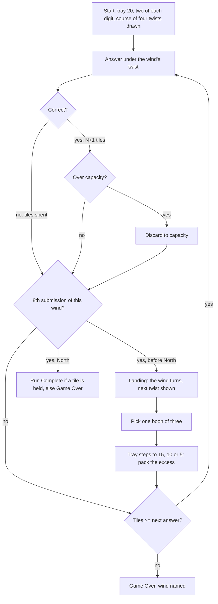

# 09 · Four Winds · 네 바람

> **Status:** research draft — not canonical. Amends nothing in `docs/spec/`; on any conflict the spec wins.
> **Direction:** what if a run had acts? · Opus research agent · 2026-10-17

A run of four winds, each a level stretch of the tray with its own table rule; at each change of wind the tray closes a row and you keep one boon of three for the rest of the run.

| | |
|---|---|
| Core verb | **Choose** a boon at each change of wind, then **pack**: keep the tiles the next wind needs |
| Only this draft contributes | A modular framework: a twist is one wind's override of the equation pool and face rate, and a boon is a run-long override or grant. It comes with a measured content budget, a pacing rule (wind length from hand turnover), and the finding that choosing boons carries the mode while reading twists pays only in the last wind |
| Nearest neighbour | Classic. Adds run-level choice and a course that differs every run. Position-aware boon picks win **+19 pts** over random picks: 63.6% vs 44.7%, slice configuration, same bot. Same kind of arc (a fixed positional descent), but stepped |
| Spec fit | Needs amendment: `product.md` §1.1, §1.2, §1.3, §1.4a, §1.7/§1.7a, §1.8, §1.10–1.11, §1.17; `ui-i18n.md` §1.12, §1.14, §1.15 |
| Cliff verdict | Per wind, no boons: b′ **0.91 / 0.75 / 0.65 / 0.51** against 0.631. East and South sit above the cliff, West at it, North under it. Good picks lift North to 0.60 (best stack: 0.73), but North holds 5–8 tiles and ends 8 submissions later |
| Build size | **L.** It is a mode plus a framework: a sixth phase, two state fields, per-wind generator inputs, and 13 pieces of measured content. The slice is M |
| Mode select copy | **Four Winds** — New rule each wind · **네 바람** — 바람마다 새 규칙 |

## 1. Spec collisions

**A premise to correct first.** The brief calls Classic a two-wind half-game. The 21 Sep record framed it that way, but the 24 Sep calls dropped the wind tile and the felt drift (`decisions.md` § M6). The cadence section also says *"the two-act structure and its East/South alignment are withdrawn"*, because play churns the opening hand *"within a few submissions"*. Those acts were phases of the **hand**, so churn erased them. Four Winds' acts are phases of the **rules**: they exist by position, and churn cannot erase them. Churn instead sets their length (§5).

| Clause | Collision | Amendment needed | Works without? |
|---|---|---|---|
| `product.md` §1.1 | "two modes" | A third mode | No |
| §1.2 | One 45-pair pool for every draw; uniform rewards; face ramp Classic-only | A wind may filter the pool, skew reward digits, and scale the face rate. **The kind rate stays fixed for the run.** No twist or boon touches it | No |
| §1.3, §1.7a | Capacity is Endless's or Classic's | `getCapacity(fourWinds, n) = [20,15,10,5][⌊n/8⌋] + boon sockets` | No |
| §1.4a + reducer guard | "Face tiles exist in Classic only"; `SUBMIT_CORRECT` rejects faces when the mode is not Classic | Extend both to Four Winds | No |
| §1.7 | "Capacity is checked only after … rewards"; §1.7a "an incorrect submission cannot overflow" | **The landing pack:** at a change of wind, capacity drops by up to five, after a hit or a miss. The excess is marked with the existing rule (any count; the last mark completes it) | Yes. Use continuous seals (21→5, one every 2) instead: 64.4% wins before boons, no pack (§5). The pack decision is lost |
| §1.8 | The run ends at Classic's floor | The run ends after submission 32: **Run Complete** with ≥ 1 tile | No |
| §1.10–1.11 | Five phases | A sixth, `landing`: the offer is three buttons, with no global digit keys (the pack that follows uses digit keys to mark) | No |
| §1.17 difficulty curves | "Any weighting that … escalates over a run" | Extend the descent exception to Four Winds' schedule (§4) | No |
| `ui-i18n.md` §1.12 | Motion inventory | The rack step reuses `M6·1` (`oz-reseat`; 20/15/10 are the existing tier tops) and North's plugs reuse `M6` (`oz-seal`). One new moment, **the wind turns**: the 東→南 spin drawn on 21 Sep and dropped on 24 Sep | Yes, as a jump cut |
| §1.14, §1.15 | Copy; share text | Twist and boon lines (one line each, no tutorial); `ozterisk Four Winds — Run Complete — Rounds: 32`, or `— Game Over in West —` | No |

**Checked, no conflict:**
- Persistence: twists and boons die with the run.
- Seeds: the course is never shown as a seed.
- The felt rule: offers never read the hand.
- Reward count: no twist or boon changes it, which avoids the rejected *decaying reward* and *flat decay* (journal 08-09).
- Digit picker: no boon asks for a digit.

**Relics.** The cut reads *"a meta-system needing run milestones to attach to; a separate project after Classic"*. Both conditions are now met: Classic has shipped, and winds are the milestones. Slay the Spire's relics also last only *"for the duration of the run"* [5]. The Ascension half (*"Does the floor descend on repeat wins?"*) needs persistence and stays cut.

## 2. The mode

- **Setup.** Capacity 20, with two of each digit, as in Classic. Four winds of **8 submissions** each, 32 in total. A **course** of four twists is drawn at Start Run. East, South and West are drawn without repeats from a bag of five variety twists. North is drawn from the *readable* family: twists with a sleeping digit (§4). The slice's only readable twist is *Odd tables*, and it never appears in East, South or West. The current twist and the next are always on the table.
- **Capacity** is level within a wind: **East 20 · South 15 · West 10 · North 5**, plus any boon sockets. From South on, each change closes exactly a row of five on the existing rack tiers.
- **Rounds** are Classic's: the kind bias (fixed 20%), `N+1` rewards, overflow, and the loss check. The wind's twist sets the pool for **both** the kind draw and the uniform draw, and multiplies the face ramp (5%→20% over 32 submissions).
- **Landing** comes after submissions 8, 16 and 24. In order:
  1. The wind tile turns.
  2. Three boons are offered, drawn from those not yet taken. The draw never looks at the hand. The player picks one.
  3. The tray steps down. If the hand exceeds the new capacity, the player marks the excess.
  4. The next equation is drawn.
- **End.** A loss is §1.8's (hand < answer length). The game-over screen names the wind. After submission 32, a hand of ≥ 1 tile is **Run Complete**. The score is rounds, as in Classic.

Twists and boons are **one vocabulary at two scopes**: `{pool, rewardDigits, faceMul}` for a wind, and `{sockets, faceAdd, noFaces, grant, calm}` for the run. New content is a data entry plus one line of copy.

Measured on the 20/15/10/5 base, naive bot, no boons, the other three winds plain; 3,000 runs a cell; base win 20.8% (`mode.ts`):

| Twist (the line on the board) | Pairs | Sleeps | Cliff for its pool | Δ win if placed in E / S / W / N |
|---|---|---|---|---|
| Odd tables: both factors odd (readable; North only) | 15 | 0 | 0.615 | +1.7 / +0.8 / +2.0 / −1.9 |
| Even tables: a factor even · faces ×1.5 | 30 | 9 | 0.639 | +0.5 / +0.4 / +0.9 / +0.6 |
| Small tables: factors 1–6 · no faces | 21 | 7 | 0.604 | +0.2 / −0.7 / −3.9 / +2.8 |
| Large tables: factors 4–9 · faces ×2.5 | 21 | — | 0.667 | −0.3 / +1.4 / +6.7 / −0.5 |
| Odd rain: rewards odd · faces ×2 | 45 | — | 0.631 | −1.7 / −1.0 / +3.0 / +7.0 |
| 2s and 5s: a factor is 2 or 5 | 17 | 7, 9 | 0.630 | +0.7 / +2.4 / +1.8 / +0.4 |

Same base, no twists, the boon taken at one landing (`mode.ts`):

| Boon (run-long unless "now") | Δ win taken E→S | Δ win taken W→N |
|---|---|---|
| One more socket | **+18.3** | +13.1 |
| Wildcard now | +1.1 | +13.2 |
| Face favour: +5 pts face rate | +7.9 | +3.1 |
| Two faces now (`O`, `E`) | +2.4 | **+18.7** |
| Wide table: +2 sockets, no more faces | +11.3 | +16.0 |
| Calm: the next wind has no twist | +0.0 (no twist to cancel here) | +0.0 |
| *Cut: Wild heart (✳ now, one socket fewer)* | −13.4 † | −5.9 † |

† Measured under an earlier landing order (pack before boon) and not re-run. Every other boon figure uses the order above.

## 3. The loop

## 4. The decision it creates

**Classic is one course. Four Winds builds a course from legs every run.** Classic fixes its course on purpose (*"the arc is the course, the score is your round on it"*), so all its choices are tile-sized. Four Winds keeps the definite arc but adds three run-sized choices, each priced by position:

1. **Which boon, here.** Sockets and face favour pay early. Grants pay late: two faces are worth +2.4 early and +18.7 late, and a wildcard +1.1 and +13.2. A picker who knows this beats a random picker by **19 points** (slice). It also has to read the course: a picker that ignores it took *Wide table*, which ends faces, against *Table of 5 · faces ×3* in North, and did worse than random picks (31.6% vs 33.4%).
2. **What to pack.** At a landing you keep 15 of 20, or 10 of 15. The next wind's rule tells you what it will ask for.
3. **What sleeps.** In North, *Odd tables* means no 0 is ever asked for. A bot that sheds 0s first wins **5–8 pts** more often than one that doesn't (slice, by boon policy).

**Why the twists are not a difficulty curve.** Each twist pays for itself: a narrowed pool is paired with a face multiplier until its Δ win stays within about 7 pts at every position. The one-sided versions were measured on the 20/15/10/7 base (`twists.ts`, `gap2.ts`) and cut:

| Cut twist | Δ win |
|---|---|
| *Large tables* alone | −21 in North |
| *Face wind ×3* | +25 in West |
| *Narrow table* | −24 in North |
| *Table of 5* | −25 in North |

The bag is drawn blind to the hand and to position, so twists add variety, not escalation. The escalation is the plateau descent, *"a fixed schedule counted in submissions, identical for every player and blind to their play"*: Classic's exception, extended. Against 억까 (*"no channel to signal intent"*), a twist is declared a full wind ahead.

**Precedents:**
- **Slay the Spire** telegraphs each act: *"Every boss has a unique portrait shown at the top of the Spire map"* [9]. Each act draws from three bosses [8]. A boss gives *"a choice of 3 boss relics"* [5]. Trade relics model *Wide table*: Coffee Dripper reads *"Gain 1 Energy … You can no longer Rest at Rest Sites"* [6], and Ectoplasm is offered only after Act 1 [7].
- **Balatro.** An ante is *"a Small Blind, a Big Blind, and a random Boss Blind"*, and each boss *"has a special ability"*, such as The Psychic's *"Must play 5 cards"* [1][4]. Bosses have a minimum ante (The Needle: 2), and *"no Boss Blind will reappear until all others have appeared"* [2]. *Calm* mirrors the voucher *"Reroll Boss Blind 1 time per Ante"* [3]. That the boss shows in advance is *(unverified recall)*.
- **Hades:** four regions, each unlocked by clearing the last; boons offer *"three persistent boosts and effects for that run"*, lost on death [10].
- **Luck be a Landlord:** rent due *"within a limited number of spins"*; won by paying *"12 rounds of rent"* [11].
- **Inscryption** changes *"the nature"* of its game each act, while *"the fundamental rules … remain the same"* [12]. That is the target here.
- **Mahjong.** A hanchan is East and South, 8 hands. A tonpuusen is East only. An isshou is *"four cycles … for a total of 16 rounds"* [13]. The round wind is a positional rule: a triplet of *"the round wind"* scores yakuhai [14], and play can continue into West and North [15].

## 5. Economy

**Where it sits.** The plateaus schedule the cliff. With no twists and no boons, b′ at draw time is 0.91 / 0.75 / 0.65 / 0.51 by wind. Runs are lost in West (8.8%) and North (66.8%), never earlier. North's 5-socket ceiling holds the run under: even when boons lift North's b′ over 0.631, a hand of 5–8 tiles cannot bank a buffer before the run ends. The stable loop exists locally but cannot be ridden: Classic's resolution. A pool twist also **moves the cliff** through the miss cost: *Large tables* asks only two-digit answers, so its cliff is 0.667.

**Instrument.** `work/fw-lib.ts` re-implements only the round loop, so capacity, pool and face rate can vary. It imports the real `createInitialInventory`, `tileDigits` and `canConstruct`, and for calibration `gameReducer`, `generateKindEquation` and `generateRewardTiles`. Two bots:
- Both answer correctly at 0.95 whenever the hand can spell the product, spending exact digits before the narrowest face. On a miss or a discard they drop the tile whose loss costs the least coverage.
- The **naive** bot measures coverage over all 45 pairs.
- The **aware** bot measures it over the current wind's pool, plus the next wind's weighted as 4 submissions.

Each cell is 3,000 runs on seeds 1000+i, with kind 0.2 and faces ramping 5→20%.

**Calibration (`calib.ts`):**
- Fast spelling matches `canConstruct` with 0 mismatches in 225,000 checks.
- b(10) = 0.478, b(20) = 0.799, b(0) = 0.
- Analytic Endless drift at b = 0.48 is −0.409 per round.
- **The real reducer and the loop agree on Classic:** 64.8% vs 65.8% at skill 0.95, and 54.0% vs 54.9% at 0.85. Journal 09-27's weaker bot got 61.2%, so read differences, not levels.

**Negative controls:**
- Zero rewards: 0.0% wins.
- Foresight with a plain North: **−0.3 to +0.1**. There is nothing to read there, and the instrument reads nothing.

**Base regime (`structure.ts`; no twists, no boons; naive bot):**

| Schedule | Win | Runs lost in E / S / W / N | b′ by wind |
|---|---|---|---|
| Classic (control, two halves of 15) | 65.8% | 0.1 / 31.4 (halves) | 0.83 / 0.64 (halves) |
| Seals: 21→5, one every 2, 4×8 | 64.4% | 0 / 0.1 / 5.0 / 27.2 | 0.90 / 0.74 / 0.67 / 0.60 |
| Flat 10 (Endless rack) + faces | 19.3% | 1.7 / **34.5 / 28.3 / 15.5** | 0.71 / 0.55 / 0.56 / 0.59 |
| Plateaus 20/15/10/7 | 45.0% | 0 / 0 / 8.8 / 42.4 | 0.91 / 0.75 / 0.65 / 0.56 |
| **Plateaus 20/15/10/5** | 20.8% | 0 / 0 / 8.8 / **66.8** | 0.91 / 0.75 / 0.65 / 0.51 |

- **Flat 10:** losses scatter. That is the *"cliff at an unknown, luck-determined position"* journal 08-09 rejects.
- **Seals:** Classic stretched over four winds.
- **Plateaus:** the climax lands in North. 20/15/10/5 is harsh on purpose before boons.

**The slice (`gap3.ts`).** North is fixed to *Odd tables*. East, South and West are drawn from the other five twists. There are three landings, each offering three boons not yet taken. Win %:

| Boon picks | Naive | Aware | Foresight gap |
|---|---|---|---|
| None | 22.5 | 30.2 | +7.7 |
| Random | 44.7 | 50.8 | +6.1 |
| Position-aware (`PREF` in `mode.ts`) | **63.6** | **68.3** | +4.7 |

- With position-aware picks, North's b′ reads 0.60. Runs are lost in West (6.1%); the rest of the losses fall in North.
- **Comparison, random courses with North drawn from all six (`full.ts`):**
  - None: 23.4 / 25.0. Random: 44.3 / 45.3. Position-aware: 59.3 / 61.0.
  - The foresight gap there is **+1.0 to +1.7: null** by the bar set before running (≥ 5 real, 2–5 weak, < 2 null). Reading pays only where a readable twist sits last.
- **Worst case.** The best stack without duplicates (socket, favour, two faces) wins **66.7%**, which is Classic with the same bot (65.8%). North then reads b′ 0.73 and is at capacity for 65% of its draws, yet drifts −0.37 tiles per submission. No legal stack makes the run unloseable.

**Pacing.** This is the share of a wind's opening tiles still held after k submissions (`full.ts`):

| k | 1 | 2 | 3 | 4 | 5 | 6 | 7 |
|---|---|---|---|---|---|---|---|
| Still held | 0.81 | 0.65 | 0.52 | 0.41 | 0.33 | 0.26 | 0.20 |

After the pack, 0.09 remains, so the **half-life is about 3 submissions**. Two consequences:
- A wind needs about 3 submissions before its rule reaches the hand; eight is about 2.7 half-lives.
- Preparation for the next wind fades within about 3 submissions, so foresight is weak except in the last wind.

**Playtime (estimate).** Classic's 6.5 min over 30 submissions is about 13 s each. 32 submissions plus three landings at a guessed 20 s each is **about 8 minutes, 1.2× Classic**, where a real isshou is twice a hanchan. A landing is not a save point: nothing may persist.

**Content budget (`budget.py`, 200k Monte Carlo runs; 9 offers a run):**

| Boon pool | Distinct boons offered per run | P(a given boon is offered) |
|---|---|---|
| 6 | 5.7 | 0.95 |
| 12 | 7.4 | 0.62 |
| 18 | 8.0 | 0.44 |

Three twists a run come from the variety bag:

| Twist bag | P(a given twist appears) | Shared with the last run |
|---|---|---|
| 5 | 0.60 | 1.8 |
| 10 | 0.30 | 0.9 |

For scale, Slay the Spire uses three bosses per act [8], and Balatro uses 23 bosses plus 5 finishers [2].
- **The slice needs 5 variety twists, 1 readable twist and 6 boons.** That tests choice, though every boon shows up almost every run.
- **Release needs about 10 variety twists, 3–4 readable ones and 12 boons.**

## 6. Smallest playable slice

Plateaus 20/15/10/5, the five variety twists above, North fixed to *Odd tables*, and the six boons.

**It reuses:**
- `gameReducer`'s submit, overflow and `TOGGLE_DISCARD`. The landing pack is overflow with a larger count.
- `getCapacity`, with a third mode branch.
- `generateKindEquation` and `generateRewardTiles`. Each reads the wind from `totalRounds`, as `getClassicFaceRate` does, so no call site can pass a stale dial (endless-polish §3.3).
- `TileInventory`'s stepped tiers and `oz-reseat`.
- `OverflowControls` and the share service.

**It adds:**
- `course` and `boons` in `GameState`. The course is drawn outside the reducer and passed with `START_RUN`.
- A `landing` phase and a `TAKE_BOON` action.
- A wind marker, the twist plate, and boon cards drawn as tile and socket swatches (there is no icon set), with their i18n strings.
- **An invariant test in the style of `balance.test.ts`.** It sweeps every twist at every position and every legal boon stack. It asserts that analytic b′ in North stays under the cliff, or that the measured win stays in band. Its failure message names the twist, the stack and the margin.

## 7. Biggest risk — and the playtest that would kill it

The sim says the twists are **mostly decoration**. Reading them is worth +1.0–1.7 pts on random courses, and only North's sleeping digit clears the bar (+4.7–7.7). If people play it the same way, Four Winds is *Classic with boons*. That is still a real layer (+19 pts of choice), but it is not acts. The 5-tile pack may also feel like a chore rather than a decision.

**The kill test.** Ten runs per player:
- After each wind, ask "what did that wind change?"
- In North, watch whether players shed the sleeping digit first.
- At landings, watch whether picks follow position (sockets early, grants late).

If fewer than half can name the wind's rule and North discards ignore the sleeping digit, **cut the twist layer** and ship landings and boons on Classic's descent. If boon picks also look random, **drop the direction**.

## 8. Open questions for Ori

1. **Is a stepped descent different enough from Classic's slope** to pay for the §1.7 pack amendment? Continuous seals (64.4%) avoid it, but the pack decision goes with it.
2. **Readable North only, or more readable winds?** Sleeping a digit helps only if it is common, and 0, 7 and 9 are already rare. *Odd tables* read strongest.
3. **Where should a good picker land?** Position-aware picks reach 64–68% in the slice; Classic with the same bot is 65.8%. Random picks reach 45–51%.
4. **Boons as cards (the mockup), or as tiles in a reserved cut**, the 21 Sep tray's wind slot?
5. **Should the share line name the course** (`東 2s·5s / 南 Odd rain …`)? §1.15 is silent.
6. **Calm taken going into North cancels the readable twist**, the only one with measured reading value. Should Calm only ever cancel a variety twist?

## Sources

1. https://balatrowiki.org/w/Blinds_and_Antes
2. https://balatrowiki.org/w/Boss_Blinds
3. https://balatrowiki.org/w/Director%27s_Cut
4. https://en.wikipedia.org/wiki/Balatro
5. https://slaythespire.wiki.gg/wiki/Relics
6. https://slaythespire.wiki.gg/wiki/Coffee_Dripper
7. https://slaythespire.wiki.gg/wiki/Ectoplasm
8. https://slaythespire.wiki.gg/wiki/Bosses
9. https://slaythespire.wiki.gg/wiki/Boss
10. https://en.wikipedia.org/wiki/Hades_(video_game)
11. https://en.wikipedia.org/wiki/Luck_Be_a_Landlord
12. https://en.wikipedia.org/wiki/Inscryption
13. https://majandofu.com/en-mahjong-terminology
14. https://en.wikipedia.org/wiki/Japanese_mahjong_yaku
15. https://en.wikipedia.org/wiki/Japanese_mahjong

**Repo:** `docs/spec/product.md`; `docs/spec/ui-i18n.md`; `docs/superpowers/specs/2026-08-09-endless-mode-polish-design.md` §1–2; `docs/design-system/decisions.md` (§ M6, § M7, § M6 + M7); `docs/journal/journal-2026-08-09.md`; `docs/journal/journal-2026-09-27.md`; `src/game/{balance,selectors,generators,gameReducer,factories}.ts`; `src/app/App.tsx`.

**Sims** (work folder `…/09-four-winds/work/`): `fw-lib.ts`, `calib.ts`, `report.ts`, `structure.ts`, `twists.ts`, `mode.ts`, `full.ts`, `gap.ts`, `gap2.ts`, `gap3.ts`, `budget.py`, `make_svg.py`.
