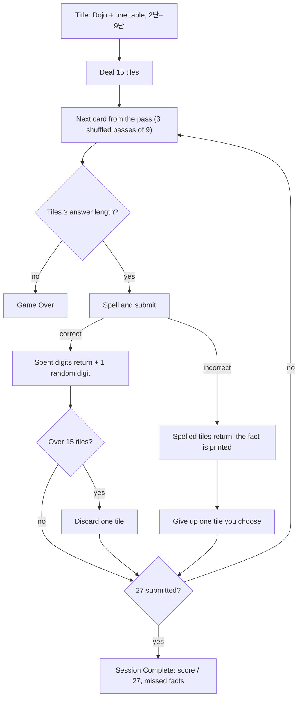

# 10 · Dojo · 도장

> **Status:** research draft — not canonical. Amends nothing in `docs/spec/`; on any conflict the spec wins.
> **Direction:** What if a mode existed to teach the times tables (곱셈구구)? · Opus research agent · 2026-10-17

Pick one table and answer its nine facts in three shuffled passes. A correct answer gives back the tiles it spelled, and a miss costs one tile you choose, so "Incorrect" lands on what you did not know, not on what your rack could not spell.

| | |
|---|---|
| Core verb | Recall one table's facts three times over; on a miss, give up one tile of your choice |
| Only this draft contributes | The pedagogy lens, plus a measurement showing that today's economy cannot carry it. On shipped rules, a one-table pool marks **43–64% of rounds "Incorrect" for a learner who knows every fact** |
| Nearest neighbour | **Endless.** Dojo adds verdicts that mean knowledge, the same 27 retrievals for every learner, and a discard that asks which digits the table uses |
| Spec fit | Needs amendment: product.md §1.1, §1.2, §1.3, §1.5 step 6, §1.6 step 1, §1.7a, §1.8, §1.10/§1.14; ui-i18n §1.12, §1.15. **Crosses no §1.17 or AGENTS.md line** |
| Cliff verdict | No supply cliff: b_run = 1.00 at perfect recall against a 0.654 cliff. A miss costs one tile, so the drain is accuracy, not supply: at 55% accuracy or better, 92–100% of sessions complete |
| Build size | M: a table picker, a deck in `GameState`, echo rewards and a one-tile toll. Reuses Classic's 15-socket rack and its win ending |
| Mode select copy | **Dojo** — One table, three passes · **도장** — 한 단, 세 바퀴 |

## 1. Spec collisions

A new mode always writes new spec. The question is which clauses Dojo must contradict. Two of them are load-bearing (**L**): without them the mode fails, as §5 measures.

| Clause (file §) | Today | Amendment for Dojo |
|---|---|---|
| product.md §1.1 | "an arithmetic inventory game with two modes"; the PoC "validates whether this loop is understandable and engaging" | Three modes. A claim that Dojo *teaches* cannot be validated inside the PoC, which has no records and no analytics; it needs an offline test (§7) |
| §1.2 | 45-pair pool "drawn uniformly with replacement"; a kind gate sample; "Rewards are independent uniformly distributed digits" | Dojo draws the chosen table's 9 facts from a deck, without replacement, with no kind gate. Rewards follow §1.5 below |
| §1.3 | Capacity 10 or 20, a round-robin deal, and a mode choice | Capacity 15, a round-robin deal to 15, and a table choice 2–9. Neither choice persists |
| §1.5 step 6 (**L**) | "Generate exactly N + 1 random reward tiles" | **Echo:** N tiles bearing the N spent digits, plus one uniform digit. Net +1 is unchanged |
| §1.6 steps 1 and 8, and its closing paragraph (**L**) | "Remove the N submitted tiles permanently"; feedback then offers **Next Round**; a wrong answer is "a costly survival mechanism" | **Pay-one:** the spelled tiles return, and the player gives up one tile, marked as in §1.7. The toll replaces **Next Round** |
| §1.7, §1.7a | `excess = inventory.length - capacity`; "An incorrect submission cannot overflow" | Add a toll of exactly one after a miss, outside the excess formula |
| §1.7a | `getCapacity` is 10 in Endless and 20 → 5 in Classic | `getCapacity(dojo, n) = 15` |
| §1.8 | Step 0 ends Classic at its floor | Dojo's next advance after the 27th submission ends the run as **Session Complete** |
| §1.10 / §1.14 | The title rules name "the ten-tile capacity, and Classic's twenty closing to five" | Add Dojo's rule line and copy keys |
| ui-i18n §1.12 | The 11–15 mid rack belongs to Classic's stepped rack | Dojo draws the 5 × 3 mid rack at a fixed 15, with no plugs |
| ui-i18n §1.15 | Endless and Classic share formats | `ozterisk Dojo 7단 — Session Complete — Rounds: 27` |

**Checked and not crossed:**
- **§1.17 difficulty curves.** The deck is a fixed schedule, identical for everyone and blind to play.
- **Multiple attempts.** Every fact is tested three times whatever the outcome, so the deck is not a retry.
- **The rest of §1.17:** timers, skip, saved history, seeded runs (ordinary randomness shuffles each pass), and result pages (missed facts print only on `gameOver`).
- **AGENTS.md persistence.** Nothing is stored.
- **AGENTS.md tutorials.** Dojo practises a table taught in class; it does not instruct.

**The ruled-on Pass idea.** The endless-polish spec keeps Pass out because the deliberate wrong answer already is "a manual discard that is already correctly priced". Pay-one reprices that discard, from the N spelled tiles to one tile of the player's choice. It is still not a Pass or a §1.17 manual-discard action:
- It fires only on a submitted answer, the one submission per equation.
- It resets the streak.
- At 15 sockets, shedding tiles has no use, so nobody submits a wrong answer on purpose.

For a learner, removing that incentive is the point. For the game, it is what Dojo gives up.

**Lines a learning mode would want to cross, and what each buys:**

| Clause | Buys | Cost |
|---|---|---|
| §1.17 "Difficulty curves — any weighting that adapts to player skill" | A Leitner-style re-queue, shifting trials within the 27 toward missed facts | Adaptivity the spec rules out. The deck already re-tests a fact missed in pass 1 twice more |
| AGENTS.md "persist only the language preference", and §1.17 "Saved best score or history" | Spacing across days. Cepeda et al. [3] find the best gap grows with how long the fact must be kept, so keeping a fact for weeks wants gaps of days | Ends the product's no-records stance |
| §1.17 "Timers" | Fluency practice. The WWC panel rates the evidence for timed practice "strong" [6] | The anxiety risk Boaler argues [5]. Not recommended for this audience |

## 2. The mode

The changes below are a delta against Endless.

**Setup**
- The title gains a third option, **Dojo**. Selecting it shows eight table buttons, 2단–9단, defaulting to 2.
- 1단 and the 0 products are left out. 1단 is trivial, and operand 0 is out of scope (§1.17).
- The pool is the table's nine facts, k × 1 … k × 9. Display order stays randomized, so both 8 × 7 and 7 × 8 appear; the 2022 curriculum teaches commutativity through the 곱셈표 [15].
- **Deck:** each pass deals the nine facts in a uniformly shuffled order, without replacement. Three passes make 27 submissions.
- Capacity is 15. The opening hand deals round-robin to 15 (one of each digit, then 0–4 again), with no face tiles.

**Round**
- **Correct:** §1.5 steps 1–5 and 7–10 apply as written. Rewards are the spent digits back plus one uniform digit.
- **Overflow:** at capacity this overflows by exactly one, resolved by §1.7 unchanged.
- **Incorrect:** score is unchanged and the streak resets, as in §1.6. The feedback prints the whole fact ("8 × 7 = 56"), not only the product, alongside the submitted answer. Optional copy, before the last pass: "Comes back in pass 3" / "3바퀴째에 다시 나와요". It is positional and true by the deck. The spelled tiles return to the rack, re-sorted, under a neutral ring, never gold, since gold means reward. The player then gives up one tile through the overflow interaction with a required count of one: the mark completes it, there is no confirm, and digit keys mark. The round then advances on its own.

**End**
- After the 27th submission, the next advance ends the run as **Session Complete**, through Classic's win path with its final hand.
- The §1.8 loss still applies: fewer tiles than the next answer needs.
- `gameOver` shows score out of 27, longest streak, and this session's missed facts as plain text ("8 × 7 = 56 · 6 × 7 = 42"). It never shows a grid or a completion goal, which is draft 05's ground.

**HUD and keyboard**
- The HUD reads Round "14/27" (primary), Score, Streak, and a fourth entry with three pass pips (positional, like Classic's capacity entry).
- The keyboard is unchanged.

## 3. The loop

## 4. The decision it creates

**Who it serves.** In the 2022 Korean curriculum, the grade 1–2 band standard [2수01-11] reads "곱셈구구를 이해하고, 한 자리 수의 곱셈을 할 수 있다". I read it from a publisher-hosted copy of the curriculum document [15]; the NCIC original was not reached. Under the 2015 curriculum, multiplication starts in 2-1 and 곱셈구구 is unit 2 of 2-2 [16]. The textbook introduces one 단 per lesson, so Dojo's one table is that lesson's practice. The order of the 단 is *(unverified recall)*: 2·5, 3·6, 4·8, 7·9. Adults rebuilding fluency take the same deck.

**The decision.** The main act is retrieval itself. The tile acts ask one question: does this table use this digit? Every 5단 answer uses only 0–5, 7단 never uses 0, and the digits of a 9단 answer sum to 9. The toll and the overflow both ask it, and the right answer to both is usually a digit the table never uses or a duplicate.

At 15 sockets that question is low-stakes, which is the honest cost (§7). The skill rewarded is knowing the facts. The feeling is untimed and calm: a session with a definite end, where a miss is a correction and not a cascade.

**What the learning science says, mapped to rules:**

| Finding | Rule | Status |
|---|---|---|
| Testing beats restudy: 56% vs 42% recalled after a week [1] | Every round is unaided, constructed recall | Fits |
| Dropping already-recalled items from *testing* cut one-week recall from ~80% to 33–36% [2] | The deck keeps testing every fact all session; nothing retires | Fits |
| Spacing: the best gap grows with the retention interval [3] | Within a session only: repeats fall about nine rounds apart. Across days needs persistence | Amendment, above |
| Blocked practice scored 89% vs 60% while practising, and 20% vs 63% a week later [4]. College students and volume problems, so applying it to facts is extrapolation | Dojo is *blocked*, matching how the classroom introduces a 단. Endless is the interleaved practice to graduate to | Fits; a two-table option is a §8 question |
| Boaler argues timed tests cause math anxiety and calls flash cards speed materials [5]. Barshay finds no well-designed experiment showing timed tests cause anxiety, while the WWC rates timed practice "strong" [6] | Untimed, as the spec already is; a deliberate trade of fluency for calm | Fits |
| In Siegler and Shrager's model, a stated wrong answer is reinforced too, at half the rate of a right one [7] (secondhand summary). Extending this to *deliberate* wrong answers is my inference | Pay-one removes every reason to submit an answer you know is wrong. Forced misses are about 0 (§5) | Needs §1.5 and §1.6 |
| Intrinsic integration produced more learning and 7× the voluntary play [8] | The answer is spelled in the resource. My sims show the discard *rewards* digit-pattern knowledge; whether it *teaches* it is untested | Fits |

**Precedents**
- **Times Tables Rock Stars** ranks pupils by speed and runs an adaptive mode that serves more of a pupil's slow facts [11]. England's Year 4 check is 25 questions at 6 seconds each [12]. Dojo is the untimed, non-adaptive counterpart, by spec.
- **DragonBox** was compared with an algebra tutor in 7th–8th graders. Carnegie Mellon judged it "a lot more smoke than fire" for actual learning, and blamed too much scaffolding [9].
- **Prodigy** gates RPG battles behind math questions. A 2021 FTC complaint alleged up to four times more ads than exercises [10]. This is the extrinsic, persistent, commercial pattern the spec already forbids.

**Hardest facts.** The evidence is weak and conflicting: 6 × 8 was missed 63% of the time by 232 pupils [13], and 9 × 6 tops an unnamed study of about 250 million answers [14]. So the deck weights every fact equally. A fixed extra card for a named fact would sit inside §1.17, since it neither adapts nor escalates, but the data does not say which fact.

## 5. Economy

**Where it sits.** On shipped rules a single table sits further below the cliff than Endless, not above it. Only one 5–9단 answer is a single digit, so a miss costs 1.89 tiles and the cliff rises to 0.654. Tables that use eight or nine digits spread table-weighted rewards so thinly that weighting barely helps. Dojo therefore removes the supply cliff:
- Echo means correct play never degrades the rack.
- Pay-one means a miss costs exactly one tile, so drift is 2·accuracy − 1.
- The 27-submission session ends the run, not the cliff.

**Instruments**
- `dojo-sim.ts` steps the real `gameReducer` with mode `endless` (capacity 10) and injects the deck and rewards at the boundary, as `App.tsx` does.
- `echo-capacity.ts` and its variants are a count mirror for other capacities and for the pay-one rule, which the reducer does not have.
- Both live in the session scratchpad, not committed.
- **Bot:** knows each fact with probability *acc*; spells exact digits when it can; discards and sheds by coverage loss over the table's facts, then by most copies. Variants: a table-blind discarder (most copies), and **plausible errors**, where a miss spells a neighbouring product such as 48 or 63 for 8 × 7.
- **Runs:** sessions of 27, seed 42, 1,500–3,000 runs per cell. Bots are not players; compare rows with each other.

**Calibration**
- Static b(10) = 0.480 and b(20) = 0.801 with the real `canConstruct` over 20,000 hands, against the repo's 0.481 and 0.801.
- The mirror reproduces the reducer: shipped rewards at perfect recall give per-table forced shares within one point, and echo at 7단, 85% gives 55%/14% against 55%/13%.
- Pay-one exists only in the mirror, because the reducer has no such rule. The mirror is calibrated on the rules the two share, not on pay-one itself.
- **Negative controls:** 5단 fed only its dead digits 6–9 completes 0% (reducer), and accuracy 0 completes 0/500 in every mirror variant.
- **Positive control:** one of each digit spells 9/9 facts of every table.

**Static b(10), shipped rules.** U is a uniform hand; T is a hand weighted by the table's answer digits.

| | 2단 | 3단 | 4단 | 5단 | 6단 | 7단 | 8단 | 9단 |
|---|---|---|---|---|---|---|---|---|
| Digits never used | 3 5 7 9 | 0 | 5 7 9 | 6–9 | 7 9 | 0 | 9 | 0 |
| Cliff L/(1+L) | 0.609 | 0.625 | 0.640 | 0.654 | 0.654 | 0.654 | 0.654 | 0.654 |
| b_U(10) | 0.514 | 0.490 | 0.463 | 0.433 | 0.437 | 0.439 | 0.438 | 0.437 |
| b_T(10) | 0.752 | 0.579 | 0.651 | 0.706 | 0.585 | 0.516 | 0.547 | 0.488 |

**In-run results (real reducer, perfect recall)**
- **Pool filter only:** 0–4% of sessions reach 27 submissions, and **43–64% of submissions are forced misses**. The worst is 5단, where 40% of rewards are digits the table never uses.
- **Table-weighted rewards:** 15–67% complete, with 28–40% forced.
- **Endless itself:** a run lasts 19.3 submissions on average.
- **Echo at 10 sockets (85% accuracy, cheap errors):** a table-blind discarder completes 13–39% of sessions, against 52–97% for a table-aware one. Discards matter.

**The frontier.** The chart is the finding: the more the rack can bite, the more it lies to the learner.
- **Echo alone does not fix it.** Honest errors burn table digits, the single random extra replaces a given digit only about one time in ten, and the gap spreads into later "Incorrect" verdicts.
- **Pay-one does,** and capacity sets how much stake is left. At 10 sockets the rack bites through the discard: a table-blind player is forced 16–21% of the time. At 15 the rack is a cushion.

**Recommended setting: echo + pay-one, 15 sockets, plausible errors** (mirror, 2,000 sessions per table):

| Accuracy | 0.85 | 0.70 | 0.55 | 0.40 | 0.30 |
|---|---|---|---|---|---|
| Sessions completed, table-aware | 100% | 100% | 98–99% | 73–87% | 38–54% |
| Sessions completed, table-blind | 100% | 100% | 92–96% | 60–67% | 27–34% |
| Forced share, table-blind | 0.0% | 0.2–0.3% | 2.9–3.5% | 13–15% | 22–24% |

**Dose.** Every learner at 55% or better reaches about 27 retrievals (26.6–27.0). In Endless (reducer, uncapped), the run length falls with skill: 19.3, 15.9, 13.1 and 11.2 submissions at 100%, 85%, 70% and 55%. Endless's survival loss gives the least practice to whoever knows least. Dojo removes that effect.

## 6. Smallest playable slice

**Reuses**
- `gameReducer` `SUBMIT_CORRECT` as is. Echo is built at the boundary in `App.tsx` `handleSubmit`, since the reducer already accepts any N + 1 digit tiles outside Classic and `getRewardCount` stays N + 1.
- `createInitialInventory(ids, 15)`, `canConstruct`, `sortTiles`.
- `TOGGLE_DISCARD`, with the overflow UI and keyboard.
- Classic's mid rack (`TileInventory`), and the `isAtClassicFloor` pattern for the session end.

**Adds**
- `GameMode` gains `"dojo"`, and `GameState` gains `table` and `deck`. The deck is run state: the boundary shuffles each new pass with the injected `RandomSource`, the way `generateKindEquation` reads `state.inventory`, and the reducer stores what is left.
- **Pay-one is a reducer change.** `SUBMIT_INCORRECT` drops `selectedTiles` today. In Dojo it returns them and enters `overflow` with a toll count of one, which generalizes `getOverflowCount`.
- `TOGGLE_DISCARD` completes by treating the last `required` tiles as rail survivors. A toll has no rail, so it needs its own completion branch: remove the marked tile, and move nothing else.
- `getCapacity(dojo) = 15`, `isSessionComplete`, the title table picker, and the copy keys.

**Deferred:** the missed-facts list, share text and pass pips. The round counter "n/27" carries the arc meanwhile.

## 7. Biggest risk — and the playtest that would kill it

**Risk 1: flashcards wearing tiles.** Under echo and pay-one, no spelled tile is ever consumed; the consumable role shrinks to one chosen tile per miss. That is the third of the three roles §1.1 says the PoC exists to validate. At 15 sockets a table-blind player loses nothing above 70% accuracy, so the tile layer reduces to one low-stakes discard per round. If that discard teaches nothing, the tiles are overhead, and a plain drill does not belong in this product.

*Kill test, in person, needing no analytics:* five or six 2nd–3rd graders play two sessions each, of 5단 and 7단.
- **Score it at discards where a digit the table never uses** (6–9 in 5단, 0 in 7단) **is in the rack.** A random pick gives up any one such tile about one time in sixteen. If, by the second session, children give it up no more often than that, drop the direction.
- **Retune or drop** if a child hears "오답" on a fact they said aloud correctly more than once a session. At 15 sockets that should be about zero.

**Risk 2: teaching cannot be measured here.** §1.1 limits the PoC to engagement, and DragonBox shows in-game success need not transfer [9]. The only evidence that Dojo teaches is a paper test on the table's nine facts, given before and a week after.

## 8. Open questions for Ori

1. Is teaching in scope for this PoC at all (§1.1)?
2. Echo and pay-one change what a miss costs. Are they acceptable for a third mode?
3. **Capacity:** 15 keeps verdicts honest and the rack near-inert; 10 makes the discard matter but costs a table-blind child 16–21% forced misses. Let a playtest pick?
4. One table, or also a two-table option (6·7단) for interleaving [4]?
5. Display order: random, which matches the curriculum's commutativity, or chant order (7 × m)?
6. Session length: 27 (three passes) or 18?
7. **Name:** to children, 도장 reads first as "stamp" (칭찬 도장). 익힘, from the national workbook *수학 익힘*, is the alternative.
8. Is spacing across days, which no single session can give, worth reopening the persistence rule?

## Sources

1. Roediger & Karpicke (2006), *Psychological Science*: <https://psychology.ecu.edu/wp-content/pv-uploads/sites/216/2019/03/Roediger-Karpicke-2006.pdf>
2. Karpicke & Roediger (2008), *Science* 319: <https://www.brucehayes.org/Teaching/papers/2008_Roediger_Karpicke_Science.pdf>; release: <https://source.washu.edu/2008/02/practicing-information-retrieval-is-key-to-memory-retention-study-finds/>
3. Cepeda, Pashler, Vul, Wixted & Rohrer (2006), *Psychological Bulletin*: <https://www.evullab.org/pdf/CepedaPashlerVulWixtedRohrer-PB-2006.pdf>
4. Rohrer & Taylor (2007), *Instructional Science* 35: <https://www.gwern.net/doc/psychology/spaced-repetition/2007-rohrer.pdf>
5. Boaler (2014), *Teaching Children Mathematics* 20(8): <https://www.youcubed.org/wp-content/uploads/2017/03/nctm-timed-tests.pdf>
6. Barshay (2023), *The Hechinger Report*: <https://hechingerreport.org/proof-points-do-math-drills-help-children-learn/>
7. Siegler & Shrager's reinforcement rule, as summarized in notes on Lebiere (1998) — secondhand: <https://www.jimdavies.org/summaries/lebiere1998.html>
8. Habgood & Ainsworth (2011), *Journal of the Learning Sciences* 20(2): <https://shura.shu.ac.uk/3556/>
9. Carnegie Mellon on DragonBox (2014): <https://www.cmu.edu/homepage/computing/2014/spring/fun-and-games.shtml>
10. Fairplay (CCFC) FTC complaint on Prodigy (2021): <https://fairplayforkids.org/feb-19-2021-advocates-to-ftc-prodigy-math-game-preys-on-kids-and-families/>
11. Times Tables Rock Stars, school guide: <https://www.manor-road.lancsngfl.ac.uk/information/maths/>
12. DfE, Multiplication tables check attainment 2022/23: <https://explore-education-statistics.service.gov.uk/find-statistics/multiplication-tables-check-attainment/2022-23>
13. 6 × 8, 232 pupils (Guardian Datablog, 2013, via): <https://ibmathsresources.com/2013/06/01/which-times-tables-do-students-find-difficult-an-investigation/>
14. 9 × 6, ~250 million answers, source unnamed (radio listing): <https://www.goloudnow.com/podcasts/moncrieff-43/why-is-9-x-6-the-hardest-times-table-589991>
15. 2022 개정 수학과 교육과정, publisher-hosted copy (Visang; the NCIC original was not reached): <https://dn22.vivasam.com/VS/ES/MAT/106393/promo_library/ref_common/2022%20개정%20초등%20수학과%20교육과정.pdf>
16. Kim Sung-joon (2017), *East Asian Math. J.* 33(4), on the 2015 textbook: <https://www.koreascience.or.kr/article/JAKO201726163272730.pdf>

Repo (read-only): `docs/spec/product.md` §1.1–§1.17; `docs/spec/ui-i18n.md` §1.12–§1.16; `docs/superpowers/specs/2026-08-09-endless-mode-polish-design.md` §1–§3; `docs/design-system/decisions.md` (Classic section); `src/game/balance.ts`, `generators.ts`, `selectors.ts`, `gameReducer.ts`, `factories.ts`; `src/app/App.tsx`; `docs/journal/journal-2026-09-27.md`.
