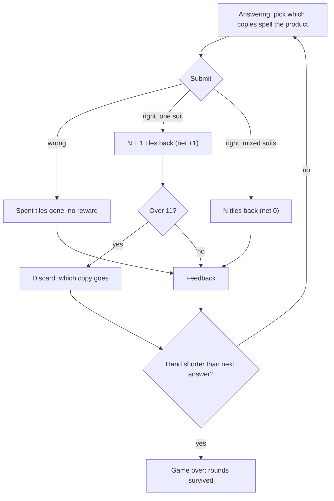

# 11 · Suits · 무늬

> **Status:** research draft — not canonical. Amends nothing in `docs/spec/`; on any conflict the spec wins.
> **Direction:** does making tiles non-fungible create the decisions the pool says fungible tiles cannot? · Opus research agent · 2026-10-19

Every tile carries one of three mahjong suits. A two-digit answer spelled in one suit earns its bonus tile; a mixed-suit answer is still correct, scores as usual, and only replaces what it spent.

| | |
|---|---|
| Core verb | **Match**: choose *which copy* of a digit to spend, keep or discard, so the next answer can be spelled in one suit |
| Only this draft contributes | A direct test of the pool's finding 3. Making two 7s different multiplies the suit choices to about 11 a run, but each is worth about a tenth of a round. The whole suit layer is worth 6.4 ± 0.8% of run length, about what the overflow discard itself is worth on the same bot (5.1%). Half of it is a dominance (take the flush when offered), not a trade-off. Suits make the decisions **frequent, not deep** |
| Nearest neighbour | **Classic with M7 faces.** A face *widens* a tile (one tile stands for several digits), so tiles become more interchangeable. A suit *narrows* one (two copies of a digit stop being equal). Faces never ask "which 6?"; suits ask it every round |
| Spec fit | Needs amendment: `product.md` §1.4 ("Duplicate digit tiles have no strategic distinction"), §1.11 digit keys, §1.2, §1.3, §1.5 step 6, §1.1/§1.10; `ui-i18n.md` §1.12–§1.15; `decisions.md` "No icon set, deliberately". The score stays unweighted (§1.5), and §1.17 is untouched |
| Cliff verdict | Under. The rule moves the cliff to b\* = m/(s+m) ≈ **0.70** (s = 0.721 of correct answers net +1). Run-wide b is 0.551. Full-rack b is 0.721, at the full-hand b\* of 0.715, but as in Endless the ceiling leak and the drift below the ceiling end runs. Measured drift is negative at every hand size: −0.51 per submission at the 11-socket full rack, −0.35 one tile below. On the round yardstick it matches Endless (19.1 ± 0.3 against 19.3 ± 0.3 rounds), so b′ ≈ 0.584 *(estimate)* against the 0.611 gate |
| Build size | **M**: a suit field on `Tile`, one reward branch, a focus-then-activate key rule and drawn suit marks. The 11-socket rack layout already ships in Classic |
| Mode select copy | **Suits** — One suit, one more · **무늬** — 같은 무늬면 한 장 더 |

## 1. Spec collisions

1. **`product.md` §1.4: "Duplicate digit tiles have no strategic distinction."** This is the line the direction exists to cross.
   - **Amendment:** in Suits, duplicates differ by suit, and the suit decides the reward (§2).
   - **Without it:** no mode.
2. **§1.4 and §1.11 digit keys.** In `answering`, a digit key picks "the first matching digit tile … in sorted inventory order". In `overflow`, it marks "the first matching digit tile not already marked". Once the suit is the decision, a keyboard player cannot make it, and keyboard support is an AGENTS.md global constraint.
   - **Amendment** to the §1.11 `answering` and `overflow` `0`–`9` rows. When the hand holds the digit in more than one suit, the key does not select or mark. It moves focus to the next copy of that digit in suit order (만 → 통 → 삭), wrapping around. Space or `Enter` then activates the focused tile, because rack tiles are already `<button>`s (`Tile.tsx`) and §1.11 says "a focused button retains normal browser behavior". With one suit held, the key acts as today.
   - A plain "press again to cycle" rule fails twice:
     - In overflow, Suits is over by exactly one, so the first press completes the discard (§1.7) before a second press can cycle.
     - A burn could never spell `66`.
   - **Without it:** the mode fails a global constraint.
3. **§1.3 initial state**, plus a new dial.
   - Capacity is **11** (`SUITS_CAPACITY`, added under AGENTS §4.5; no existing dial changes).
   - The opening deal is round-robin `i % 10` for the digit and `i % 3` for the suit.
   - Duplicates sort by suit, then by ID.
4. **§1.2 rewards.** "Independent uniformly distributed digits": each reward also draws an independent uniform suit.
5. **§1.5 step 6: "Generate exactly `N + 1`".** A one-suit answer gets `N + 1`, and a mixed two-digit answer gets `N`. A one-tile answer is always one suit. Steps 2–4 and the unweighted score ("not a product-, speed-, streak-, or difficulty-weighted value") are **unchanged**: the verdict stays "Correct" and the score +1. A rejected points variant (B, §5) would collide with that clause, as 06 Riichi does.
6. **§1.1, §1.3, §1.10:** "two modes" become three. The Endless-style meter shows 11 pips.
7. **`ui-i18n.md` §1.12.**
   - **Tile anatomy:** a suit mark sits under the numeral.
   - **Colour:** "Use color plus text or shape; never color alone". Suits use **shape only**: marks in the engraved ink, with no suit hue. Mahjong's red, green and blue would also break "Semantic colour appears only at the moment of the event".
   - **Accessible names:** "6 of dots" / "통 6". This meets WCAG 1.4.1 [5].
   - **Copy and sharing:** §1.14 gains new strings (feedback: "Correct · one suit, +1 tile" / "Correct · mixed suits"). §1.15 gains the prefix `ozterisk Suits — Rounds: n`.
8. **`decisions.md` § Content.**
   - **"No emoji, anywhere."** The marks are drawn like the favicon's ✳, not set as text, so no font fallback is involved. If text were ever used, U+25C6 ◆, U+25CF ●, U+2016 ‖ and U+842C 萬 are all absent from emoji-data 16.0. The control U+1F004 🀄 is listed as emoji, and U+1F019 (one of circles) as Extended_Pictographic, so the Unicode mahjong block is out [6].
   - **"No icon set, deliberately … If a future need is genuinely unmet, that is the moment to introduce an icon set and record it."** Three suit marks are exactly that moment. **Ruling needed.**
9. **`balance.test.ts`.** Its analytic guard assumes a correct answer nets +1, so it cannot see this economy (§5). Like 01 Market, this mode needs a simulated guard.

**Checked, no collision:**
- §1.17 digit picker: the player picks a tile, never a digit.
- Difficulty curves: suits are uniform and fixed.
- Manual discard during answering: none.
- Seeds and persistence: none.
- §1.8 loss: count-based, unchanged.

## 2. The mode

A delta against **Endless**:

- **Setup.**
  - Capacity 11, 11 opening tiles: 0–9 plus a second 0, suits dealt round-robin.
  - Kind bias 0.2 as shipped.
  - No face tiles.
- **Tiles.**
  - `Tile` gains `suit: "man" | "pin" | "sou"` (만 characters, 통 dots, 삭 bamboo).
  - Marks: characters a diamond, dots a ring, bamboo two bars.
  - Constructibility and correctness ignore suit.
- **Correct answer.**
  - Score +1, streak +1.
  - Rewards: `N + 1` if every spent tile shares a suit, otherwise `N`. A mixed-suit answer therefore nets 0.
  - Rewards are uniform over digit × suit.
- **Incorrect answer, overflow, loss:** exactly as Endless. A mixed answer cannot overflow, since it returns what it spent.
- **Keyboard:** the digit key focuses a copy, and Space or `Enter` acts on it (§1, item 2). Everything else is §1.11 as written.
- **State:**
  - one field on `Tile`;
  - `"suits"` in `GameMode`;
  - `getRewardCount(spent, oneSuit)`;
  - the generator draws a suit per reward. The reducer stays pure.

## 3. The loop

## 4. The decision it creates

The decision is **which copy**, at three moments:

- **Answering:** which 6 completes 56.
- **Burning:** which copies to throw on a deliberate miss.
- **Overflow:** which duplicate goes.

In Endless, all three are digit-only, and §1.4 says so. Here a hand like 5○ 6○ 6‖ makes a one-suit answer worth a tile. The skill is reading the rack in two dimensions: keep suit pairs that spell common products together, and throw the orphan suits.

**Measured, it is real and small (§5).**
- **Many choices.** About 11 suit choices come up a run.
- **Little each.** Each is worth about 0.11 rounds.
- **Half is a dominance.** "Take the one-suit answer when offered" is free, because the digits are fixed by the product. A player who does only that recovers 47% of the suit layer's value.
- **The rest is thinking.** What remains (3.4% of run length) comes from burns and discards that keep suits coherent.

**The tie-break finding.** The bot values a hand as the share of facts it can spell plus λ × the share it can spell in one suit:
- In variant A, moving λ from 0 to 0.25 adds 1.9 rounds.
- Any λ above that adds nothing. In variant E, λ 0.5, 1 and 2 are identical.

So suit potential works as a **tie-break among copies of equal digit value**. Letting it override digit coverage never helps. The brief asked whether answers, discards and overflow would trade digit against suit; on this evidence they almost never do. The digit decides, and the suit refines.

**Precedents.**
- **Mahjong** has three suits of nine ranks: characters (萬子), circles (筒子) and bamboo (索子) [1]. Its full flush, *chinitsu*, is "a hand containing tiles from only one suit", worth 6 han closed [2]. That flush is a whole-hand goal; here it is a two-tile bonus.
- **Balatro's** Flush is "five cards of any rank that all share the same suit", paid in score (35 chips × 4 mult) [3]. That is variant B's currency, and §1.5 forbids it.
- **Lost Cities** gives each card a colour expedition and a number, and "players can only move forward on an expedition" [4]. There suit and rank constrain each other, the way the rejected gate variants (C, D) do here.

## 5. Economy

**Where it sits.** A mixed answer nets 0, so drift is `b·s − (1 − b)·m`, where *s* is the share of correct answers that net +1. The cliff moves from 0.631 to **b\* = m/(s + m)**.
- **Measured s:** 0.721 (one-digit answers plus one-suit pairs).
- **Moved cliff:** b\* ≈ 0.704 with the uniform miss cost of 1.711, and 0.715 with the full-hand cost of 1.806.
- **What holds the mode under it:** the mixed-suit tax.
- **What makes 11 sockets safe:** at a full rack the tax costs almost nothing, because a net +1 there is discarded anyway (the ceiling leak works in its favour). It bites below the ceiling, where runs are lost.

**Instrument and conditions.**
- **Loop:** `lib.ts`, a re-implementation of Endless's round over suited tiles.
- **Bot:** greedy.
  - It answers whenever it can (skill 1).
  - Every choice maximises the next hand's buildable share, plus λ × its one-suit share.
  - A deliberate miss burns the least valuable tiles.
  - The rack is kept sorted, so ties break by digit, never by copy position.
- **Randomness:** mulberry32 seeds 1000+. Game draws and policy draws use separate streams, so seeds pair.
- **Runs:** kind 0.2, round cap 1,000.

**Calibration** (`calib.out`):
- **Constructibility:** on 20,000 random 10-tile hands, my constructibility matches the repo's real `canConstruct` with **0 disagreements**. b(10) = 0.478 (repo 0.48), b(20) = 0.801.
- **Drift:** analytic drift at b = 0.48 is −0.410 (repo −0.41).
- **Whole runs:** Endless rules give 19.2 ± 0.3 rounds with the kind bias and 13.4 without it. The pool's bots give 18.8–20.0 and 13.1.

**Controls:**
- **Negative:** with zero rewards, no run lasts past round 8.
- **Null, for the thesis instrument:** with suits cosmetic, randomising every suit choice changed **0 of 2,000** paired runs.
  - That control first *failed*: 309 runs changed, because ties broke by copy position. That is the evidence it can fail.
  - It passed after the canonical sort.

**Static cliff check** (`cliff.out`, 20,000 hands per cell, b′ = 0.2 + 0.8b). This shows how a suit *gate* collapses b:

| n | Endless b′ | Gate: both answer tiles one suit (C) | Gate: equation names a suit, one tile in it (D) |
|---|---|---|---|
| 10 | 0.584 | 0.474 | 0.425 |
| 12 | 0.652 | 0.531 | 0.481 |
| 16 | 0.761 | 0.637 | 0.582 |

The C gate costs about four sockets of b. Runs regain Endless's length at 12 sockets only because the bot shapes its hand by suit.

**Variants on one instrument** (3,000 runs each; `cliff.out`, `cliff2.out`, `thesis2.out`, `drift.out`):

| Variant | Rounds | Notes |
|---|---|---|
| Endless, 10 / 11 / 12 sockets | 19.3 / 22.3 / 26.0 | the round yardstick |
| **E: only one suit pays, 11 sockets (proposed)** | **19.1 ± 0.3** | drift −0.51 at a full rack, −0.35 one below |
| A: one suit pays an extra tile, 10 | 22.9 ± 0.5 | f = 0.288, so b\* = m/(1 + f + m) ≈ **0.571**, with b_run 0.565 at it. About 1.1 sockets above Endless, so **fails the 0.611 gate** |
| B: one suit scores +1 point, 10 | 19.7 (13.9 points vs 10.6) | tiles as Endless; **§1.5 collision** |
| C: same-suit pair judged correct, 12 | 20.2 ± 0.3 | right digits marked Incorrect: a dishonest verdict |
| C′: every pair must share a suit, 12 | 19.1 ± 0.3 | drift −0.72 at a full rack |
| D: equation names a suit, 12 | 18.3 ± 0.3 | |

**Thesis test** (`thesis.out`, `thesis2.out`). Following 02 Factor's method, I used 10,000 paired seeds per variant. Each suit-aware decision was swapped for a random suit *with the bot's digit choice kept*, one decision at a time. The table gives the rounds lost (± 95% CI) and the share of the baseline.
- **Positive control:** randomise the whole overflow discard, digit included.
- **"Obvious":** take a one-suit answer when offered, with every other suit choice random.

| Variant | Answer copy | Discard copy | Burn copies | **All suit choices** | Beyond "obvious" | Positive control |
|---|---|---|---|---|---|---|
| Endless, suits cosmetic | 0.00 | 0.00 | 0.00 | **0.00** | — | 1.16 ± 0.18 (6.1%) |
| **E, 11** | 0.77 ± 0.14 | 0.07 ± 0.09 | 0.44 ± 0.11 | **1.22 ± 0.15 (6.4%)** | 0.65 ± 0.13 (3.4%) | 0.97 ± 0.15 (5.1%) |
| A, 10 | 0.64 ± 0.22 | 0.12 ± 0.21 | 0.56 ± 0.19 | **1.38 ± 0.25 (6.1%)** | 0.98 ± 0.24 (4.3%) | 2.48 ± 0.28 (10.9%) |
| B, 10 (points) | 0.59 ± 0.06 | 0.24 ± 0.06 | 0.23 ± 0.06 | **1.01 ± 0.08 (7.4%)** | 0.46 ± 0.08 (3.4%) | 1.78 ± 0.17 (13.1%) |
| C, 12 | 0.07 ± 0.09 | 0.34 ± 0.12 | 1.02 ± 0.14 | **1.42 ± 0.16 (7.0%)** | — | 0.95 ± 0.16 (4.7%) |
| C′, 12 | 0.09 ± 0.09 | 0.23 ± 0.12 | 0.30 ± 0.09 | **0.66 ± 0.14 (3.4%)** | — | 0.92 ± 0.16 (4.8%) |
| D, 12 | 0.08 ± 0.09 | 0.11 ± 0.07 | 0.36 ± 0.11 | **0.54 ± 0.13 (3.0%)** | — | 0.68 ± 0.12 (3.7%) |

**What it means.**
1. **Suits do not escape finding 3; they spread it out.**
   - In every variant the whole suit layer is worth 3–7% of run length, about one overflow discard decision on this bot.
   - In E it comes from about 11 choices a run: 2.2 answers, 2.1 discards and 6.5 burns, where copies differ in suit. That makes about 0.11 rounds a choice.
   - 02 Factor's pair choice was 1% of a run, but from a different bot, so the two are not comparable (finding 6).
2. **Gates cost more than they give.**
   - C and D collapse b and need two extra sockets to recover.
   - C′, the honest gate, carries less suit value than E (3.4% against 6.4%).
   - C's higher figure rests on marking correct products Incorrect, which 10 Dojo shows is a verdict that stops meaning knowledge.
3. **E is the best on offer.** It keeps an honest verdict and an unweighted score, matches Endless's length, and carries the most suit value that needs no §1.5 ruling.
4. **The bot is a floor.** A one-step greedy bot cannot plan suit pairs two rounds ahead, so a stronger planner might find more. This instrument cannot say how much.

## 6. Smallest playable slice

**Variant E on the Endless reducer.**

- **Reuse:**
  - `canConstruct`, `answerMatches` and `generateKindEquation` (`selectors.ts`, `generators.ts`), unchanged, since suits never affect correctness;
  - the overflow and rail logic of `TOGGLE_DISCARD` (`gameReducer.ts`);
  - Classic's 11–15 mid rack in `TileInventory`.
- **Add:**
  - `suit` on `Tile`, drawn in `generateRewardTiles` and `createInitialInventory`;
  - the one-suit check in the `SUBMIT_CORRECT` reward count (`getRewardCount`);
  - `SUITS_CAPACITY = 11`;
  - the focus-then-activate keyboard rule;
  - three drawn marks and their accessible names;
  - `en`/`ko` copy.
- **Tests:**
  - a mixed answer returns `N`;
  - a one-suit answer returns `N + 1`;
  - a one-tile answer always counts as one suit;
  - a digit key focuses copies in suit order and wraps;
  - Space acts on the focused copy, including a `66` burn and an overflow mark;
  - the share prefix;
  - a simulated economy check in `balance.test.ts`.

## 7. Biggest risk — and the playtest that would kill it

**The suit is a tax players pay without deciding.** The measured value is small, and half of it is a dominance. If players take the flush when it is offered and otherwise ignore the marks, Suits is Endless at 11 sockets with a mixed-suit tax. It would be a readability burden (a second glyph on every tile, at 30 × 38 compact size too) that buys nothing.

**Kill test:** five players, three runs each, thinking aloud, with every burn and discard logged.
- **Drop the direction if** fewer than one burn or discard in four keeps a suit pair on purpose ("keep the ring 6, it goes with the ring 5").
- **Drop it too if** players misread a mixed-suit "Correct" as a loss.

## 8. Open questions for Ori

1. May a mode cross §1.4's "Duplicate digit tiles have no strategic distinction"? It is the whole direction.
2. Should the "No icon set" ruling admit three drawn suit marks? Or should they be set as text, ◆ ● ‖ or 萬 筒 索? None of those is emoji, and the 21 Sep wind tile used 東/南 in both locales as a precedent.
3. Faces × suits is undefined. Does a face carry a suit? A suitless face that counts as any suit would make faces wilder still. That decides whether Suits could ever join Classic, and it is untested.
4. Is a net-zero "Correct" readable, or does it feel like a hidden penalty? The playtest should check it.
5. Should `balance.test.ts` admit a simulated guard? This mode's cliff is `m/(s + m)`, which the analytic guard cannot express (01 Market's question again).

## Sources

1. Mahjong tiles: the three suits, four of each rank 1–9 — https://en.wikipedia.org/wiki/Mahjong_tiles
2. Japanese Mahjong yaku: Chinitsu, "a hand containing tiles from only one suit", 6 han closed — https://en.wikipedia.org/wiki/Japanese_Mahjong_yaku
3. Balatro Wiki, Flush: "Five cards of any rank that all share the same suit", 35 chips × 4 mult — https://balatrowiki.org/w/Flush
4. Lost Cities: colour-coded expeditions, ascending play — https://en.wikipedia.org/wiki/Lost_Cities
5. WCAG 2.2 Understanding SC 1.4.1 Use of Color — https://www.w3.org/WAI/WCAG22/Understanding/use-of-color.html
6. Unicode emoji-data 16.0 (checked U+25C6, U+25CF, U+2016, U+842C, U+7B52, U+7D22, U+2733, U+1F004, U+1F019; output `glyphs.out`) — https://www.unicode.org/Public/16.0.0/ucd/emoji/emoji-data.txt

**Repo files:**
- `docs/spec/product.md` §1.1–§1.11, §1.17
- `docs/spec/ui-i18n.md` §1.12
- `docs/design-system/decisions.md` (§ Content; the M6 wind-tile record)
- `src/game/balance.ts`, `selectors.ts`, `generators.ts`, `types.ts`
- Pool drafts 02 Factor §5, 05 Card §1, 07 Kiln, 09 Four Winds §1

**Sims** ([`sims/`](sims/)): `lib.ts`, `calib.ts`, `cliff.ts`, `cliff2.ts`, `thesis.ts`, `thesis2.ts`, `drift.ts`, `glyphs.mjs`, `mock.py`. **Outputs:** `calib.out`, `cliff.out`, `cliff2.out`, `thesis.out`, `thesis2.out`, `drift.out`, `glyphs.out`.
