# Game-mode research pool

> **Status:** research — not canonical. Nothing here amends `docs/spec/`; on any conflict the spec wins. Every draft carries the same line.
> Eleven directions for a third mode, 2026-10-17/19. Each was researched by its own Opus agent from one shared brief, then reviewed, checked and committed by Claude for Ori.

Each draft owns one design axis: who picks the challenge, which way the arithmetic runs, randomness, other players, goals, risk, transformation, space, structure, audience, and what tells two copies of a digit apart. Each was measured by simulation against the real game modules, and every precedent claim is sourced. This page is the map. Each draft's own first screen is the summary: pitch, verb, what only it contributes, and a mockup.

**Where the pool lands.** This is my read; the numbers are in each draft's §5.

- **New verbs with strong evidence.**
  - [03 Puzzle](03-puzzle/): plan a face-up line against par.
  - [08 Well](08-well/): read geometry.
  - [09 Four Winds](09-four-winds/): build the run from boons.
- **A live bet, modestly paid.** [06 Riichi](06-riichi/)'s declaration is a real decision by EV, but the prize is +17% points, the stake is a knife-edge, and declarations bunch early in a run.
- **New audiences, light mechanics.** [04 Table for Two](04-table-for-two/) adds a second player. [10 Dojo](10-dojo/) is for learning the tables.
- **Thin as decisions, useful as findings.** [01 Market](01-market/), [02 Factor](02-factor/), [05 Card](05-card/) and [07 Kiln](07-kiln/) each say so themselves, and each leaves a result the others can reuse. [11 Suits](11-suits/) was briefed to test why, and confirms it.
- **If one gets built next, build Puzzle.** See [Recommendation](#recommendation).

<table>
<tr>
<td align="center" width="20%"><a href="01-market/">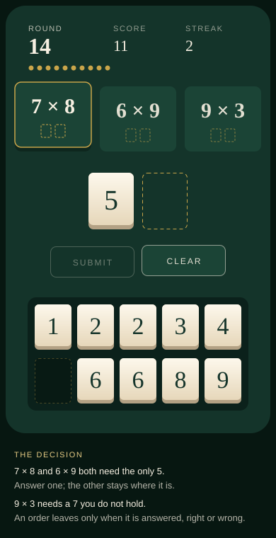</a> <b>01 Market</b> · 장터 choose the equation</td>
<td align="center" width="20%"><a href="02-factor/">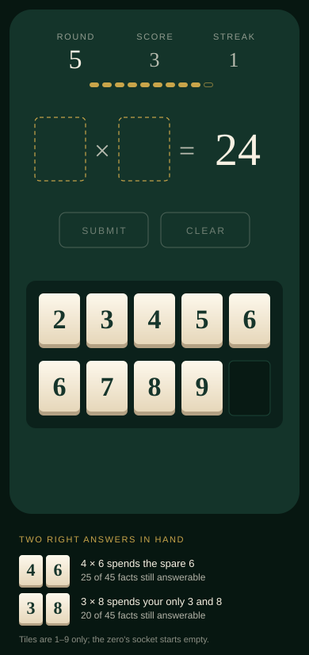</a> <b>02 Factor</b> · 팩터 spell the factors</td>
<td align="center" width="20%"><a href="03-puzzle/">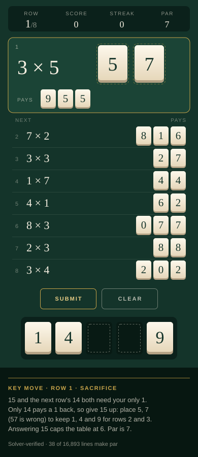</a> <b>03 Puzzle</b> · 묘수풀이 plan a line</td>
<td align="center" width="20%"><a href="04-table-for-two/">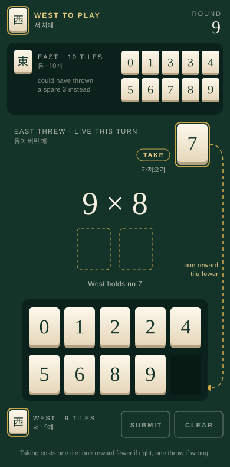</a> <b>04 Table for Two</b> · 둘이서 take their throw</td>
<td align="center" width="20%"><a href="05-card/">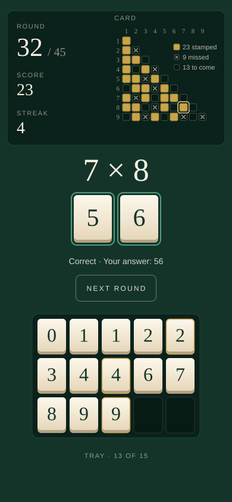</a> <b>05 Card</b> · 카드 stamp every fact once</td>
</tr>
<tr>
<td align="center" width="20%"><a href="06-riichi/">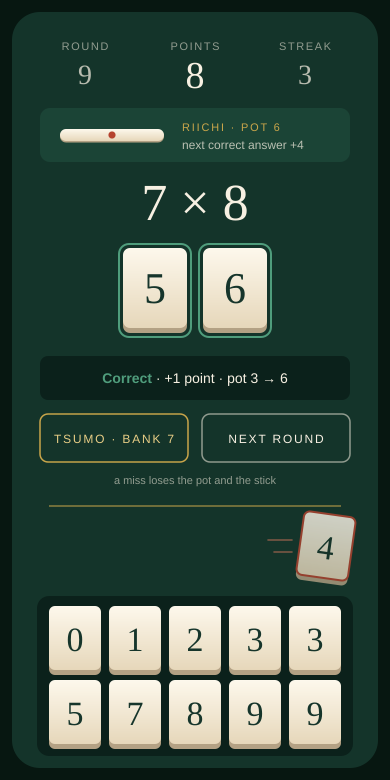</a> <b>06 Riichi</b> · 리치 declare, then ride or bank</td>
<td align="center" width="20%"><a href="07-kiln/">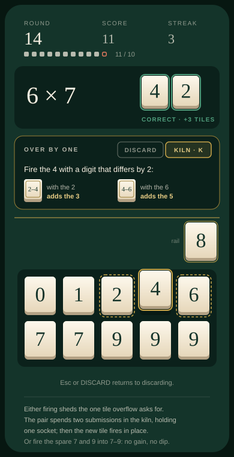</a> <b>07 Kiln</b> · 가마 fire two tiles into one</td>
<td align="center" width="20%"><a href="08-well/">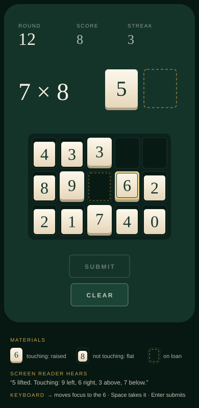</a> <b>08 Well</b> · 우물 dig a touching pair</td>
<td align="center" width="20%"><a href="09-four-winds/">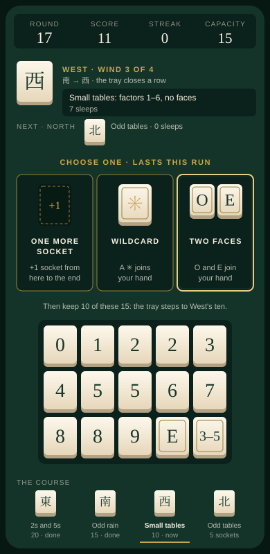</a> <b>09 Four Winds</b> · 네 바람 a boon at every wind</td>
<td align="center" width="20%"><a href="10-dojo/">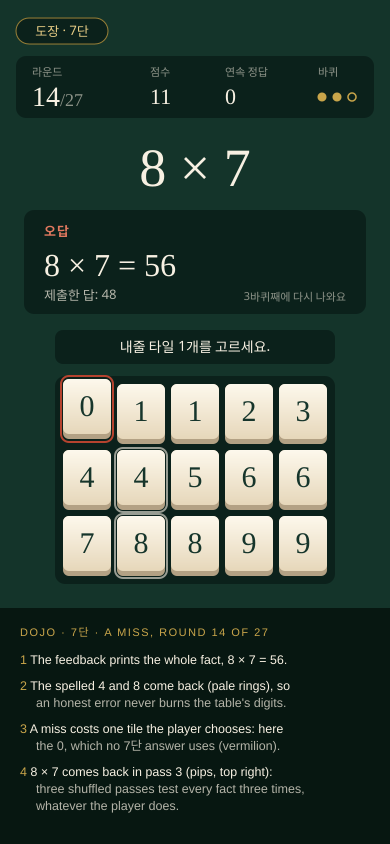</a> <b>10 Dojo</b> · 도장 learn one table</td>
</tr>
<tr>
<td align="center" width="20%"><a href="11-suits/">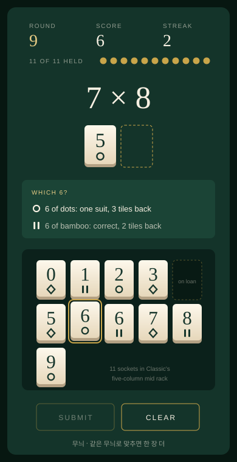</a> <b>11 Suits</b> · 무늬 spend the matching copy</td>
</tr>
</table>

## The eleven at a glance

| # | Mode | The verb | What only this draft contributes | Needs a scope ruling? | Economy | Build |
|---|---|---|---|---|---|---|
| [01](01-market/) | Market · 장터 | Choose which of three open equations to answer | Whether an unchosen equation *leaves* decides the cliff. A row that keeps them clogs and regulates itself, so no aging rule is needed | No | Under: the standing row's late drift is −0.45/submission; median 17 rounds vs Endless's 18 | M |
| [02](02-factor/) | Factor · 팩터 | Spell both factors of a shown product | The reversed economy (cliff at 2/3, the 0 tile retired, 5 and 7 irreplaceable). Also a measured negative: two-answer choices come about once a run and are worth about 1% of run length | §1.17 division modes | Under its own 2/3 cliff; runs ≈ Endless | M |
| [03](03-puzzle/) | Puzzle · 묘수풀이 | Plan a line through a face-up table, against par | Solver-verified tables (the sample needs a sacrifice on row 1, replayed on the real reducer) and a deal-and-verify generator. Also the handle analysis: a table is not a seed, but a *name* for one is | No, as a per-session deal. Numbered or daily tables: the seed line | No drift cliff; difficulty is the gap between perfect (0.666) and myopic (0.371) play | M |
| [04](04-table-for-two/) | Table for Two · 둘이서 | Take the tile your opponent just threw, instead of a blind reward | Two racks on one phone. The river is positive-sum: a rubber band on luck, a mild ratchet on skill, and fair to both seats | §1.1 "does not validate competition" | Under: b at 9 tiles is 0.62 | M |
| [05](05-card/) | Card · 카드 | Stamp each fact once on a visible card; late in the deal, count what is left | A completion goal sized by coupon-collector math. The shipped draw stamps only 9–16 of 45 cells a run, so the mode deals without replacement, which turns the card from a record into a forecast. Also a 45-glyph share grid with no emoji | §1.17 curves (a fixed kind gate inside a finite deal skews the late facts); "No emoji" in spirit | The deal ends every run. b falls from 0.85 to 0.47 across it, so the cliff sets the win rate (34% for the bot) | M |
| [06](06-riichi/) | Riichi · 리치 | Declare (stake a point, lock the rack), then ride or bank | A push-your-luck call shown live by EV: break-even at q ≈ 0.50, 58% of rack states above it, and a rack-reading player beats both never and always declaring. It works only when paid in points | §1.5 unweighted score | Under: b′ 0.552, because points never touch tiles | M |
| [07](07-kiln/) | Kiln · 가마 | At overflow, fire two digits that differ by 2 into the Neighbours tile between them | The transformation economy. Compressing tiles is a trap, and free invention breaks Classic; one invented digit priced by a two-submission hold sits in between. The hold can price other mechanics too | No | Under, thinly: estimated b′ ≈ 0.605 against a 0.611 gate | M |
| [08](08-well/) | Well · 우물 | Dig: spend a touching pair from a 5 × 3 well with gravity | Geometry as a resource: touching costs a third of b, two-digit facts need only 21 digit pairs, and a fixed opening spells 44 of 45 facts. Includes a keyboard and screen-reader grid design | `decisions.md` 9i and the flat rule | Under, thinly: b′ 0.61 at capacity | L |
| [09](09-four-winds/) | Four Winds · 네 바람 | At each change of wind, keep one boon of three, then pack the hand for the next wind | A twist-and-boon framework, with a content budget and a pacing rule derived from hand turnover (half-life about 3 submissions, so winds of 8). Boon choice carries the mode: +19 points over random picks. Twists pay only when a readable rule sits in the last wind | The relics ruling (it argues both conditions are now met); extending §1.17's descent exception | Plateaus of 20/15/10/5: b′ runs 0.91 → 0.51 across the winds, and no boon stack makes a run unloseable | L |
| [10](10-dojo/) | Dojo · 도장 | Recall one table's nine facts three times; a miss costs one tile you choose | The pedagogy lens, and proof that shipped rules can't carry it: on one table, a learner who knows every fact is marked Incorrect in 43–64% of rounds | No, as proposed. Its wishes (adaptivity, persistence, timers) would | No supply cliff: echo rewards and a one-tile toll | M |
| [11](11-suits/) | Suits · 무늬 | Choose *which copy* of a digit to spend, keep or discard, so an answer can be spelled in one suit | A direct, paired-seed test of finding 3 across six suit rules. Suits make choices frequent (about 11 a run) but not deep: the whole suit layer is worth 6.4% of run length, about what the overflow discard is worth, and half of it is a dominance (take the flush when offered) | `decisions.md` "No icon set, deliberately"; it also crosses `product.md` §1.4 "Duplicate digit tiles have no strategic distinction" | Under: its cliff moves to ≈ 0.70; runs 19.1 rounds vs Endless's 19.3 | M |

"Needs a scope ruling" means the draft crosses a line the project drew on purpose: a §1.17 exclusion, an AGENTS.md constraint, a definition with a stated prohibition, or a recorded ruling. Every draft also rewrites rules for itself, the way Classic did. The matrix shows both.

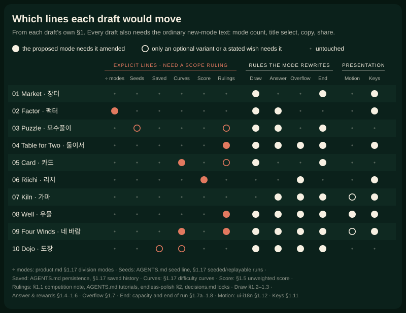

## What the pool found across drafts

Each finding is reported by the drafts named, on their own instruments. I spot-checked the arithmetic and re-ran a sample of the sims (see [How this was made](#how-this-was-made)).

1. **The 0.631 cliff is a guard, not a forecast.**
   - A miss costs more at a full hand. Misses there skew to two-digit products and cost about 1.81 tiles, so drift crosses zero near 0.644 ([01](01-market/), analytic and engine; I recomputed 1.806 by hand). [04](04-table-for-two/) reads about 0.68 off its own tables.
   - The ceiling leaks. Overflow takes a full rack's +1 while a miss still costs, so a full-rack b above 0.631 does not lock runs in. Endless's full-rack b′ is 0.71, yet runs end in about 20 rounds. Endless rules at capacity 20 averaged 174 rounds, and no run reached 1,000 ([07](07-kiln/); [02](02-factor/)).
   - Lock-in does happen when choice is free: with three open equations and the kind bias on, 98% of [01](01-market/)'s free-row runs passed 100 submissions.
   - Bots measure Endless shorter than the endless-polish spec's "~22 rounds". [04](04-table-for-two/) gets 13.1 rounds with the kind bias off and 18.3 with it on; [02](02-factor/), [06](06-riichi/) and [07](07-kiln/) get 18.8–20.0 with different bots.
   - None of this moves a dial. The analytic guard errs safe in one direction and cannot see dynamics in the other. [01](01-market/) asks whether `balance.test.ts` should admit a simulated guard for any mode with a second state variable.
2. **Every generous mechanic needs a price, and the cheapest prices are positional:**
   - conservation: an order leaves only when answered ([01](01-market/));
   - a hold of two submissions ([07](07-kiln/));
   - a one-turn window on throws ([04](04-table-for-two/));
   - a stake paid in points rather than tiles ([06](06-riichi/)).
   Without its price, each of these crossed the cliff or broke a mode.
3. **Tiles are fungible, so single-tile decisions run thin.** There are ten digit kinds, rewards are uniform, and one copy is enough.
   - [02](02-factor/)'s pair choice comes about once a run.
   - [04](04-table-for-two/)'s mahjong call rescues 2.8% of turns.
   - Whether to fire at all doesn't matter in [07](07-kiln/); only which gap does.
   - [06](06-riichi/)'s prize is +17% points.
   - [11](11-suits/) tested the finding head-on by making two copies of a digit differ by suit. Every suit choice randomised costs 1.22 ± 0.15 rounds (6.4%), close to randomising the whole overflow discard (5.1%). Suit only ever helped as a tie-break between copies; letting it outrank digit coverage never helped.
   The drafts with a new verb change what a tile *means* ([08](08-well/): its place; [10](10-dojo/): the table's digits) or what the player *sees* ([03](03-puzzle/): the whole future).
4. **Paying in tiles hits the ceiling.** A tile prize is capped at capacity, while a tile stake is not ([06](06-riichi/)). Compressing tiles burns coverage ([07](07-kiln/)).
5. **Rewards tied to completion arrive too late to matter.**
   - A table on [05](05-card/)'s card completes at fact 41.4 of 45 on average, so any payout lands with about four facts left. Socket, wildcard or tile payouts moved the win rate by at most 1.7 points.
   - [09](09-four-winds/) puts its rewards at fixed positions instead, a boon at every change of wind, and there choosing well is worth 19 points.
6. **Bots disagree, so compare variants, not levels.**
   - On identical faceless-Classic rules, the T84 journal's bot wins 33.0% of runs and [05](05-card/)'s bot 50.2%.
   - [09](09-four-winds/)'s loop matched the real reducer on Classic to within a point.
   - Every number in this pool compares variants measured on one instrument. None of them forecasts real players.

## Recommendation

This is my judgment, not a finding.

1. **Build [Puzzle](03-puzzle/) first.**
   - It has the most different verb.
   - As a per-session deal it needs no scope ruling.
   - It is an M build, and its solver already exists as research code (about 150 lines to port).
   - Its kill test is cheap: five people, three tables each.
   - It also answers the question [Well](08-well/) and [Four Winds](09-four-winds/) both depend on: will these players read the board and plan?
2. **Then let Puzzle's playtest choose the second.**
   - If players read the board, build **Well** (L; a thin cliff margin; needs the §1.12 motion amendment and a ruling on `decisions.md` 9i).
   - If they enjoyed the arc but not the reading, take **Four Winds'** own fallback: boons on Classic's descent, without the twists (needs the relics ruling).
3. **Riichi is the cheapest feel test.** It is Endless plus one button, and its open question is cheap to answer: can people read a rack's strength? It needs the §1.5 points ruling first.
4. **Settle scope before designing [Table for Two](04-table-for-two/) or [Dojo](10-dojo/).** Is local competition, or teaching, inside the PoC's thesis (§1.1)? Each draft says its mode only makes sense if the answer is yes.
5. **Keep the findings, park the modes:**
   - [Market](01-market/)'s conservation;
   - [Factor](02-factor/)'s reversed economy;
   - [Kiln](07-kiln/)'s hold as a price;
   - [Card](05-card/)'s coupon-collector sizing and share grid;
   - [Suits](11-suits/)' negative result on finding 3, and its keyboard rule for choosing between copies.

**Rulings this pool asks of Ori,** whichever drafts go forward:
- division modes (02);
- the unweighted score (06);
- §1.1 competition (04);
- the relics ruling and extending the descent exception (09);
- `decisions.md` 9i and the flat rule (08);
- the late-deal skew and the "No emoji" spirit (05);
- seeds, only for numbered or daily tables, and whether a par-line reveal is a tutorial (03);
- duplicate tiles with a strategic distinction (§1.4) and drawn suit marks under "No icon set" (11).

## How this was made

- **Brief.** One shared brief gave every agent:
  - the rules and the economy model;
  - the hard constraints and earlier rulings, quoted;
  - a fixed template;
  - graphics rules in the Tile House palette;
  - provenance rules (a URL or an "unverified recall" label for every precedent; instrument, calibration and a negative control for every number).
  Each agent also got its own axis and the list of the others.
- **Agents.** Ten Opus agents wrote only to a session scratch folder; none touched the repo. The account's usage limit interrupted them five times, and each resumed from its saved transcript.
- **Suits** was the spare direction. Ori asked for it on 2026-10-19, and an eleventh agent researched it from the same brief, with the pool's findings added and the Classic error corrected.
- **Simulations.** TypeScript ran on the real `src/game` modules through Vite's module runner (`vite-node` is not installed). Every draft reproduces `b(10) ≈ 0.48` before trusting its own numbers. Each draft's scripts and outputs are in its `sims/` folder. The shared runner, the checker and the matrix generator are in [`_runner/`](_runner/). Committing them departs from the T84 precedent (`docs/journal/journal-2026-09-27.md`), at Ori's call.
- **Review.** A mechanical checker tested every draft before I read it: template, SVG well-formedness, embedded images, word cap and sources. The checker was itself tested against a draft built to fail.
  - I read every draft and re-derived the claims I could check by hand, among them the 21 digit pairs, the nine two-pair products, Puzzle's par line, Dojo's per-table miss costs and Riichi's ride-or-call EV.
  - I looked at every SVG rendered. QuickLook crops tall SVGs to a square, so I rendered square-padded copies.
- **Edits on integration.**
  - I trimmed Riichi by 11 words to meet the 2,500-word cap.
  - Card's own agent trimmed it from 2,613 words, and I confirmed that its figures survived.
  - References to the agents' scratch folders now point at each draft's `sims/` folder.
  - In the archived scripts, absolute session paths became repo-relative ones, and the checker now accepts a draft's `sims/` folder. To pass the repo's lint, unused imports and dead assignments were removed and `any` casts typed. Re-running nine of the edited sims gave byte-identical outputs. Nothing else in them changed.
  - Nothing else was changed.
- **A correction to the brief.** The brief described Classic as a two-wind half-game. [09](09-four-winds/) §1 corrects this from the 24 Sep design calls, which dropped the wind tile and withdrew the East/South acts.
- **Re-run from the committed copies** (worktree at 4d1259e plus docs, Node through `_runner/run.mjs`):
  - Byte-identical to the archived output: Puzzle's `verify.ts` at capacity 5, Factor's `bn.ts`, Kiln's `kan.ts` and `last.ts`, Card's `tableA.ts`, and Market's `static` section. `smoke.ts` gave b(10) = 0.480, b(20) = 0.802 and b(0) = 0.
  - Within Monte Carlo noise (±0.005; these three use unseeded `Math.random`): Table for Two's `calib.ts`, and Well's `static-sweep.ts` and `opening-search.ts`. The opening search found different layouts with the same coverage, 34/45 and 44/45.
  - Negative control: the same Puzzle verify at capacity 10 differs from the capacity-5 log, so the capacity patch is what the log measures.
  - Not re-run: the long sweeps and Four Winds, which printed to the console and saved no output.
  - The scripts import the live `src/game`, so they describe 4d1259e and will drift as the game changes.
- **Not verified here.** Beyond that sample, I did not re-run the agents' sims. Precedent claims rest on each draft's cited sources; claims the agents could not open are labelled in place.
