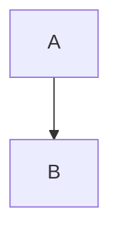

# 00 · Good · 좋음
> **Status:** research draft — not canonical. Amends nothing.
| | |
|---|---|
| Core verb | x |
| Only this draft contributes | x |
| Nearest neighbour | x |
| Spec fit | x |
| Cliff verdict | x |
| Build size | x |
| Mode select copy | x |

## 1. Spec collisions
## 2. The mode
## 3. The loop

## 4. The decision it creates
## 5. Economy
## 6. Smallest playable slice
## 7. Biggest risk — and the playtest that would kill it
## 8. Open questions for Ori
## Sources
1. https://example.com
